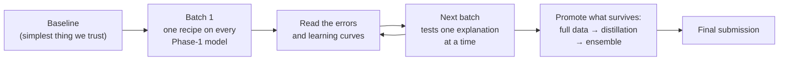

# CS-781 Capstone: An In-House Legal Intelligence System

**Name:** Kavin Chowdary Gonuguntla · **Roll no.:** 230551 · **Codabench:** k_230551
A compact legal language model built **from scratch** on Indian court judgments, then reused for six downstream legal
tasks. Everything here was trained on the official course data only (`Exploration-Lab/CS-781-Capstone`). There are no
pretrained weights and no outside corpora; we used our own BPE tokenizer and ran every notebook on free Kaggle T4 GPUs.

| | |
|---|---|
| **Foundation model** | 218.7M-parameter Mixture-of-Experts decoder (111.2M active per token), trained from scratch |
| **Tokenizer** | our own byte-level BPE, 40,000 tokens, written without libraries (Assignment 1) |
| **Tasks** | pretraining, named entities, rhetorical roles, judgment prediction, statute identification, summarisation, prior-case retrieval |
| **Notebooks / submissions** | 150 notebooks; 377 valid Codabench submissions were made, and the repo keeps the 346 zips that were saved |

---

## Results at a glance

| Phase | Task | Metric | Our best score | Final system |
|---|---|---|---|---|
| [1](phase1-pretraining) | Legal LM pretraining (512-word prompt → 128 words) | BERTScore F1 | **0.8376** | MoE + Muon, two continuations, MBR-16 decoding |
| [2](phase2-legal-ner) | Legal named-entity recognition (12 types) | strict macro-F1 | **0.5852** | MoE + adapters + BiLSTM head, self-trained on ensemble labels |
| [3](phase3-rhetorical-roles) | Rhetorical role of every sentence (13 roles) | macro-F1 | **0.5418** | MoE + IA³, 96-sentence context, position feature |
| [4](phase4-judgment-prediction) | Court judgment prediction (binary) | macro-F1 | **0.7547** | Calibrated ensemble of 5 models (MoE + distilled GQA students) |
| [5](phase5-statute-identification) | Statute identification (100 labels, multi-label) | macro-F1 | **0.3952** | Calibrated ensemble of 5 models, shrunk per-statute thresholds |
| [6](phase6-summarization) | Abstractive summarisation | BERTScore F1 | **0.8393** | MoE + LoRMA, overlapping windows, 3-gram blocking, 400-word cut |
| [7](phase7-prior-case-retrieval) | Prior case retrieval (top 7 of a pool) | micro-F1@7 | **0.4448** | Learned combination of TF-IDF, BM25 and our dense retrievers |

Every phase folder has its own README that explains each batch of notebooks and why it was built.

---

## How we worked: one loop, repeated in every phase



1. **Baseline first.** Every phase starts from the simplest system we could trust, such as a linear head, TF-IDF, or copying the end of the judgment.
2. **Batch 1 runs one recipe on every Phase-1 model**, as the brief requires. This shows which backbone transfers best.
3. **Each later batch answers a question raised by the previous one.** For example: "the curves are still rising", "the model cannot see the right context", or "the teacher is too weak". Batches ran as parallel notebooks on separate Kaggle accounts.
4. **Only changes that survive are promoted.** Winners found on a subset were re-checked on full data, then distilled into smaller students and ensembled.
5. **Selection never uses test labels.** Each phase has its own validation protocol, described in its README.

---

## The Phase-1 models reused in every task

| Model | Parameters | Phase-1 BERTScore | Role in later phases |
|---|---|---|---|
| **MoE** (GQA + RoPE attention, DeepSeek-style MoE FFN, Muon + final LayerNorm) | 218.7M (111.2M active) | **0.8376** | strongest backbone and the knowledge-distillation teacher |
| **GQA** dense decoder (8 layers, 12 query / 3 KV heads, RoPE) | 111.1M | 0.8254 | main distillation student |
| **LSTM** (3 layers, tied embeddings) | 84M | 0.8237 | lightweight student |
| **LegalMoR** (Mixture-of-Recursions, causal routing) | 120.8M | 0.7954 | alternative architecture |
| **GDN** encoder–decoder (Gated DeltaNet encoder) | 144.3M | 0.8010 | encoder–decoder architecture |

Adaptation techniques used across the phases:
- Full fine-tuning, partial (top-k layers) fine-tuning, and a frozen backbone.
- BitFit, LoRA, rsLoRA, **LoRMA**, AdaLoRA, QLoRA (with our own NF4), and IA³.
- Houlsby and Pfeiffer adapters, prefix tuning, and prompt tuning.
- Knowledge distillation.

---

## Repository layout

```
CS781-Capstone/
├── README.md                          ← you are here
├── phase1-pretraining/                ← Phase 1: the foundation LM
│   ├── README.md                      ← what each notebook does, batch by batch
│   ├── notebooks/                     ← Kaggle notebooks, saved WITH their outputs (logs, tables, scores)
│   │   └── <batch or family folder>/  ← e.g. batch1-every-backbone/ (Phase 1: 1-adamw-moe/, 2-muon-moe/, …)
│   └── submissions/                   ← the exact zips uploaded to Codabench
│       └── <same folder names>/       ← so a notebook and the zips it produced share a folder name
├── phase2-legal-ner/
├── phase3-rhetorical-roles/
├── phase4-judgment-prediction/
├── phase5-statute-identification/
├── phase6-summarization/
└── phase7-prior-case-retrieval/
```

**Naming.** A submission zip is usually named `<notebook>_<setup>[_variant].zip`. For example,
`p7_moe3_moe_uni_maxsim_16_dense.zip` is the setup `moe_uni_maxsim_16` from notebook `p7_moe3`, ranked by the dense
model alone. This makes every submission traceable to the notebook and the setting that produced it.

**Every folder explains itself.** Each phase README tells the story; each `notebooks/<folder>/` README has a block diagram of the model, the exact setup and what the batch found (Phase 1 lists layers, heads, `d_model`, `d_head`, context length and parameter counts per notebook); each `submissions/<folder>/` README lists its zips.

**Notebook outputs are kept on purpose.** Each notebook was run on Kaggle with "Run All". The printed tables, training
curves and scores in its cells are the record of that run.

---

## Running a notebook

1. Upload the notebook to Kaggle with **GPU T4 ×1** and **Internet on**. Notebooks marked "CPU is enough" need no GPU.
2. Add two Kaggle secrets:
   - `HF`: read access to the gated dataset `Exploration-Lab/CS-781-Capstone`;
   - `HF_WRITE`: write access to a Hugging Face storage bucket.
3. Set `QUICK_TEST = True` in the settings cell for a few-minute end-to-end check, then set it back to `False` and use **Run All**.

All checkpoints, cached results and teacher files are saved to the bucket. A notebook killed by Kaggle's 12-hour limit
therefore resumes where it stopped when you run it again. Each notebook is self-contained: the model code, the
tokenizer loader, training, evaluation (the course's official scoring code) and submission writing are all inside it.

---

## Honest notes

- **One seed per setup.** Several test sets are tiny (10 documents in Phase 3, 35 in Phase 2), so small differences are noise. Each phase README says how large the noise was.
- **Phase 2 self-training** read the unlabelled test text (never its labels). This is stated in the report.
- **The Phase-7 leaderboard entry uses the citation header.** `p7_learned` uses a citation link found in Supreme Court headers. The same model without that feature (`p7_learned_noheader`, 0.4294) is our leak-free result.
- **LLM assistance.** An LLM assistant (Claude) helped write notebook code and proposed placeholder hyperparameters. The LLM-usage declaration in the report states exactly how.
