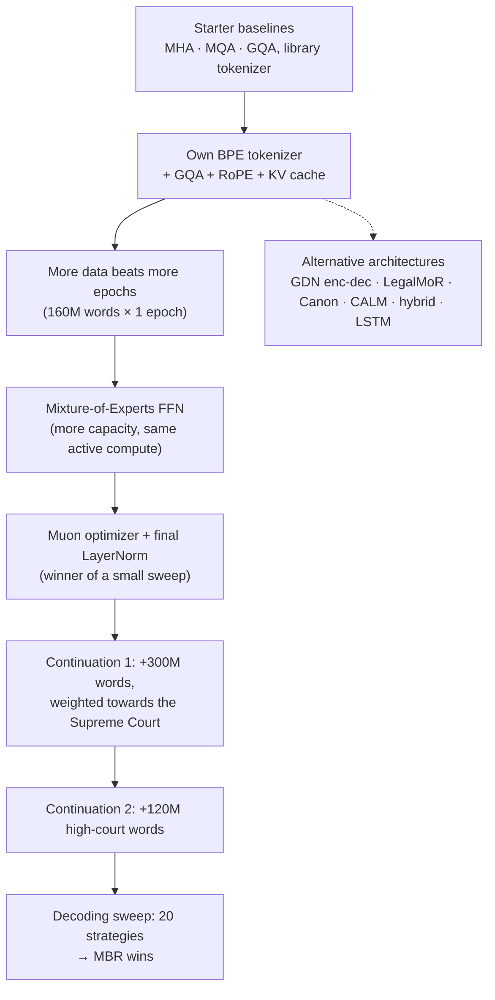

# Phase 1: Legal Language Model Pretraining

**Task.** Given a 512-word prompt from an Indian legal document, continue it with exactly 128 words.
**Metric.** BERTScore F1 (primary), with ROUGE-L and BLEU-4 as secondary metrics.
**Rules.** 50M–300M parameters, trained from scratch, no pretrained weights and no outside data.

**Best score: 0.8376.** This is a 218.7M-parameter Mixture-of-Experts model (111.2M active per token), continued twice
and decoded with minimum-Bayes-risk (MBR) over 16 samples.

---

## The story in one picture

---

## Notebooks

Notebooks are numbered in the order they were built. `notebooks/` keeps every notebook **with its outputs** (training
logs, held-out loss, local BERTScore).

### Step 1: Baselines (starter-notebook era)
| Notebook | What it does |
|---|---|
| `01-mha-baseline.ipynb` | Decoder-only Transformer with multi-head attention (118.7M), library BPE tokenizer, 60M words. Our first submission. |
| `02-mqa-baseline.ipynb` | The same model with multi-query attention (110.0M), to compare attention variants. |
| `03-gqa-baseline.ipynb` | The same model with grouped-query attention (111.6M). The three variants reached similar losses, so we kept GQA for its smaller cache. |

**Why the next step:** greedy outputs looped, and the starter notebooks used a library tokenizer, which the rules do not
allow. So we switched to our own tokenizer and a stronger GQA model.

### Step 2: Dense GQA baseline with our own tokenizer
| Notebook | What it does |
|---|---|
| `04-gqa-rope-80M-words-2-epochs.ipynb` | GQA + RoPE + KV cache, 2,048-token context, our Assignment-1 BPE; 80M words for 2 epochs. |
| `05-gqa-rope-160M-words-1-epoch.ipynb` | The same model on 160M words for 1 epoch (111.1M). Same quality as two epochs on half the words, **so from here on we preferred new data to repeated epochs.** This is the dense GQA backbone reused in Phases 2–7. |

### Step 3: The MoE model and its optimizer
| Notebook | What it does |
|---|---|
| `06-moe-gqa-adamw.ipynb` | Replaces the feed-forward blocks with a DeepSeek-style Mixture of Experts: 1 shared + 16 routed experts, top-3, aux-loss-free balancing. More capacity at the same active compute. |
| `07-moe-adamw-continued.ipynb` | Continues the AdamW MoE on new, unseen documents. |
| `08-moe-muon-finalnorm.ipynb` | Retrains the MoE from scratch with **Muon** and a **final LayerNorm**, the winner of a small norm × optimizer sweep, on the same 160M words. |

### Step 4: Training on test-like data
About 95% of the test prompts look like Supreme Court text, so we continued training on new data weighted towards it.

| Notebook | What it does |
|---|---|
| `09-moe-muon-continuation1.ipynb` | **Continuation 1:** 300M new words, Supreme Court heavy, fp16 on both T4 GPUs (9.2 h). Held-out Supreme Court loss 3.19 → **2.82**. |
| `10-moe-muon-continuation2-highcourt.ipynb` | **Continuation 2:** 120M more high-court words. Held-out loss rose to 3.16 (domain shift) and Codabench moved only within noise. This is **the Phase-1 checkpoint used in Phases 2–7.** |

### Step 5: Decoding
| Notebook | What it does |
|---|---|
| `11-decoding-sweep-continuation1.ipynb` | No training. Tries 20 decoding strategies (beam, greedy, sampling, MBR with 6/10/16 samples, top-p / min-p) on 300 held-out Supreme Court windows, then writes the submission with the winner. |
| `12-decoding-sweep-continuation2.ipynb` | The same sweep on continuation 2; **MBR-16 gave our best score, 0.8376.** |

### Alternative architectures (built to test our own ideas and to meet the architecture-family requirement)
| Notebook | Architecture | Notes |
|---|---|---|
| `20-gdn-encoder-decoder.ipynb` | Bidirectional Gated-DeltaNet encoder + attention decoder that reads a gated mix of all encoder layers (144.3M) | encoder–decoder entry |
| `21-legal-mor.ipynb` | LegalMoR: Mixture-of-Recursions with causal threshold routing (120.8M) | ~6× the baseline's perplexity |
| `22-boundary-canon-layers.ipynb` | Boundary Canon layers that mix in recent tokens, words and sentences (120.6M) | |
| `23-calm-autoencoder.ipynb` | CALM: an autoencoder squeezes 4 tokens into one vector and a Transformer predicts the next vector | |
| `24-hybrid-attention-gdn.ipynb` | Parallel attention + Gated-DeltaNet branches with a token-wise gate | local BERTScore 0.8317 vs 0.8313 for the base MoE |
| `25-lstm-lightweight.ipynb` | 3-layer LSTM (84M), the lightweight entry | |

All alternative architectures trailed the dense GQA baseline.

---

## Submissions (`submissions/`)

| File | Model and decoder | Codabench BERTScore |
|---|---|---|
| `model2_HC_mbr16_T0.7_p0.9_ng4.zip` | **continuation 2, MBR-16 (final)** | **0.8376** |
| `model1_noHC_mbr6_T0.7_minp0.05_ng4.zip` | continuation 1, MBR-6 + min-p | 0.8372 |
| `moe_muon_finalnorm_MBR_x6_T0_7_p0_9_ng4_v2.zip` | Muon MoE, MBR-6 | 0.8367 |
| `moe_muon_finalnorm_beam4_ng4_v2train.zip` | continuation 1, beam 4 | 0.8351 |
| `MoE_continued.zip` | AdamW MoE, continued | 0.8339 |
| `submission_moe160M_MBR_x6_T0_7_p0_9_ng4.zip` | AdamW MoE, MBR-6 | 0.8322 |
| `moe_muon_finalnorm_beam4_ng4.zip` | Muon MoE base run, beam 4 | 0.8312 |
| `moe160M_beam4_ng4.zip` | AdamW MoE, beam 4 + no-repeat-4 | 0.8285 |
| `MoE_gqa.zip` | AdamW MoE, first submission | 0.8263 |
| `lightweight_lstm84M_t0.7_p0.9_ng4.zip` | LSTM | 0.8237 |
| `canon_layers.zip` | Boundary Canon | 0.8054 |
| `gdn_encoder_decoder_160M.zip` | GDN encoder–decoder | 0.8010 |
| `mor_gqa_rope.zip` | LegalMoR | 0.7954 |
| `CaLM_Autoencoder.zip` | CALM | 0.7723 |
| `hybrid_gdn_beam4_ng4.zip` | attention + GDN hybrid | – |

`prediction.json` is an unzipped prediction file (1,000 test prompts).

**What mattered most:**
- Test-like training data: continuation 1 gave the largest drop in loss.
- Decoding: on the same checkpoint, plain sampling → beam → MBR gave +0.006.
- The MoE: lower perplexity than the dense model at the same active compute.

None of the alternative architectures beat the dense baseline.
