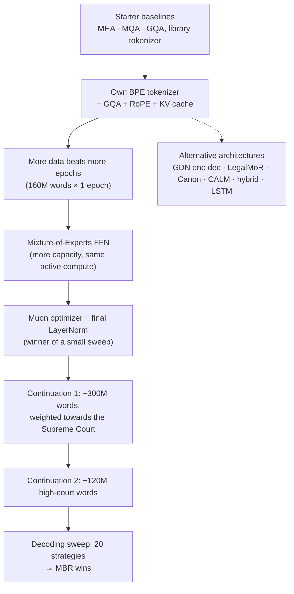

# Phase 1: Legal Language Model Pretraining

**Task.** Given a 512-word prompt from an Indian legal document, continue it with exactly 128 words.
**Metric.** BERTScore F1 (primary), with ROUGE-L and BLEU-4 as secondary metrics.
**Rules.** 50M–300M parameters, trained from scratch, no pretrained weights and no outside data.

**Best score: 0.8376.** This is a 218.7M-parameter Mixture-of-Experts model (111.2M active per token), continued twice
and decoded with minimum-Bayes-risk (MBR) over 16 samples.

---

## The story in one picture

---

## Architecture at a glance

Every model is a decoder (or the stated variant) with `d_model` 768 and a 40,000-token vocabulary. Numbers are read from the notebooks' own printouts. The folder READMEs under `notebooks/` give the full detail for each.

| Model (notebook) | Layers | Heads × head size (KV heads) | FFN | Context | Parameters (active) |
|---|---|---|---|---|---|
| MHA baseline (01) | 8 | 12 × 64 (12) | 3072 dense | 640 | 118.7M |
| MQA baseline (02) | 8 | 12 × 64 (1) | 3072 dense | 640 | 110.0M |
| GQA baseline (03) | 8 | 12 × 64 (3) | 3072 dense | 640 | 111.6M |
| GQA + RoPE (04, 05) | 8 | 12 × 64 (3) | 3072 dense | 2,048 | 111.1M |
| MoE (06, 07) | 8 | 12 × 64 (3) | layer 1 dense; layers 2–8: 1 shared + 16 routed experts of width 768, top-3 | 2,048 | 218.7M (111.2M) |
| **Muon MoE + final norm (08–12)** | 8 | 12 × 64 (3) | same as the MoE | 2,048 | **218.7M (111.2M)** |
| GDN encoder–decoder (20) | 6 encoder + 4 decoder | encoder: 4 GDN heads × 128; decoder: 12 × 64 (3) | 3072 dense | 2,048 | 144.3M |
| LegalMoR (21) | 1 + 3 shared × 3 passes + 1 | 12 × 64 (3) | 3072, own FFN per pass | 2,048 | 120.8M |
| Boundary Canon (22) | 8 | 12 × 64 (3) | 3072 dense + Canon modules | 2,048 | 120.6M |
| CALM (23) | 12 backbone | 12 × 64 (6) | 6144 dense | 2,048 tokens = 512 positions | 172.0M backbone + head (203.2M with the autoencoder) |
| Attention + GDN hybrid (24) | 8 | 12 × 64 (3) + GDN 4 × 128 | 3072 dense | 2,048 | 126.9M |
| LSTM (25) | 3 LSTM layers, hidden 1,536 | none | none | 512 (state carried) | 83.9M |

## Notebooks

Notebooks live in `notebooks/<folder>/`, and the folder names match the ones in `submissions/`, so a notebook and the zips it produced sit in the same-named folder. **Every folder has its own README** with a block diagram of the model, the setup and hyperparameters, and what the batch found; each `submissions/<folder>/` has a README listing its zips.

Notebooks are numbered in the order they were built. `notebooks/` keeps every notebook **with its outputs** (training
logs, held-out loss, local BERTScore).

### Step 1: Baselines (starter-notebook era)
| Notebook | What it does |
|---|---|
| `0-baselines/01-mha-baseline.ipynb` | Decoder-only Transformer with multi-head attention (118.7M), library BPE tokenizer, 60M words. Our first submission. |
| `0-baselines/02-mqa-baseline.ipynb` | The same model with multi-query attention (110.0M), to compare attention variants. |
| `0-baselines/03-gqa-baseline.ipynb` | The same model with grouped-query attention (111.6M). The three variants reached similar losses, so we kept GQA for its smaller cache. |

**Why the next step:** greedy outputs looped, and the starter notebooks used a library tokenizer, which the rules do not
allow. So we switched to our own tokenizer and a stronger GQA model.

### Step 2: Dense GQA baseline with our own tokenizer
| Notebook | What it does |
|---|---|
| `0-baselines/04-gqa-rope-80M-words-2-epochs.ipynb` | GQA + RoPE + KV cache, 2,048-token context, our Assignment-1 BPE; 80M words for 2 epochs. |
| `0-baselines/05-gqa-rope-160M-words-1-epoch.ipynb` | The same model on 160M words for 1 epoch (111.1M). Same quality as two epochs on half the words, **so from here on we preferred new data to repeated epochs.** This is the dense GQA backbone reused in Phases 2–7. |

### Step 3: The MoE model and its optimizer
| Notebook | What it does |
|---|---|
| `1-adamw-moe/06-moe-gqa-adamw.ipynb` | Replaces the feed-forward blocks with a DeepSeek-style Mixture of Experts: 1 shared + 16 routed experts, top-3, aux-loss-free balancing. More capacity at the same active compute. |
| `1-adamw-moe/07-moe-adamw-continued.ipynb` | Continues the AdamW MoE on new, unseen documents. |
| `2-muon-moe/08-moe-muon-finalnorm.ipynb` | Retrains the MoE from scratch with **Muon** and a **final LayerNorm**, the winner of a small norm × optimizer sweep, on the same 160M words. |

### Step 4: Training on test-like data
About 95% of the test prompts look like Supreme Court text, so we continued training on new data weighted towards it.

| Notebook | What it does |
|---|---|
| `2-muon-moe/09-moe-muon-continuation1.ipynb` | **Continuation 1:** 300M new words, Supreme Court heavy, fp16 on both T4 GPUs (9.2 h). Held-out Supreme Court loss 3.19 → **2.82**. |
| `2-muon-moe/10-moe-muon-continuation2-highcourt.ipynb` | **Continuation 2:** 120M more high-court words. Held-out loss rose to 3.16 (domain shift) and Codabench moved only within noise. This is **the Phase-1 checkpoint used in Phases 2–7.** |

### Step 5: Decoding
| Notebook | What it does |
|---|---|
| `2-muon-moe/11-decoding-sweep-continuation1.ipynb` | No training. Tries 20 decoding strategies (beam, greedy, sampling, MBR with 6/10/16 samples, top-p / min-p) on 300 held-out Supreme Court windows, then writes the submission with the winner. |
| `2-muon-moe/12-decoding-sweep-continuation2.ipynb` | The same sweep on continuation 2; **MBR-16 gave our best score, 0.8376.** |

### Alternative architectures (built to test our own ideas and to meet the architecture-family requirement)
| Notebook | Architecture | Notes |
|---|---|---|
| `3-gdn-encoder-decoder/20-gdn-encoder-decoder.ipynb` | Bidirectional Gated-DeltaNet encoder + attention decoder that reads a gated mix of all encoder layers (144.3M) | encoder–decoder entry |
| `4-legal-mor/21-legal-mor.ipynb` | LegalMoR: Mixture-of-Recursions with causal threshold routing (120.8M) | ~6× the baseline's perplexity |
| `5-boundary-canon/22-boundary-canon-layers.ipynb` | Boundary Canon layers that mix in recent tokens, words and sentences (120.6M) | |
| `6-calm-autoencoder/23-calm-autoencoder.ipynb` | CALM: an autoencoder squeezes 4 tokens into one vector and a Transformer predicts the next vector | |
| `7-hybrid-attention-gdn/24-hybrid-attention-gdn.ipynb` | Parallel attention + Gated-DeltaNet branches with a token-wise gate | local BERTScore 0.8317 vs 0.8313 for the base MoE |
| `8-lstm/25-lstm-lightweight.ipynb` | 3-layer LSTM (84M), the lightweight entry | |

All alternative architectures trailed the dense GQA baseline.

---

## Submissions (`submissions/`)

Submissions are grouped into **families** (one folder per batch of experiments, so the folders follow the story above):

| Folder in `submissions/` | What is inside | Files |
|---|---|---|
| `1-adamw-moe/` | AdamW MoE: first submission, continuation, decoding variants | 4 |
| `2-muon-moe/` | Muon MoE (final norm), its two continuations and the decoding sweeps, including the final 0.8376 | 5 |
| `3-gdn-encoder-decoder/` | GDN encoder–decoder (144.3M) | 1 |
| `4-legal-mor/` | LegalMoR, Mixture-of-Recursions (120.8M) | 1 |
| `5-boundary-canon/` | Boundary Canon layers (120.6M) | 1 |
| `6-calm-autoencoder/` | CALM autoencoder | 1 |
| `7-hybrid-attention-gdn/` | Attention + Gated-DeltaNet hybrid | 1 |
| `8-lstm/` | Lightweight LSTM (84M) | 1 |
| `examples/` | An unzipped prediction file, to show the format | 1 |

| File | Model and decoder | Codabench BERTScore |
|---|---|---|
| `2-muon-moe/model2_HC_mbr16_T0.7_p0.9_ng4.zip` | **continuation 2, MBR-16 (final)** | **0.8376** |
| `2-muon-moe/model1_noHC_mbr6_T0.7_minp0.05_ng4.zip` | continuation 1, MBR-6 + min-p | 0.8372 |
| `2-muon-moe/moe_muon_finalnorm_MBR_x6_T0_7_p0_9_ng4_v2.zip` | Muon MoE, MBR-6 | 0.8367 |
| `2-muon-moe/moe_muon_finalnorm_beam4_ng4_v2train.zip` | continuation 1, beam 4 | 0.8351 |
| `1-adamw-moe/MoE_continued.zip` | AdamW MoE, continued | 0.8339 |
| `1-adamw-moe/submission_moe160M_MBR_x6_T0_7_p0_9_ng4.zip` | AdamW MoE, MBR-6 | 0.8322 |
| `2-muon-moe/moe_muon_finalnorm_beam4_ng4.zip` | Muon MoE base run, beam 4 | 0.8312 |
| `1-adamw-moe/moe160M_beam4_ng4.zip` | AdamW MoE, beam 4 + no-repeat-4 | 0.8285 |
| `1-adamw-moe/MoE_gqa.zip` | AdamW MoE, first submission | 0.8263 |
| `8-lstm/lightweight_lstm84M_t0.7_p0.9_ng4.zip` | LSTM | 0.8237 |
| `5-boundary-canon/canon_layers.zip` | Boundary Canon | 0.8054 |
| `3-gdn-encoder-decoder/gdn_encoder_decoder_160M.zip` | GDN encoder–decoder | 0.8010 |
| `4-legal-mor/mor_gqa_rope.zip` | LegalMoR | 0.7954 |
| `6-calm-autoencoder/CaLM_Autoencoder.zip` | CALM | 0.7723 |
| `7-hybrid-attention-gdn/hybrid_gdn_beam4_ng4.zip` | attention + GDN hybrid | – |

`examples/prediction.json` is an unzipped prediction file (1,000 test prompts).

**What mattered most:**
- Test-like training data: continuation 1 gave the largest drop in loss.
- Decoding: on the same checkpoint, plain sampling → beam → MBR gave +0.006.
- The MoE: lower perplexity than the dense model at the same active compute.

None of the alternative architectures beat the dense baseline.
