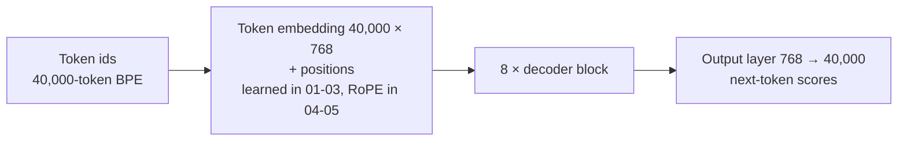
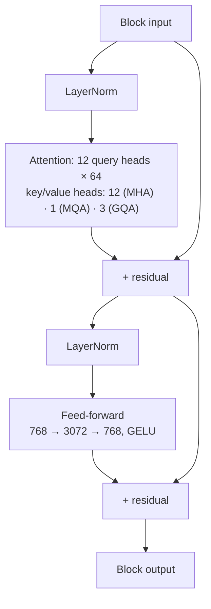

# Phase 1 · `0-baselines`: the starter-era models

Five notebooks that built our first decoder-only Transformers. There are **no zips in `submissions/` for this folder**: these runs fed the Phase-1 loss and perplexity comparisons, not Codabench entries.

## Architecture diagram

The model, and one decoder block (the three attention variants differ only in the key/value heads):

All Phase-1 models share these fixed choices unless a row says otherwise:

| | |
|---|---|
| Width `d_model` | 768 |
| Layers | 8 (the MoR, CALM and GDN encoder–decoder differ, see their rows) |
| Query heads / head size | 12 heads × 64 (`d_head` = 768 / 12) |
| Dense feed-forward | 768 → 3072 → 768 with GELU (`d_ff` = 3072) |
| Vocabulary | 40,000 byte-level BPE tokens |
| Normalisation | pre-LayerNorm |
| Output layer | separate from the embedding (not tied) |
| Hard limit | 50M–300M parameters |

## What each notebook builds

| Notebook | Attention | Key/value heads | Positions | Context | Parameters | Training data |
|---|---|---|---|---|---|---|
| `01-mha-baseline.ipynb` | multi-head (MHA) | 12 | learned absolute | 640 tokens (512 prompt + 128 continuation) | 118.7M | 60M words (15M per source), 2 epochs |
| `02-mqa-baseline.ipynb` | multi-query (MQA) | 1 | learned absolute | 640 | 110.0M | same |
| `03-gqa-baseline.ipynb` | grouped-query (GQA) | 3 (groups of 4 query heads) | learned absolute | 640 | 111.6M | same |
| `04-gqa-rope-80M-words-2-epochs.ipynb` | GQA | 3 | RoPE (base 10,000) | 2,048 | 111.1M | 80M words (20M per source), 2 epochs |
| `05-gqa-rope-160M-words-1-epoch.ipynb` | GQA | 3 | RoPE (base 10,000) | 2,048 | 111.1M | 160M words (40M per source), 1 epoch |

**Common training setup.** AdamW, learning rate 3e-4, pre-LayerNorm. Notebooks 01–03 use batch size 8 windows of 640 tokens. Notebooks 04–05 use batch size 2 windows of 2,048 tokens and a KV cache for generation.

**How the key/value heads change the size.** Going from 12 to 3 to 1 key/value heads removes about 7.1M and 8.7M parameters (118.7M → 111.6M → 110.0M), which is why the three attention variants differ only in cache size and parameters, not in layers or width.

**Tokenizer.** Notebooks 01–03 use a library BPE tokenizer. From 04 on, every notebook uses our own byte-level BPE from Assignment 1, with the same 40,000 entries.

**What these runs showed.** The three attention variants reached similar losses, so we kept GQA for its smaller cache. Notebook 05 matched 04's quality with half as many passes over the data, so later runs used new data instead of repeated epochs. Notebook 05 is the dense GQA backbone reused in Phases 2–7.
