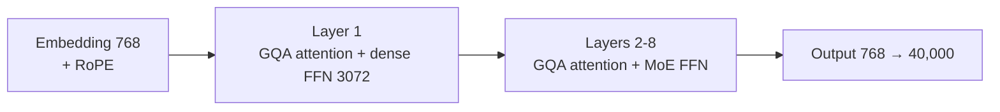
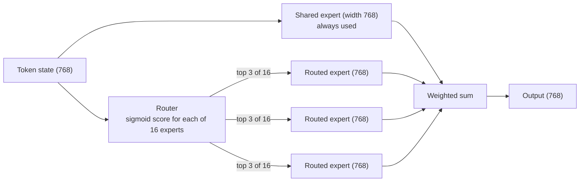

# Phase 1 · `1-adamw-moe`: the Mixture-of-Experts model, AdamW

Notebook `06` replaces the dense feed-forward blocks with a Mixture of Experts. Notebook `07` continues that model on new documents. The submissions of this family are in `submissions/1-adamw-moe/`.

## Architecture diagram

The whole model, and what one routed feed-forward layer does with a token:

All Phase-1 models share these fixed choices unless a row says otherwise:

| | |
|---|---|
| Width `d_model` | 768 |
| Layers | 8 (the MoR, CALM and GDN encoder–decoder differ, see their rows) |
| Query heads / head size | 12 heads × 64 (`d_head` = 768 / 12) |
| Dense feed-forward | 768 → 3072 → 768 with GELU (`d_ff` = 3072) |
| Vocabulary | 40,000 byte-level BPE tokens |
| Normalisation | pre-LayerNorm |
| Output layer | separate from the embedding (not tied) |
| Hard limit | 50M–300M parameters |

## The MoE architecture (notebook 06)

| | |
|---|---|
| Layers | 8 pre-LayerNorm blocks, each = GQA attention + feed-forward |
| Attention | 12 query heads, 3 key/value heads, head size 64, RoPE (base 10,000), context 2,048 |
| Layer 1 feed-forward | dense, 768 → 3072 → 768 (kept dense on purpose) |
| Layers 2–8 feed-forward | **1 shared expert + 16 routed experts**, **top-3** routed experts per token |
| One expert | Linear → GELU → Linear, hidden width 768 (a dense FFN made narrower) |
| Router | sigmoid scores; DeepSeek-style **aux-loss-free balancing** (a per-expert selection bias moves by 0.001 per step, no auxiliary loss, no token dropping) |
| Total parameters | **218,685,760 (218.7M)** |
| Active per token | **111,198,016 (111.2M)** (shared + 3 routed experts = 4 × 768 = 3072, the same compute as the dense FFN) |
| Total FFN capacity | 17 × 768 = 4.25× the dense FFN |
| Vocabulary | 40,000 |

## What each notebook does

| Notebook | What it does | Data and optimisation |
|---|---|---|
| `06-moe-gqa-adamw.ipynb` | Trains the MoE from scratch | 160M words (40M per source), 1 epoch, batch 2 windows of 2,048 tokens, AdamW, learning rate 3e-4 |
| `07-moe-adamw-continued.ipynb` | Continues notebook 06 on new, unseen documents | 195M new words (150M Supreme Court + 15M each from high courts, acts and tribunals); learning rate 3e-4 held for 80% of the run, then cosine decay to 3e-5; warm-up 300 steps |

Its first Codabench submission scored 0.8263, against 0.8254 for the dense GQA with the same active compute. It became the backbone for the later Muon runs.
