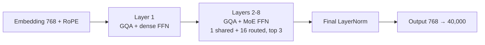
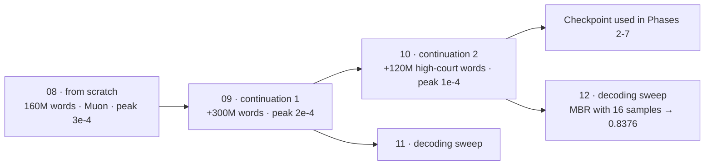
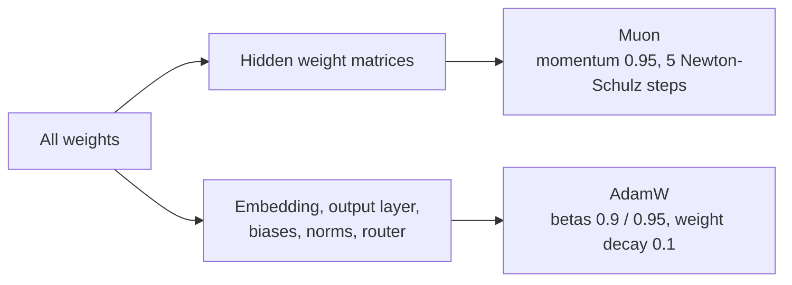

# Phase 1 · `2-muon-moe`: the final model (Muon, final LayerNorm) and its decoding sweeps

The same MoE as in `1-adamw-moe`, retrained with the **Muon** optimizer and a **final LayerNorm**, then extended twice. Notebooks 11 and 12 train nothing: they search decoding strategies. The submissions are in `submissions/2-muon-moe/`.

## Architecture diagram

The model is the same MoE with a final LayerNorm. The training chain of the final model, and how the two optimizers split the weights:

All Phase-1 models share these fixed choices unless a row says otherwise:

| | |
|---|---|
| Width `d_model` | 768 |
| Layers | 8 (the MoR, CALM and GDN encoder–decoder differ, see their rows) |
| Query heads / head size | 12 heads × 64 (`d_head` = 768 / 12) |
| Dense feed-forward | 768 → 3072 → 768 with GELU (`d_ff` = 3072) |
| Vocabulary | 40,000 byte-level BPE tokens |
| Normalisation | pre-LayerNorm |
| Output layer | separate from the embedding (not tied) |
| Hard limit | 50M–300M parameters |

## Architecture (notebooks 08–10, 11–12 load the result)

| | |
|---|---|
| Blocks | 8 pre-LayerNorm blocks: GQA attention + feed-forward |
| Attention | 12 query heads, 3 key/value heads, head size 64, RoPE (base 10,000), context 2,048 |
| Feed-forward | layer 1 dense (3072); layers 2–8 MoE with 1 shared + 16 routed experts, top-3, expert width 768 |
| Final LayerNorm | **yes** (a LayerNorm before the output head: 768 weights + 768 biases) |
| Total parameters | **218,687,296 (218.7M)**; the MoE of notebook 06 plus that final LayerNorm |
| Active per token | **111,199,552 (111.2M)** |

## What each notebook does

| Notebook | What it does | Data and optimisation |
|---|---|---|
| `08-moe-muon-finalnorm.ipynb` | Trains from scratch with Muon + final norm. The winner of a small norm × optimizer sweep. | 160M words (40M per source), 1 epoch. **Muon** on the hidden weight matrices (momentum 0.95, 5 Newton–Schulz steps), **AdamW** on everything else (betas 0.9/0.95, weight decay 0.1), gradient clip 1.0. Peak learning rate 3e-4, warm-up 300 steps, cosine decay to 3e-5. Saves and resumes inside 11-hour sessions. |
| `09-moe-muon-continuation1.ipynb` | **Continuation 1.** Starts from notebook 08's weights. | 300M new words: 165M Supreme Court, 70M acts, 40M high courts, 25M tribunals. Peak 2e-4, cosine decay to 2e-5. fp16 on both T4 GPUs. |
| `10-moe-muon-continuation2-highcourt.ipynb` | **Continuation 2.** Starts from continuation 1. This is the checkpoint used in Phases 2–7. | 120M more words, all high courts. Peak 1e-4, cosine decay to 1e-5. |
| `11-decoding-sweep-continuation1.ipynb` | No training. Tries 20 decoding strategies on continuation 1 and writes the submission with the best. | beam, greedy, sampling, MBR with 6/10/16 samples, top-p, min-p; scored on 300 held-out Supreme Court windows |
| `12-decoding-sweep-continuation2.ipynb` | The same sweep on continuation 2. **MBR with 16 samples gave 0.8376.** | same search |

**Total pretraining data of the final model:** 160M + 300M + 120M = **580M words**.
