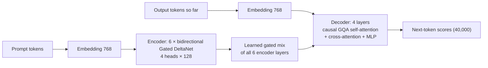

# Phase 1 · `3-gdn-encoder-decoder`: Gated-DeltaNet encoder–decoder

An encoder–decoder entry, built to meet the architecture-family requirement. Notebook: `20-gdn-encoder-decoder.ipynb`. Submission: `submissions/3-gdn-encoder-decoder/`.

## Architecture diagram

Encoder–decoder: the encoder reads the prompt, and the decoder reads a learned mix of all encoder layers:

| | |
|---|---|
| Encoder | **6 bidirectional Gated-DeltaNet blocks** (each = a forward and a backward pass whose outputs are added). Each block: q/k/v projections, short causal depthwise convolution (kernel 4) with SiLU, L2-normalised q and k, delta-rule memory with a gate and a step size, per-head RMSNorm, an output gate, output projection. |
| Gated DeltaNet size | 4 heads × head size 128, convolution 4, chunk length 64, computed in fp32 |
| Decoder | **4 layers**: causal GQA self-attention + cross-attention to the prompt + MLP |
| Decoder attention | 12 heads, head size 64, 3 key/value heads, RoPE |
| `d_model` / `d_ff` | 768 / 3072 (GELU MLP in every block) |
| Context | 2,048 tokens |
| Vocabulary | 40,000 (embedding and output head are separate) |
| Parameters | **144,298,172 (144.3M)**: encoder blocks 52.1M, decoder blocks 30.7M, embedding 30.7M, output head 30.7M |
| The decoder reads | a **learned gated mix of all encoder layers**, not only the last one |
| Training | 160M words (40M per source), 1 epoch, batch 4, AdamW, learning rate 3e-4 |

Result: BERTScore F1 0.8010.
