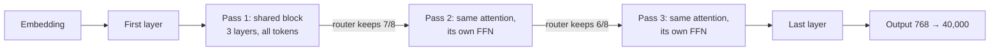

# Phase 1 · `4-legal-mor`: LegalMoR (Mixture-of-Recursions)

A recursive-depth decoder where a causal router decides how many passes through a shared block each token gets. Notebook: `21-legal-mor.ipynb`. Submission: `submissions/4-legal-mor/`.

## Architecture diagram

Depth layout: the middle block is reused three times and a router lets fewer tokens through each pass:

| | |
|---|---|
| Layout | 1 first layer + **3 shared layers × 3 passes** + 1 last layer = up to 11 layers deep |
| `d_model`, heads | 768; 12 query heads, 3 key/value heads (GQA), head size 64 |
| Feed-forward | 3072, GELU; **each pass has its own FFN** (attention is shared; "relaxed sharing" adds about 28M parameters at the same compute) |
| Router | **causal threshold routing**: a learned score per token, thresholds that follow the batch quantile (momentum 0.1) |
| Tokens kept per pass | 100%, 87.5% (7/8), 75% (6/8) of all tokens (gentle skipping on purpose; the original paper uses 1, 2/3, 1/3) |
| Attention in deep passes | sees the full context (`MOR_FULL_CONTEXT = True`), not only the tokens still selected |
| Extras | a pass embedding is added to the block input; a learned vector per reached depth is added before the last layer |
| Context | 2,048 tokens, RoPE (base 10,000) |
| Parameters | **120,842,946 (120.8M)** |
| Training | 160M words (40M per source), 1 epoch, batch 2, AdamW, learning rate 3e-4 |

Result: BERTScore F1 0.7954 (about 6× the baseline's perplexity). In later phases it also stayed far behind the other backbones.
