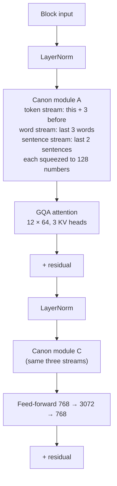

# Phase 1 · `5-boundary-canon`: Boundary Canon layers

Our own idea: add small "Canon" modules that mix in the previous tokens, words and sentences around each position. Notebook: `22-boundary-canon-layers.ipynb`. Submission: `submissions/5-boundary-canon/`.

## Architecture diagram

One decoder block with the two Canon modules added:

| | |
|---|---|
| Backbone | the dense GQA model: 8 layers, 12 query heads × 64, 3 key/value heads, FFN 3072, RoPE, context 2,048 |
| Canon modules | two per layer: one after the first norm (right before attention) and one after the second norm (right before the feed-forward) |
| Bottleneck | each stream compresses the 768-d state to **128** numbers before mixing |
| Token stream | this token and the 3 before it (4 positions) |
| Word stream | the last **3 finished words** (a word ends at a token whose string ends with `</w>`) |
| Sentence stream | the last **2 finished sentences** (a sentence ends at `.`, `?` or `!`) |
| Parameters | **120,551,488 (120.6M)** |
| Training | **240M words** (60M per source), 1 epoch, batch 2, AdamW, learning rate 3e-4 |

Result: BERTScore F1 0.8054.
