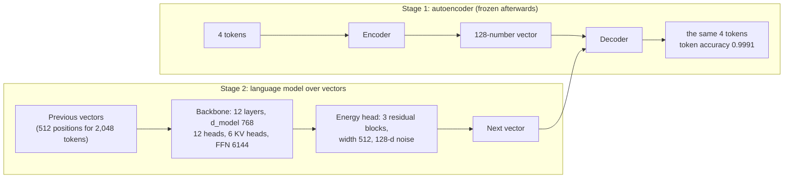

# Phase 1 · `6-calm-autoencoder`: CALM (continuous autoregressive language model)

Instead of predicting the next token, the model predicts the next **vector** that stands for 4 tokens. Notebook: `23-calm-autoencoder.ipynb`. Submission: `submissions/6-calm-autoencoder/`.

## Architecture diagram

Two stages: an autoencoder turns every 4 tokens into one vector, then a language model predicts the next vector:

**Stage 1: the autoencoder** (trained first, then frozen)

| | |
|---|---|
| Job | squeeze a chunk of **K = 4 tokens** into one **128-number** latent vector and reconstruct the tokens |
| Size | width 512, feed-forward 2,048, **31.2M parameters** (25.8M of them are needed at generation time) |
| Regularisation | KL weight 1e-3 with 0.5 "free bits" per dimension, latent dropout 0.15, 15% of input tokens masked |
| Data | about 120M words (34.5M chunks) |
| Stopped | when held-out token accuracy reached 99.9% (after at least 3,000 steps). It reached **0.9991 token / 0.9964 whole-chunk accuracy**. |

**Stage 2: the backbone and the generative head**

| | |
|---|---|
| Backbone | **12 layers**, `d_model` 768, 12 query heads × 64, **6 key/value heads** (groups of 2), feed-forward **6,144**, RoPE |
| Context | 2,048 tokens = **512 backbone positions** (each position is one 4-token chunk) |
| Generative (energy) head | width 512, 3 residual FFN blocks, 128-d noise input, 8 guesses per position in training, 100 posterior samples as targets |
| Parameters | stage 2: **172.0M**; the whole system counting the encoder: **203.2M** |
| Training | batch 8 windows, warm-up 1,000 steps |

Result: BERTScore F1 0.7723.
