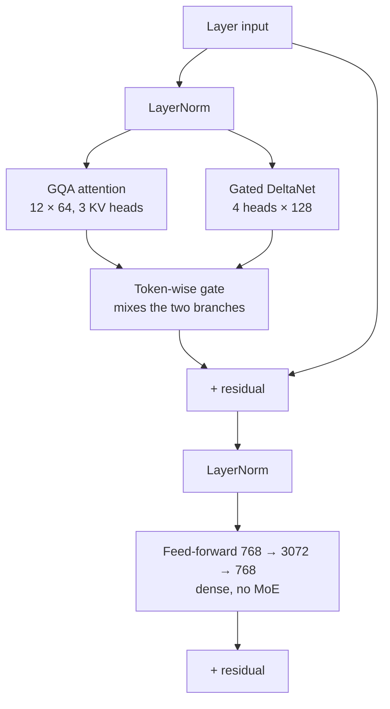

# Phase 1 · `7-hybrid-attention-gdn`: attention + Gated-DeltaNet hybrid

Each layer runs attention and a Gated-DeltaNet branch **in parallel** and mixes them with a learned gate. Notebook: `24-hybrid-attention-gdn.ipynb`. Submission: `submissions/7-hybrid-attention-gdn/`.

## Architecture diagram

One layer: attention and a Gated-DeltaNet branch run in parallel and a learned gate mixes them:

| | |
|---|---|
| Layers | 8 pre-LayerNorm blocks |
| Attention branch | GQA: 12 query heads × 64, 3 key/value heads, RoPE |
| Gated-DeltaNet branch | 4 heads × head size 128, convolution 4, chunk 64 (same block as the encoder in `3-gdn-encoder-decoder`) |
| Mixing | Both branches read the same normed input. A token-wise gate, `Linear(768 → 2)` followed by a softmax over {attention, GDN} and initialised to 50/50, weights the two outputs. The weighted sum is then added to the residual, and the feed-forward follows. After training, the GDN share per layer was L0 0.54, L1 0.99, L2 0.93, L3 0.90, L4 0.80, L5 0.82, L6 0.68, L7 0.41. |
| Feed-forward | **dense** 768 → 3072 → 768 in every layer (the MoE is switched off here) |
| Context | 2,048 tokens |
| Parameters | **126,937,744 (126.9M)**, all used per token |
| Training | 160M words (40M per source), 1 epoch, AdamW (betas 0.9/0.95, weight decay 0.1, clip 1.0), peak learning rate 3e-4, warm-up 300, cosine decay to 3e-5 |

Local BERTScore 0.8317, against 0.8313 for the base MoE under the same local test. A `hybrid_gdn_beam4_ng4.zip` was produced; its Codabench score is not recorded here.
