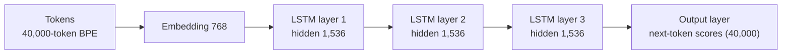

# Phase 1 · `8-lstm`: the lightweight LSTM

A recurrent baseline and the lightweight member of the family (used as a distillation student in later phases). Notebook: `25-lstm-lightweight.ipynb`. Submission: `submissions/8-lstm/`.

## Architecture diagram

A plain recurrent language model:

| | |
|---|---|
| Embedding | 768-d, vocabulary 40,000 |
| Recurrent core | **3-layer LSTM, hidden size 1,536** |
| Parameters | **83.9M** |
| Training sequence | 512 tokens; at generation time the LSTM carries its state beyond that |
| Data | 80M words (20M per source), 1 epoch |
| Optimisation | AdamW, peak learning rate 1.5e-3, weight decay 0.01, gradient clip 1.0, warm-up 300 steps, cosine decay to 1.5e-4 |

It has no attention or linear projections inside its recurrence, so LoRMA-type adapters have nothing to attach to in later phases; those phases use full fine-tuning for it.

Result: BERTScore F1 0.8237.
