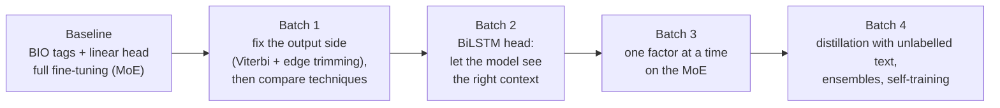

# Phase 2: Legal Named-Entity Recognition (L-NER)

**Task.** Find every entity in an Indian judgment and give its exact character span and one of 12 types: APP, RESP,
A.COUNSEL, R.COUNSEL, JUDGE, WIT, AUTH, COURT, STAT, PREC, DATE and CASENO.
**Metric.** Strict macro-F1. Start, end and type must all match exactly.
**Data.** Two labelled folds of 35 judgments each; the test fold has 35 judgments.

**Validation protocol.** Train on fold 1, choose the epoch on fold 2, then refit on fold 1 + fold 2 and predict the test
fold. Codabench ran 0.04–0.09 above fold 2 but ranked systems in the same order.

**Best score: 0.5852.** This is a single self-trained model (`p2_17b`). The final ensemble scored 0.5843.

---

## The story

**Two problems found in the baseline:**
1. Argmax decoding broke spans apart.
2. About a third of gold spans start or end *inside* one of our tokens, because our tokenizer glues punctuation to words.

**Batch 1** fixed the output side first:
- a Viterbi decoder that only allows valid BIO tag sequences;
- a learned table that trims span edges.

Only then did it compare the adaptation techniques. They finished close together, so the technique was not the
bottleneck.

**Batch 2** added a BiLSTM head. Our decoders read only to the left, but a party's role is usually written to its right
("…, counsel for the respondent"). The head helped every technique and every backbone.

**Batch 3** changed one factor at a time on the MoE. Its winners gained much less on the test fold than on our own fold,
so instead of tuning further we turned to unlabelled text.

**Batch 4:**
- Distillation helped only when the student also learned the teacher's tags on unlabelled text.
- A span-voting ensemble was best.
- Self-training one model on the ensemble's spans let a single model match the ensemble.

---

## Notebooks

### Batch 1: output side, then the adaptation techniques (MoE, Phase-1 continuation 2)
| Notebook | What it does |
|---|---|
| `p2-01-moe-hc-full-ft.ipynb` | Baseline: BIO tags, linear head, full fine-tuning |
| `p2-02-moe-hc-lorma.ipynb` | LoRMA (the compulsory technique) |
| `p2-03-moe-hc-lora.ipynb` | LoRA |
| `p2-04-moe-hc-full-ft-bidir.ipynb` | Full fine-tuning with the causal mask removed (bidirectional attention). This hurt. |
| `p2-05-moe-hc-full-ft-punct.ipynb` | Punctuation split before tokenizing. It fixes span edges but raises the Phase-1 loss. |
| `p2-06-moe-hc-full-ft-clsw.ipynb` | Full fine-tuning + class weights |
| `p2-07-moe-hc-lorma-clsw.ipynb` | LoRMA + class weights |
| `p2-08-moe-hc-lora-clsw.ipynb` | LoRA + class weights |
| `p2-09-moe-hc-adapter-clsw.ipynb` | Houlsby adapters + class weights |
| `p2-10-moe-hc-bitfit-clsw.ipynb` | BitFit (biases only) + class weights |
| `p2-11-moe-hc-prefix-clsw.ipynb` | Prefix tuning. Failed (0.12). |

### Batch 2: BiLSTM head, on the MoE and on every other backbone
| Notebook | What it does |
|---|---|
| `p2-12-moe-hc-full-ft-bilstm-clsw.ipynb` | Full fine-tuning + BiLSTM head |
| `p2-13-moe-hc-adapter-bilstm-clsw.ipynb` | Houlsby adapters + BiLSTM head (0.5335): the teacher for batch 4 |
| `p2-14-moe-hc-lorma-bilstm-clsw.ipynb` | LoRMA + BiLSTM head |
| `sweep-p2s-gqa160.ipynb` | One notebook, many setups on the dense **GQA** (adapters, Pfeiffer, LoRMA, LoRMA-π, all with the BiLSTM head) |
| `sweep-p2s-lstm84.ipynb` | The same sweep on the **LSTM** (adapters, Pfeiffer, partial, frozen) |
| `sweep-p2s-mor2.ipynb` | The same sweep on **LegalMoR** (LoRA, LoRMA, LoRMA-π, BitFit) |
| `sweep-p2s-gdn.ipynb` | The same sweep on the **GDN** encoder (adapters, LoRMA, full fine-tuning) |

### Batch 3: one factor at a time on the MoE
| Notebook | What it does |
|---|---|
| *(p2s_moe2; zips only)* | Higher learning rate, 1,024-token window, rare-label oversampling, larger adapters |
| `sweep-p2s-moe3.ipynb` | The batch-2 winners stacked, plus a 256-token document header, a 512-token window and oversampling |
| `sweep-p2s-moe5.ipynb` | The stacked recipe with the other techniques: full fine-tuning, LoRA, Pfeiffer, prompt tuning |

### Batch 4: knowledge distillation, ensembles, self-training
| Notebook | What it does |
|---|---|
| `p2-15a-kd-moe13-to-lstm-labelled-only.ipynb` | KD: MoE teacher → LSTM student, labelled folds only |
| `p2-15b-kd-moe13-to-lstm-plus-unlabelled.ipynb` | KD: the teacher also labels unlabelled text (0.5458, **beats its teacher**) |
| `p2-15c-kd-moe13-to-gqa-plus-unlabelled.ipynb` | The same KD into the GQA student |
| `p2-16e-ensemble-final-moe3-plus-students.ipynb` | Span-voting ensemble of the strongest MoE models + the KD students |
| `p2-16f-ensemble-final-with-lora-full-selftrain.ipynb` | Ensemble 16e + LoRA, full fine-tuning and self-trained members |
| `p2-17-selftrain-moe-from-ensemble.ipynb` | Self-training: one MoE model trained on the ensemble's spans for the unlabelled test text |
| `p2-17b-selftrain-header256-seed1.ipynb` | **Final model:** self-training with the 256-token header (0.5852) |

Ensembles 16a, 16b, 16c and 16g were built by the same notebook family; only their zips are kept.

---

## Submissions (`submissions/`), selected Codabench scores

| Submission | What it is | strict macro-F1 |
|---|---|---|
| `p2_17b_selftrain_header256_seed1.zip` | **final single model**, self-trained | **0.5852** |
| `p2_16g_ensemble_final_with_two_selftrain_A.zip` / `_B` | final ensemble | 0.5843 / 0.5823 |
| `p2_16f_…_A.zip` / `p2_16e_…_A.zip` | earlier ensembles | 0.5840 / 0.5803 |
| `p2_17_selftrain_moe_from_ensemble.zip` | first self-trained model | 0.5793 |
| `p2s_moe3_stack_window512.zip` | best batch-3 single model | 0.5485 |
| `p2_15b_kd_moe13_to_lstm_plus_unlabelled.zip` | KD LSTM student with unlabelled text | 0.5458 |
| `p2_13_moe_hc_adapter_bilstm_clsw.zip` | adapters + BiLSTM head (teacher) | 0.5335 |
| `p2s_gqa160_adapter_bilstm.zip` | GQA, adapters + BiLSTM | 0.5200 |
| `p2_01_moe_hc_full_ft.zip` | baseline | 0.4343 |
| `p2_11_moe_hc_prefix_clsw.zip` | prefix tuning (failed) | 0.1220 |

The other zips are the individual setups named in the tables above (`p2s_<backbone>_<setup>.zip`).

**Note.** The batch-4 students and the self-trained models read the unlabelled *text* of the test fold, never its
labels. The report states this.
