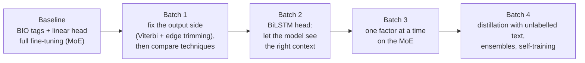
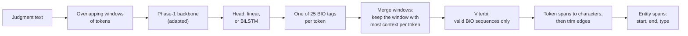
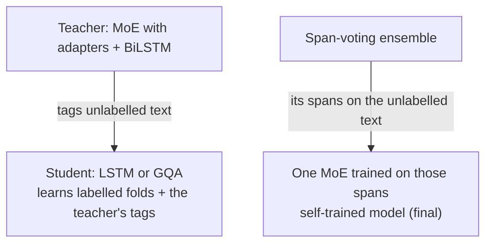

# Phase 2: Legal Named-Entity Recognition (L-NER)

**Task.** Find every entity in an Indian judgment and give its exact character span and one of 12 types: APP, RESP,
A.COUNSEL, R.COUNSEL, JUDGE, WIT, AUTH, COURT, STAT, PREC, DATE and CASENO.
**Metric.** Strict macro-F1. Start, end and type must all match exactly, and the F1 is averaged over the 12 types, so a
rare type such as WIT (187 entities) counts as much as DATE (1,575).
**Data.** Two labelled folds of 35 judgments each; the test fold has 35 judgments. Judgments are long (median about
4,500 words).

**Validation protocol.** Train on fold 1, choose the epoch on fold 2, then refit on fold 1 + fold 2 and predict the test
fold. Codabench ran 0.04–0.09 above fold 2 but ranked systems in the same order. Fold 2 has only 35 documents, so
differences below about 0.015 are noise.

**Best score: 0.5852.** This is a single self-trained model (`p2_17b`). The final ensemble scored 0.5843.

---

## The story



**Two problems found in the baseline:**
1. Argmax decoding broke spans apart.
2. About a third of gold spans start or end *inside* one of our tokens, because our tokenizer glues punctuation to words.

**Batch 1** fixed the output side first: a Viterbi decoder that only allows valid BIO sequences, and a learned table that
trims span edges. Only then did it compare the adaptation techniques. They finished close together, so the technique was
not the bottleneck.

**Batch 2** added a BiLSTM head. Our decoders read only to the left, but a party's role is usually written to its right
("…, counsel for the respondent"). The head helped every technique and every backbone.

**Batch 3** changed one factor at a time on the MoE. Its winners gained much less on the test fold than on our own fold,
so instead of tuning further we turned to unlabelled text.

**Batch 4:** distillation helped only when the student also learned the teacher's tags on unlabelled text; a span-voting
ensemble was best; self-training one model on the ensemble's spans let a single model match it.

---

## How it works

### 1. From text to entities

The model never predicts character offsets directly. It tags every token, and the offsets are worked out afterwards.



- **Window and stride.** A judgment is cut into windows because the model reads a limited number of tokens at once (the
  Phase-1 model supports at most 2,048). The stride is how far the window moves each time. Window 512 with stride 256
  overlaps by half, so most tokens are predicted from a window where they have context on both sides.
- **BIO tags.** Each token gets one of 25 tags: `O`, plus `B-` (begins an entity) and `I-` (inside) for each of the 12 types.
  Example: `Delhi High Court` → `B-COURT I-COURT I-COURT`.
- **Viterbi decoding.** Chooses the best tag sequence under BIO rules (an `I-X` must follow `B-X` or `I-X`). It beat
  plain argmax by about 0.04–0.08.
- **Characters from tokens.** Every token records its character start and end, so an entity's offsets are the first
  token's start and the last token's end.
- **Edge trimming.** 2,828 of 8,393 gold spans (33.7%) start or end inside a token (`Ltd.,`). A table learned per
  (label, edge character) trims trailing punctuation after decoding (+0.12 to +0.18). Splitting punctuation before
  tokenizing was tried (`p2-05`) but changes the input the Phase-1 model was trained on (loss 3.11 → 3.56 nats).

### 2. Class weights

Macro-F1 weighs all 12 types equally, but most tokens are `O`. Each token's loss is multiplied by a weight that depends
on its true tag `c`:

```math
w_c = \sqrt{\frac{\text{total tokens}}{\text{tokens with tag } c}}, \qquad
\mathcal{L} = \frac{\sum_t w_{c_t}\,\mathrm{CE}_t}{\sum_t w_{c_t}}
```

Example: with 9,000 `O` tokens and 100 `B-WIT` tokens out of 10,000, the weights are about 1.05 and 10. Full
fine-tuning went from 0.4343 to 0.4758 with class weights ("clsw" in notebook names).

### 3. Adaptation techniques and their size

The backbone is the Phase-1 MoE (continuation 2) unless stated. Counts are trainable parameters.

| Technique | What is trained | Size |
|---|---|---|
| Full fine-tuning | every weight | 188–190M (86–87%) |
| Partial fine-tuning | the top layers + head | LSTM: 22.6M |
| **LoRA** | low-rank update `ΔW = A·B` added to q, k, v, o | `r(d + d')` per matrix |
| **LoRMA** | multiplicative low-rank update (compulsory technique) | 511K (0.23%) |
| Houlsby adapters | bottleneck 768→64→768 after attention and after the FFN | 1.61M with a linear head |
| Pfeiffer adapters | one adapter per block | 2.91M with the BiLSTM head |
| BitFit | bias terms only | 0.1% |
| Prefix tuning | 20 learned key/value rows per layer | about 81K with the head |
| Prompt tuning | 20 learned input vectors | about 15K plus the head |

**LoRA parameter count.** With `A` of size `d × r` and `B` of size `r × d'`, the trainable count is
`d·r + r·d' = r(d + d')`. With r = 16 on the q, k, v and o projections of all 8 blocks (q and o: 768→768; k and v:
768→192 because there are 3 key/value heads of size 64):

```
per block: 16·(768+768) + 16·(768+192) + 16·(768+192) + 16·(768+768) = 79,872
8 blocks : 638,976      + linear head (768·25 + 25 = 19,225)  ≈ 658K
```

<details>
<summary><b>Prefix tuning in detail (and why it failed)</b></summary>

Prefix tuning does not touch `W_q`, `W_k` or `W_v`. It prepends learned rows to the keys and values of every layer, so
every real token can attend to extra "virtual tokens":

```math
K' = [\,P_K ;\ X W_k\,], \qquad V' = [\,P_V ;\ X W_v\,], \qquad Q = X W_q
```

```math
\text{output} = \mathrm{softmax}\!\left(\frac{Q K'^{\top}}{\sqrt{d}}\right) V'
```

- **Rows, not columns.** K and V get 20 rows longer; the weight matrices keep their shape and stay frozen.
- **Random only at the start.** `P_K` and `P_V` are initialised randomly once, then learned: every forward pass uses their
  current values, backprop sends gradients through the frozen network into them, and the optimizer updates them after each
  step. After training they are frozen and the same rows go in front of every window.
- **Parameter count.** 20 positions × 2 (K and V) × 192 (3 KV heads × 64) × 8 layers = 61,440, plus the 19,225-parameter
  head ≈ 81K.
- **Why it failed (0.122).** Very few trainable parameters, prefix vectors trained directly without the MLP
  re-parameterisation of the original paper, and class weights pushing towards recall. Train loss plateaued near 0.47 and
  it predicted 18,355 spurious spans.

</details>

### 4. The BiLSTM head

A 1-layer bidirectional LSTM (256 units per direction, about 2.1M parameters) on top of the backbone's final hidden
states, followed by a linear layer. It gives every token right-hand context inside its window without changing the
pretrained (left-to-right) layers. It was the largest single gain (+0.05) and cut spurious spans about four-fold.

### 5. Knowledge distillation (KD)

A small **student** learns from a bigger **teacher**'s softened probabilities, which tell it which classes look alike.
Softmax with temperature `T`:

```math
p_i(T) = \frac{\exp(z_i / T)}{\sum_j \exp(z_j / T)}
```

Logits (4, 1, 0) give (0.936, 0.047, 0.017) at T = 1 and (0.736, 0.164, 0.100) at T = 2. The gap between the teacher's
distribution `p` and the student's `q` is the KL divergence, and the loss mixes it with the normal cross-entropy:

```math
\mathrm{KL}(p \,\Vert\, q) = \sum_i p_i \ln\frac{p_i}{q_i}, \qquad
\mathcal{L} = (1-\alpha)\,\mathrm{CE}(y,\, q_{T=1}) + \alpha\, T^2\, \mathrm{KL}(p_T \,\Vert\, q_T)
```

Here α = 0.5 and T = 2, computed per token over the 25 BIO tags, with the teacher frozen. The factor `T²` keeps the soft
term's gradients as large as the hard term's. On **unlabelled** windows the cross-entropy term is skipped and only the
KL term trains the student. That is what made KD work (see Batch 4).

### 6. Span-voting ensemble

No training and no GPU: the ensemble combines predictions that already exist.

1. For each document, count how many members predicted each span.
2. Keep a span if its (weighted) vote share is at least a threshold τ (searched from 0.15 to 0.80). With 5 members and
   τ = 0.4, a span predicted by 4 members (share 0.8) is kept and one predicted by 1 (share 0.2) is dropped.
3. *Exact* mode votes on (start, end, label); *boundary* mode votes on (start, end) and takes the majority label.
   Weights are equal or proportional to each member's fold-2 F1.
4. Accept spans in order of votes, skipping any that overlap an already accepted span.
5. An abbreviation-period rule learned on fold 1 repairs cases such as `Ltd.`.
6. The honest estimate picks the setting on half of the fold-2 documents and scores the other half.

### 7. Self-training

The ensemble's predicted spans on unlabelled text become ordinary hard training labels for **one** MoE model.



Honest simulation on fold 2: fold-1 gold + pseudo-labels for the fold-2 text (made by fold-1-trained members) +
pseudo-labels for the test text. Fold 2: control (gold only) 0.5132, self-trained 0.5413, ensemble 0.5481. The final
model trains on folds 1+2 gold + the test-text pseudo-labels for 8 epochs; 97% of its test spans equal the ensemble's.

**KD vs self-training.** KD uses one teacher's soft probabilities and a different, smaller student; self-training uses the
ensemble's hard spans and trains an MoE again.

---

## Notebooks

Notebooks live in `notebooks/<folder>/`, and the folder names match the ones in `submissions/`, so a notebook and the zips it produced sit in the same-named folder. **Every folder has its own README** with a block diagram of the model, the setup and hyperparameters, and what the batch found; each `submissions/<folder>/` has a README listing its zips.

### Batch 1: output side, then the adaptation techniques (MoE, Phase-1 continuation 2)
| Notebook | What it does |
|---|---|
| `batch1-moe-techniques/p2-01-moe-hc-full-ft.ipynb` | Baseline: BIO tags, linear head, full fine-tuning |
| `batch1-moe-techniques/p2-02-moe-hc-lorma.ipynb` | LoRMA (the compulsory technique) |
| `batch1-moe-techniques/p2-03-moe-hc-lora.ipynb` | LoRA |
| `batch1-moe-techniques/p2-04-moe-hc-full-ft-bidir.ipynb` | Full fine-tuning with the causal mask removed (bidirectional attention). This hurt. |
| `batch1-moe-techniques/p2-05-moe-hc-full-ft-punct.ipynb` | Punctuation split before tokenizing. It fixes span edges but raises the Phase-1 loss. |
| `batch1-moe-techniques/p2-06-moe-hc-full-ft-clsw.ipynb` | Full fine-tuning + class weights |
| `batch1-moe-techniques/p2-07-moe-hc-lorma-clsw.ipynb` | LoRMA + class weights |
| `batch1-moe-techniques/p2-08-moe-hc-lora-clsw.ipynb` | LoRA + class weights |
| `batch1-moe-techniques/p2-09-moe-hc-adapter-clsw.ipynb` | Houlsby adapters + class weights |
| `batch1-moe-techniques/p2-10-moe-hc-bitfit-clsw.ipynb` | BitFit (biases only) + class weights |
| `batch1-moe-techniques/p2-11-moe-hc-prefix-clsw.ipynb` | Prefix tuning. Failed (0.12). |

### Batch 2: BiLSTM head, on the MoE and on every other backbone
| Notebook | What it does |
|---|---|
| `batch2-bilstm-head-and-backbones/p2-12-moe-hc-full-ft-bilstm-clsw.ipynb` | Full fine-tuning + BiLSTM head |
| `batch2-bilstm-head-and-backbones/p2-13-moe-hc-adapter-bilstm-clsw.ipynb` | Houlsby adapters + BiLSTM head (0.5335): the teacher for batch 4 |
| `batch2-bilstm-head-and-backbones/p2-14-moe-hc-lorma-bilstm-clsw.ipynb` | LoRMA + BiLSTM head |
| `batch2-bilstm-head-and-backbones/sweep-p2s-gqa160.ipynb` | One notebook, many setups on the dense **GQA** (adapters, Pfeiffer, LoRMA, LoRMA-π, all with the BiLSTM head) |
| `batch2-bilstm-head-and-backbones/sweep-p2s-lstm84.ipynb` | The same sweep on the **LSTM** (adapters, Pfeiffer, partial, frozen) |
| `batch2-bilstm-head-and-backbones/sweep-p2s-mor2.ipynb` | The same sweep on **LegalMoR** (LoRA, LoRMA, LoRMA-π, BitFit) |
| `batch2-bilstm-head-and-backbones/sweep-p2s-gdn.ipynb` | The same sweep on the **GDN** encoder (adapters, LoRMA, full fine-tuning) |

The sweep notebooks run in three stages: train each setup on fold 1 and score fold 2; re-run the best few the other way
round (fold 2 → fold 1) and rank by the mean of both folds; refit the top few on both folds and write submission zips.

### Batch 3: one factor at a time on the MoE
| Notebook | What it does |
|---|---|
| *(p2s_moe2; zips only)* | Higher learning rate, 1,024-token window, rare-label oversampling, larger adapters |
| `batch3-moe-one-factor/sweep-p2s-moe3.ipynb` | The `stack` recipe (adapters + BiLSTM head + class weights, LR 1e-3, 30 epochs, window 1,024) plus a 256-token document header, a 512-token window, oversampling of APP/RESP/WIT, and LoRMA |
| `batch3-moe-one-factor/sweep-p2s-moe5.ipynb` | The stacked recipe with the other techniques: full fine-tuning, LoRA, Pfeiffer, prompt tuning |

### Batch 4: knowledge distillation, ensembles, self-training
| Notebook | What it does |
|---|---|
| `batch4-kd-ensembles-selftraining/p2-15a-kd-moe13-to-lstm-labelled-only.ipynb` | KD: MoE teacher → LSTM student, labelled folds only |
| `batch4-kd-ensembles-selftraining/p2-15b-kd-moe13-to-lstm-plus-unlabelled.ipynb` | KD: the teacher also labels unlabelled text (0.5458, **beats its teacher**) |
| `batch4-kd-ensembles-selftraining/p2-15c-kd-moe13-to-gqa-plus-unlabelled.ipynb` | The same KD into the GQA student |
| `batch4-kd-ensembles-selftraining/p2-16e-ensemble-final-moe3-plus-students.ipynb` | Span-voting ensemble of the strongest MoE models + the KD students |
| `batch4-kd-ensembles-selftraining/p2-16f-ensemble-final-with-lora-full-selftrain.ipynb` | Ensemble 16e + LoRA, full fine-tuning and self-trained members |
| `batch4-kd-ensembles-selftraining/p2-17-selftrain-moe-from-ensemble.ipynb` | Self-training: one MoE model trained on the ensemble's spans for the unlabelled test text |
| `batch4-kd-ensembles-selftraining/p2-17b-selftrain-header256-seed1.ipynb` | **Final model:** self-training with the 256-token header (0.5852) |

Ensembles 16a, 16b, 16c and 16g were built by the same notebook family; only their zips are kept.

---

## Results

Codabench strict macro-F1 of the best system at each step:

| Step | Notebook | Codabench |
|---|---|---|
| Baseline (full fine-tuning, linear head) | `p2-01` | 0.4343 |
| + class weights | `p2-06` | 0.4758 |
| + Houlsby adapters | `p2-09` | 0.4809 |
| + BiLSTM head | `p2-13` | 0.5335 |
| + window 512 | `sweep-p2s-moe3` | 0.5485 |
| + span-voting ensemble | `p2-16g` | 0.5843 |
| **One self-trained model** | `p2-17b` | **0.5852** |

## Submissions (`submissions/`), selected Codabench scores

Submissions are grouped into **families** (one folder per batch of experiments, so the folders follow the story above):

| Folder in `submissions/` | What is inside | Files |
|---|---|---|
| `batch1-moe-techniques/` | MoE: output side, then each adaptation technique | 11 |
| `batch2-bilstm-head-and-backbones/` | BiLSTM head on the MoE, and the sweeps on GQA, LSTM, MoR and GDN | 19 |
| `batch3-moe-one-factor/` | MoE, one factor at a time, then the stacked recipe | 11 |
| `batch4-kd-ensembles-selftraining/` | Distillation, span-voting ensembles and self-training (the final models) | 17 |

| Submission | What it is | strict macro-F1 |
|---|---|---|
| `batch4-kd-ensembles-selftraining/p2_17b_selftrain_header256_seed1.zip` | **final single model**, self-trained | **0.5852** |
| `batch4-kd-ensembles-selftraining/p2_16g_ensemble_final_with_two_selftrain_A.zip` / `_B` | final ensemble | 0.5843 / 0.5823 |
| `p2_16f_…_A.zip` / `p2_16e_…_A.zip` | earlier ensembles | 0.5840 / 0.5803 |
| `batch4-kd-ensembles-selftraining/p2_17_selftrain_moe_from_ensemble.zip` | first self-trained model | 0.5793 |
| `batch3-moe-one-factor/p2s_moe3_stack_window512.zip` | best batch-3 single model | 0.5485 |
| `batch4-kd-ensembles-selftraining/p2_15b_kd_moe13_to_lstm_plus_unlabelled.zip` | KD LSTM student with unlabelled text | 0.5458 |
| `batch2-bilstm-head-and-backbones/p2_13_moe_hc_adapter_bilstm_clsw.zip` | adapters + BiLSTM head (teacher) | 0.5335 |
| `batch2-bilstm-head-and-backbones/p2s_gqa160_adapter_bilstm.zip` | GQA, adapters + BiLSTM | 0.5200 |
| `batch1-moe-techniques/p2_01_moe_hc_full_ft.zip` | baseline | 0.4343 |
| `batch1-moe-techniques/p2_11_moe_hc_prefix_clsw.zip` | prefix tuning (failed) | 0.1220 |

The other zips are the individual setups named in the tables above (`p2s_<backbone>_<setup>.zip`).

**Note.** The batch-4 students and the self-trained models read the unlabelled *text* of the test fold, never its
labels. The report states this.

---

## How to run

1. Upload a notebook to Kaggle with **GPU T4** and **Internet on** (the ensemble notebooks need no GPU).
2. Add two Kaggle secrets: `HF` (read access to the gated dataset `Exploration-Lab/CS-781-Capstone`) and `HF_WRITE`
   (write access to a Hugging Face storage bucket; the notebooks save checkpoints, caches and teacher files there and
   resume from them after Kaggle's 12-hour limit).
3. Set `QUICK_TEST = True` in the settings cell for a short check, then `False` and **Run All**.
4. Every notebook starts from the Phase-1 checkpoint (continuation 2) and our tokenizer, loaded from the bucket. Later
   notebooks load files that earlier ones saved there.

Each notebook was run on Kaggle with "Run All" and is saved **with its outputs**, so the printed tables, curves and
scores are the record of that run. Model weights are not included (course rule).
