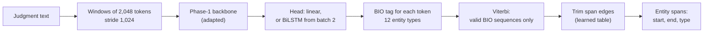
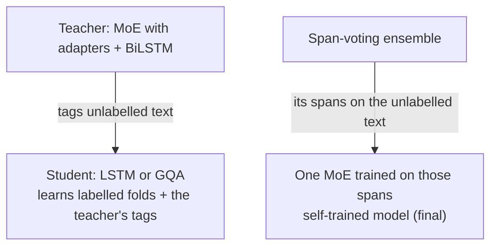

# Phase 2 · `batch4-kd-ensembles-selftraining`

**Question.** Can distillation, ensembling and self-training use the unlabelled text? **Finding.** Distillation helped only when the student also learned the teacher's tags on unlabelled text (LSTM 0.5458, which beat its teacher). A span-voting ensemble was best (0.5843), and self-training one model on the ensemble's spans let a single model match it (`p2-17b`, **0.5852, final**). Ensembles 16a, 16b, 16c and 16g were built by the same notebook family; only their zips are kept.

## Architecture

The pipeline all notebooks in this phase build on:

What batch 4 adds: distillation and self-training with unlabelled text.

## Setup shared by these notebooks

- **Task framing:** token classification with BIO tags over 12 entity types. The Phase-1 backbone reads sliding windows of 2,048 tokens (stride 1,024); overlapping windows are merged by keeping, for each token, the window in which it has most context.
- **Output side (from batch 1):** a Viterbi decoder that allows only valid BIO sequences, and a learned table that trims span edges (one entry per label and edge character).
- **Head:** a linear layer, or from batch 2 a 1-layer BiLSTM (256 per direction) on top of the backbone.
- **Backbone:** the Phase-1 MoE (continuation 2, "hc") unless a notebook says otherwise.
- **Training:** AdamW (betas 0.9/0.98, weight decay 0.01), head learning rate 1e-3, backbone 3e-4 for adapter-type methods and 3e-5 for full fine-tuning, 6% warm-up then linear decay, gradient clip 1.0, fp16. Class weights (inverse square root of label frequency) from `p2-06` on ("clsw" in a name).
- **Protocol:** train on fold 1, choose the epoch on fold 2, refit on both folds, predict the test fold. Hyperparameters are our placeholders and were not tuned.

## Notebooks in this folder

| Notebook | What it does |
|---|---|
| `p2-15a-kd-moe13-to-lstm-labelled-only.ipynb` | KD: MoE teacher → LSTM student, labelled folds only |
| `p2-15b-kd-moe13-to-lstm-plus-unlabelled.ipynb` | KD: the teacher also labels unlabelled text (0.5458, **beats its teacher**) |
| `p2-15c-kd-moe13-to-gqa-plus-unlabelled.ipynb` | The same KD into the GQA student |
| `p2-16e-ensemble-final-moe3-plus-students.ipynb` | Span-voting ensemble of the strongest MoE models + the KD students |
| `p2-16f-ensemble-final-with-lora-full-selftrain.ipynb` | Ensemble 16e + LoRA, full fine-tuning and self-trained members |
| `p2-17-selftrain-moe-from-ensemble.ipynb` | Self-training: one MoE model trained on the ensemble's spans for the unlabelled test text |
| `p2-17b-selftrain-header256-seed1.ipynb` | **Final model:** self-training with the 256-token header (0.5852) |

Each notebook was run on Kaggle with "Run All" and is saved **with its outputs**, so the printed tables, curves and scores are the record of that run.

## Submissions produced

17 files in [`../../submissions/batch4-kd-ensembles-selftraining/`](../../submissions/batch4-kd-ensembles-selftraining/). See that folder's README for every file; the scores that the phase README lists are:

| File | What it is | Score |
|---|---|---|
| `p2_15b_kd_moe13_to_lstm_plus_unlabelled.zip` | KD LSTM student with unlabelled text | 0.5458 |
| `p2_17_selftrain_moe_from_ensemble.zip` | first self-trained model | 0.5793 |
| `p2_17b_selftrain_header256_seed1.zip` | **final single model**, self-trained | 0.5852 |
