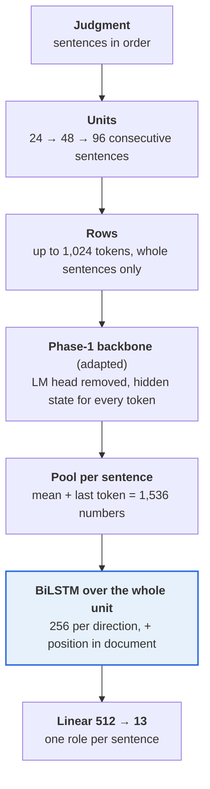
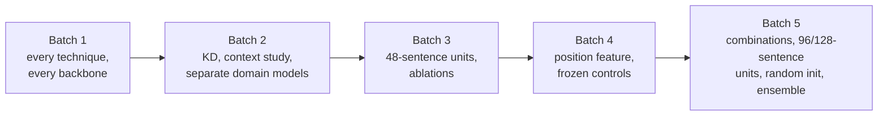

# Phase 3: Rhetorical Role Prediction

**Task.** Give every sentence of a judgment one of 13 rhetorical roles: Fact, Issue, ArgumentPetitioner,
ArgumentRespondent, Statute, Dissent, PrecedentReliedUpon, PrecedentNotReliedUpon, PrecedentOverruled,
RulingByLowerCourt, RatioOfTheDecision, RulingByPresentCourt and None.
**Domains.** Two: Corporate Law (CL) and Information Technology (IT).
**Metric.** Macro-F1: the F1 of each role, averaged with equal weight, so a rare role counts as much as a common one.
**Data.** 90 labelled judgments (18,987 sentences); the test set has **only 10 judgments**.

| Split | Documents | Sentences |
|---|---|---|
| CL train / dev / test | 40 / 5 / 5 | 10,593 / 1,396 / 1,339 |
| IT train / dev / test | 40 / 5 / 5 | 6,252 / 746 / 858 |

Judgments are long (median 4,908 tokens, only 26% fit in 2,048), and sentences have a median of 30 tokens.
Two roles cannot be learned: Dissent appears in only 2 of 45 CL documents and never in IT, and PrecedentOverruled has 3
gold sentences in total. Both score F1 = 0 everywhere, which caps macro-F1 at about 11/13 = 0.85.

**Validation protocol.** With 10 test documents the leaderboard cannot separate close systems: three seeds of one setup
scored 0.4985, 0.5209 and 0.5397. Before training anything we fixed a **5-fold document-level cross-validation (CV)**
over the 90 labelled judgments, and every decision was made on it. Each round trains on 4 folds and holds out 1; all
held-out predictions are scored together. The epoch is chosen from the held-out curve (smoothed over 3 epochs), then the
model is refit on all 90 documents. Results are cached per fold in a Hugging Face bucket, so later notebooks reuse earlier
folds instead of retraining them.

**Best score: 0.5418.** This is the MoE with IA³, 96-sentence context units and a sentence-position feature.

---

## The model



1. **Units.** A judgment is cut into units of at most 24, 48 or 96 consecutive sentences. Consecutive units start `stride`
   sentences apart and the last one is aligned to the end of the document. A unit is what the BiLSTM sees as one sequence,
   and one training example is one unit.
2. **Rows.** The backbone cannot take a whole unit if it exceeds the token limit, so the sentences of a unit are packed
   into rows: add sentences until the next one would push the row over 1,024 tokens, then start a new row. A sentence is
   never split. With a median of about 30 tokens per sentence, a 24-sentence unit is roughly 720 tokens (1 row), a
   48-sentence unit about 1,440 tokens (2 rows) and a 96-sentence unit about 2,900 tokens (3 rows).
3. **Backbone, one row at a time.** Each row is an independent backbone input. Inside a row a token attends to earlier
   tokens (the backbone is causal). Sentences in different rows of a unit cannot see each other here.
4. **Hidden states, not predictions.** The Phase-1 LM head (the 768 × 40,000 layer that predicts the next word) is removed.
   The embeddings and all blocks, with their attention and FFN layers, are kept. We use the **final hidden state of every
   token**, a vector of 768 numbers that summarises that token given the tokens before it.
5. **Sentence vector.** For each sentence separately, take the **mean** of its tokens' hidden states and the hidden state
   of its **last token** (in a causal model, the position that has read the whole sentence), and concatenate them:
   2 × 768 = 1,536 numbers. Nothing is averaged across a whole row.
6. **BiLSTM over the unit.** The sentence vectors of all rows of the unit are put back in order into one sequence. After
   LayerNorm, dropout and the position features, a bidirectional LSTM (256 units per direction) runs over it: at
   sentence *i* the forward LSTM has read sentences 1 to *i*, and the backward LSTM has read *i* to the end. The 512-number
   output (256 + 256) of each sentence goes through one linear layer to 13 scores; softmax and argmax give the role.
   Unrolled, each direction is one chain of cells with shared weights that pass their state along, and the backward chain
   has its own weights.

**Window vs unit.** The *window* is a token limit on one backbone row. It comes from memory and pretraining (the Phase-1
models were trained on 2,048-token chunks). The *unit* is how many sentences the BiLSTM sees together, and it can be much
longer because the BiLSTM works on short sentence vectors. Only the BiLSTM links the rows of a unit. This is why longer
units helped while a longer window did not.

**Position feature (from batch 4).** For sentence *i* of a document with *n* sentences, let *p = i / (n − 1)*. Five
numbers are appended to the sentence vector before the BiLSTM:

```math
[\,p,\; p^{2},\; \sin(\pi p),\; \cos(\pi p),\; \log(1+n)/10\,]
```

The position is taken over the **whole document**, not the unit, so it is the one piece of global information the head
receives. The domain flag (batch 5) is one more number: +1 for IT, −1 for CL.

**Overlapping units at inference.** A sentence can lie in several overlapping units. `center` keeps the prediction from
the unit where the sentence is farthest from the unit's edges; `average` averages the log-probabilities (the "overlap
averaging" of batch 5).

**Training recipe (taken from Phase 2, not tuned).** AdamW (betas 0.9 / 0.98, weight decay 0.01); head learning rate 1e-3,
backbone 3e-4 for PEFT and 3e-5 for full fine-tuning; 6% warm-up then linear decay; gradient clip 1.0; fp16; 12 epochs;
class-weighted cross-entropy. Each notebook ran on one Kaggle T4.

### Adaptation techniques

Trainable counts include the BiLSTM head (about 3.7M) and are for the MoE (192M in total) unless stated.

| Technique | Idea | Trainable |
|---|---|---|
| Full fine-tuning | train every weight | 191.6M (87.6%) |
| **LoRA** | freeze `W₀`, learn a low-rank update `W = W₀ + A·B` | 4.32M (about 2%) |
| **rsLoRA** | LoRA with scaling α/√r instead of α/r | 4.32M |
| **LoRMA** | multiplicative low-rank update (the compulsory technique) | 4.18M |
| **AdaLoRA** | starts at a larger rank and prunes unimportant directions (24 → 8) | 4.64M |
| **QLoRA** | LoRA on a 4-bit (NF4) frozen backbone; 223 MB stored instead of 770 MB | 4.32M |
| **IA³** | learned scaling vectors on keys, values and FFN activations | 3.78M |
| Prompt / prefix tuning | learned virtual input vectors / key-value rows (decoders only) | about 3.7M (GQA) |
| Frozen backbone | train only the BiLSTM head | 3.68M |

The LSTM backbone has no linear layers in its recurrence, so only full fine-tuning and frozen apply to it.

### Class weights and macro-F1

Cross-entropy is weighted by the true role of each sentence: inverse square root of frequency, capped at 10 and rescaled so
the mean over present roles is 1.

```math
w_c = \min\!\left(10,\ \sqrt{\frac{N}{K\,n_c}}\right), \qquad
\mathcal{L}_{CE} = \frac{\sum_i w_{y_i}\,\mathrm{CE}_i}{\sum_i w_{y_i}}
```

Here *N* is the number of sentences, *K* the number of present roles and *n_c* the count of role *c*. In the ablation, no
weights, inverse square root and full inverse frequency differed by less than 0.005 CV, which is noise.

```math
F1_c = \frac{2\,TP_c}{2\,TP_c + FP_c + FN_c}, \qquad \text{macro-F1} = \frac{1}{|C|}\sum_{c \in C} F1_c
```

### Knowledge distillation (KD), and why its CV is misleading

The student learns from the teacher's softened probabilities as well as the gold labels. With T = 2 and α = 0.5:

```math
p_i(T)=\frac{e^{z_i/T}}{\sum_j e^{z_j/T}}, \qquad
\mathcal{L}=(1-\alpha)\,\mathrm{CE}(y,q)+\alpha\,T^{2}\,\mathrm{KL}\!\left(p_T \,\Vert\, q_T\right)
```

The teacher's score for a document is its prediction when that document was **held out**, and no test text is used. But
in student fold *k*, the teacher scores for the *training* documents come from teacher models that were trained on fold
*k*'s documents. Fold *k*'s labels reach the student through the soft targets, so the student's CV is inflated. That is why
the GQA students beat their own teacher in CV (0.490 vs 0.467) and the MoE self-distillation students beat theirs by 0.08.
Codabench is unaffected, and on Codabench KD did not help.

---

## The story, batch by batch



| Batch | Question | What we learned |
|---|---|---|
| **1** | One recipe, every technique, all five Phase-1 models; and one pooled model vs separate CL/IT models | MoE best; the techniques tie; separate models lose on CL, so **one pooled model** |
| **2** | Five notebooks in parallel: KD into GQA/LSTM, context study, separate domain models on the MoE, remaining techniques on the GQA | **Context is the lever.** More sentences per unit helped; a longer token window did not. The KD gain in CV was a leak and vanished on test. |
| **3** | Keep only strong backbones at 48-sentence units; ablate the MoE recipe | Context and the BiLSTM head carry the model; class weights hardly matter |
| **4** | A unit sees only part of a judgment, so add each sentence's **position** in the whole document; frozen-backbone controls | Position helps a little; a frozen MoE comes close to the tuned one |
| **5** | Last day: combine the winners and try the remaining ideas | Only longer units helped in CV. Three seeds of one setup spread by 0.04 on test, which is larger than most differences. |

### Batch 1: every technique on every backbone

Fixed recipe: 24-sentence units, 1,024-token rows, BiLSTM head, class weights. *Pooled* is one model for CL and IT;
*separate* is a CL model for CL documents and an IT model for IT documents.

- **Backbone order:** MoE > GQA > LSTM > MoR > GDN in both CV and on Codabench (test: 0.475 to 0.488, 0.449 to 0.460,
  0.390, 0.326 to 0.349, 0.321 to 0.331). Phase-1 quality carries over to Phase 3.
- **The techniques tie.** On the GQA, rsLoRA, full fine-tuning, LoRA, LoRMA, separate LoRA and QLoRA are within 0.008
  (0.437 to 0.445); AdaLoRA, prompt, IA³ and prefix are 0.025 to 0.04 lower.
- **PEFT matches full fine-tuning** in every architecture at 2 to 4% of the trainable parameters.
- **Pooled beats separate:** a tie overall, but separate is worse on CL (GQA LoRA CL 0.405 vs 0.441) and on test
  (0.4489 vs 0.4603).
- **A frozen backbone already works:** on the GQA, head only reaches 0.4075, 92% of the best setup.

### Batch 2: distillation, context, domains

**Context study (MoE, LoRA):**

| Setup | CV | Test |
|---|---|---|
| each sentence encoded alone (only the BiLSTM sees neighbours) | 0.4411 | 0.4579 |
| 12 sentences per unit | 0.4528 | 0.4541 |
| 24 sentences (baseline) | 0.4599 | 0.4754 |
| **48 sentences** | 0.4662 | **0.5128** |
| window 2,048 tokens + 64 sentences | 0.4729 | 0.4931 |

CV rises steadily with context, and on test 48 sentences was the best submission so far (+0.037 over 24).

**KD (teacher = the MoE's held-out predictions):**

| Student | KD CV | Without KD (CV) | KD test | Without KD (test) |
|---|---|---|---|---|
| GQA full fine-tuning | 0.4940 | 0.4417 | 0.4631 | 0.4590 |
| GQA LoRA | 0.4902 | 0.4392 | 0.4601 | 0.4603 |
| LSTM full fine-tuning | 0.4128 | 0.3837 | 0.3844 | 0.3900 |

KD raised CV by 0.03 to 0.05 but gave no gain on test. What it did buy: the GQA student (84M parameters, 337 MB) reaches
94 to 96% of the MoE teacher's test scores at about half the size and about 2× faster training.

**Separate domain models (Type B) on the MoE:** LoRA 0.4595 CV / 0.4706 test, full fine-tuning 0.4670 / 0.4509, against
pooled test scores of 0.4754 and 0.4805. A tie in CV, worse on CL, worse on test.

### Batch 3: 48-sentence units and ablations

| Backbone | Setup (48 sentences) | CV | Test |
|---|---|---|---|
| MoE | rsLoRA | **0.4759** | 0.4965 |
| MoE | LoRA | 0.4662 | 0.5128 |
| MoE | full fine-tuning | 0.4643 | 0.4943 |
| MoE | LoRMA | 0.4600 | 0.5068 |
| MoE | IA³ | 0.4569 | **0.5242** |
| GQA | full fine-tuning | 0.4537 | **0.4732** |
| LSTM | full fine-tuning | 0.3879 | 0.4181 |

**Ablations (MoE, LoRA, 48 sentences):**

| Change | CV | Test |
|---|---|---|
| default | 0.4662 | 0.5128 |
| inverse-frequency class weights | 0.4701 | 0.5167 |
| no class weights | 0.4653 | 0.4975 |
| linear head instead of BiLSTM | 0.4483 | 0.4494 |
| sentences alone, linear head | 0.3829 | 0.4064 |

The BiLSTM adds about +0.018 CV, full context adds about +0.08, and class weighting is noise.

### Batch 4: position and Phase-1 controls

| MoE setup (48 sentences) | CV | Test |
|---|---|---|
| LoRA | 0.4662 | 0.5128 |
| **LoRA + position** | 0.4714 | **0.5397** |
| LoRMA | 0.4600 | 0.5068 |
| LoRMA + position | 0.4689 | 0.5115 |

On the GQA, mean + last pooling, mean only and last only scored 0.4418, 0.4469 and 0.4301 in CV, so the pooling choice hardly
matters. **Frozen backbones** (only the head trained) show how useful Phase 1 is:

| Backbone | Frozen CV | Best adapted CV | Frozen test |
|---|---|---|---|
| MoE | 0.4574 | rsLoRA 0.4759 | **0.5287** |
| MoR | 0.3030 | about 0.34 | 0.3088 |
| GDN | 0.2620 | about 0.33 | 0.2863 |

The frozen MoE reaches 96% of the best CV, trains 2 to 3 times faster, and beats every MoE full fine-tuning run on test.
For MoR and GDN the weak Phase-1 encoders limit the result, not the adaptation.

### Batch 5: combinations and final ideas

All runs use 48-sentence units and the position feature unless stated. Reference: `pos_lora_s48`, CV 0.4714, test 0.5397.

| Variant | CV | Test |
|---|---|---|
| inverse-frequency class weights | 0.4710 | 0.5110 |
| domain flag (+1 IT, −1 CL) | 0.4678 | 0.5124 |
| label smoothing 0.1 | 0.4677 | 0.5018 |
| overlapping units averaged at inference | 0.4665 | 0.5084 |
| same setup, seed 1 / seed 2 | 0.4645 / 0.4636 | 0.5209 / 0.4985 |
| rsLoRA | **0.4798** | – |
| QLoRA | 0.4712 | 0.5274 |
| IA³ | 0.4553 | 0.4934 |
| frozen backbone | 0.4516 | 0.5376 |
| LoRA, 96-sentence units | 0.4721 | 0.5187 |
| LoRA, 128-sentence units | 0.4792 | 0.4881 |
| **IA³, 96-sentence units (final)** | 0.4605 | **0.5418** |

The same setup scored 0.4636 to 0.4714 in CV and 0.4985 to 0.5397 on test depending on the seed, so every variant that
changes the recipe slightly sits inside the noise.

**Random-initialisation control.** The same MoE architecture without the Phase-1 weights:

| Setup | CV | Test |
|---|---|---|
| Phase-1 weights, full fine-tuning | 0.4643 | – |
| random init, full fine-tuning (LR 1e-4) | 0.2570 | – |
| Phase-1 weights, frozen | 0.4574 | 0.5287 |
| random init, frozen | 0.2512 | 0.2584 |

Pretraining is worth about +0.21 macro-F1, and a frozen Phase-1 encoder beats a fully trained random one by about +0.20.

**Self-distillation** (teacher: the five best MoE models; students are MoE models) gave a CV of 0.53 to 0.56 (inflated by the
leak) and a test score of 0.46 to 0.47, against 0.50 to 0.54 without KD. It hurt.

**Greedy ensemble** (31 candidate members, selected on CV, a member added only if it gains more than 0.002):

| Ensemble | CV | Test |
|---|---|---|
| best single (`pos_rslora`) | 0.4798 | – |
| average of all 31 | 0.4789 | not submitted |
| average of the top 3 by CV | 0.4810 | not submitted |
| **`pos_rslora` + `pos_ia3_s96` + `rslora_s48`** | **0.4869** | 0.5184 |
| greedy + per-label bias offsets | 0.4795 (honest estimate) | not applied |

The ensemble is the best model by CV but scored below the best single submission on test. The gap (0.024) is smaller than
the seed spread (0.041), so the test set cannot separate them.

---

## What we found

| Question | Evidence (CV unless marked test) |
|---|---|
| **Which technique is best?** | No single winner. On the MoE all PEFT methods are within about 0.02: rsLoRA 0.476 to 0.480, LoRA 0.466 to 0.479, QLoRA 0.471, LoRMA 0.460 to 0.469, IA³ 0.455 to 0.461, AdaLoRA 0.459. Prefix (0.43 test, GQA) is clearly worse. CV and test rank the methods differently. |
| **Can PEFT approach full adaptation?** | Yes. MoE full fine-tuning 0.4643 vs rsLoRA 0.4759 at about 2% of the trainable parameters, half the GPU memory and about 20% less time. On test, full 0.4943 vs PEFT 0.50 to 0.54. |
| **Does context help?** | Yes, the biggest lever after the backbone. MoE LoRA: alone 0.441 → 12 sentences 0.453 → 24: 0.460 → 48: 0.466 (0.471 with position) → 96: 0.472 → 128: 0.479. The BiLSTM head adds +0.018 over a linear head. |
| **Which roles are hard?** | Dissent and PrecedentOverruled stay at 0 (data limit). Weakest with data: PrecedentNotReliedUpon (0.20 to 0.31), RulingByLowerCourt (0.24 to 0.36), Issue (0.50 to 0.56). Main confusions: PrecedentReliedUpon ↔ Ratio, RulingByLowerCourt → Ratio, ArgumentRespondent → ArgumentPetitioner. |
| **CL vs IT?** | IT scores 0.03 to 0.05 higher than CL in almost every setup. Pooled is at least as good as separate. A domain flag raised CL by +0.016 and lowered IT by 0.014, with no net gain. |
| **Does KD preserve performance and improve efficiency?** | On test, KD students matched or slightly lost to the same models trained without KD. Teacher → GQA student: 192M → 84M parameters, 768 → 337 MB, about 2× faster training. Inference speed was not measured. |
| **How do size and compute vary?** | MoE LoRA: 4.32M trainable, 9.3 min per fold; frozen MoE 4.1 min per fold at 30k tokens/s; QLoRA stores 223 MB vs 770; GDN about 25 min per fold; LSTM 25 to 41 min per fold. |
| **Are the Phase-1 representations useful?** | Yes. Random initialisation scores 0.257 (CV) and 0.258 (test) against 0.46 and 0.53 with Phase-1 weights. A frozen Phase-1 MoE (0.457 CV, 0.529 to 0.538 test) beats every MoE full fine-tuning run on test. |

---

## FAQs

**Why one pooled model rather than one per domain?**
Separate models lost on CL in every comparison, tied overall, and scored lower on test.

**Why is the final model not the best by CV?**
IA³ at 96 sentences had the best test score (0.5418), but its CV (0.4605) is below rsLoRA + position (0.4798). With a 0.04
seed spread on test, it is one choice among tied setups. The ensemble is the best by CV.

**Why does the ensemble score below the best single model on test?**
The gap (0.024) is smaller than the seed spread (0.041), and the ensemble's CV advantage is only +0.007.

**Why did KD look good in CV and not on test?**
Leakage: the teacher's scores for the training documents came from models that had seen the held-out fold.

**Why does a longer unit help but a longer window does not?**
The BiLSTM sees more sentences cheaply, while the backbone's own context barely changes. A 2,048-token window with 64
sentences (0.473) was only slightly above 48 sentences in a 1,024 window (0.466).

**Why does the BiLSTM matter?**
The backbone is causal, so it has no right-hand context. The BiLSTM supplies both directions and links the rows of a
unit. Removing it costs about 0.018 CV.

**How is the 1,536-number sentence vector formed?**
The mean of the sentence's token hidden states (768) joined with the last token's hidden state (768).

**Do the rows go into the BiLSTM?**
No. Rows go only into the backbone; the BiLSTM runs once over the sentence vectors of a whole unit.

**What happens to the Phase-1 LM head?**
It is removed. The blocks and their FFNs are kept, and we use hidden states, not next-word predictions.

**Why does test score above CV?**
Test ran 0.03 to 0.06 above CV for the MoE in every round, probably because the 10 test documents are easier. The order
of the backbones is the same in both.

**Why can't the test set rank close systems?**
It has 10 documents. One setup trained with three seeds spread by 0.04, so differences below about 0.04 on test are noise,
and CV over 90 documents is the better selector.

**Is inference speed reported?**
No. All efficiency figures are training-side: parameters, stored size, minutes per fold, peak memory and tokens per second.

---

## Notebooks

Notebooks live in `notebooks/<folder>/`, and the folder names match the ones in `submissions/`, so a notebook and the zips it produced sit in the same-named folder. **Every folder has its own README** with a block diagram of the model, the setup and hyperparameters, and what the batch found; each `submissions/<folder>/` has a README listing its zips.

### Batch 1: every technique on every backbone
| Notebook | Backbone and setups |
|---|---|
| `batch1-every-technique/sweep-p3s-moe.ipynb` | **MoE**: full fine-tuning, LoRA, LoRMA, IA³ |
| `batch1-every-technique/sweep-p3s-gqa160.ipynb` | **GQA**: LoRA (pooled vs separate CL/IT), rsLoRA, LoRMA, QLoRA, AdaLoRA, prompt, prefix, IA³, full fine-tuning, frozen |
| `batch1-every-technique/sweep-p3s-mor.ipynb` | **LegalMoR**: LoRMA, LoRA, full fine-tuning |
| `batch1-every-technique/sweep-p3s-gdn.ipynb` | **GDN** encoder: LoRMA, LoRA, full fine-tuning, IA³ |
| `batch1-every-technique/sweep-p3s-lstm.ipynb` | **LSTM**: full fine-tuning, frozen backbone (it has no linear layers for LoRA-type methods) |

### Batch 2: five questions in parallel
| Notebook | Question |
|---|---|
| `batch2-kd-context-domains/sweep-p3s-kd-gqa160.ipynb` | **Knowledge distillation** MoE → GQA (teacher = MoE's held-out predictions; no test text) |
| `batch2-kd-context-domains/sweep-p3s-kd-lstm.ipynb` | KD MoE → LSTM |
| `batch2-kd-context-domains/sweep-p3s-moe-ctx.ipynb` | **Context study:** sentences alone, units of 12 / 48 sentences, 2,048-token window |
| `batch2-kd-context-domains/sweep-p3s-moe-typeb.ipynb` | Separate CL and IT models on the MoE ("Type B") |
| `batch2-kd-context-domains/sweep-p3s-gqa160-extra.ipynb` | Refit and submit QLoRA, AdaLoRA, prefix and prompt tuning on the GQA |

### Batch 3: strong backbones, longer context, ablations
| Notebook | What it does |
|---|---|
| `batch3-48-sentence-units-and-ablations/sweep-p3s-moe-s48.ipynb` | MoE techniques at 48-sentence units |
| `batch3-48-sentence-units-and-ablations/sweep-p3s-gqa160-s48.ipynb` | GQA techniques at 48-sentence units |
| `batch3-48-sentence-units-and-ablations/sweep-p3s-lstm-s48.ipynb` | LSTM at 48-sentence units |
| `batch3-48-sentence-units-and-ablations/sweep-p3s-moe-ablate.ipynb` | Ablations: linear head instead of BiLSTM, each sentence alone, no / inverse class weights |

### Batch 4: position feature and Phase-1 controls
| Notebook | What it does |
|---|---|
| `batch4-position-and-frozen/sweep-p3s-moe-pos.ipynb` | MoE + the sentence's position in the whole document |
| `batch4-position-and-frozen/sweep-p3s-gqa160-repr.ipynb` | GQA pooling variants (mean, last) and the position feature |
| `batch4-position-and-frozen/sweep-p3s-moe-frozen.ipynb` · `batch4-position-and-frozen/sweep-p3s-mor-frozen.ipynb` · `batch4-position-and-frozen/sweep-p3s-gdn-frozen.ipynb` | Frozen Phase-1 backbones with only the head trained: how useful are the Phase-1 representations on their own? |

### Batch 5: last day
| Notebook | What it does |
|---|---|
| `batch5-final-combinations/sweep-p3s-moe-combo1.ipynb` | LoRA variants: domain flag, inverse class weights, overlapping-window averaging, label smoothing, two extra seeds |
| `batch5-final-combinations/sweep-p3s-moe-combo2.ipynb` | IA³, rsLoRA, QLoRA, AdaLoRA and frozen, all with the position feature |
| `batch5-final-combinations/sweep-p3s-moe-long.ipynb` | **96- and 128-sentence units** (the final model) and the **random-initialisation control** |
| `batch5-final-combinations/sweep-p3s-kd-moe.ipynb` | Self-distillation from an ensemble of the five best MoE models |
| `batch5-final-combinations/p3s-ensemble-final.ipynb` | CPU only: greedy ensemble on CV, per-label bias check, error analysis (related roles, CL vs IT) and size/compute table |

---

## Results

Best Codabench submission per backbone (10 test documents):

| Backbone | Best submission | Test | Best CV |
|---|---|---|---|
| MoE 218.7M | IA³, 96-sentence units + position | **0.5418** | 0.4798 (rsLoRA + position) |
| GQA 111M | full fine-tuning, 48 sentences | 0.4732 | 0.4549 |
| LSTM 84M | full fine-tuning, 48 sentences | 0.4181 | 0.3879 |
| LegalMoR | LoRA | 0.3486 | 0.3162 |
| GDN | LoRMA | 0.3305 | 0.3008 |

Size and compute (means over the 5 folds, one T4):

| Setup | Total M | Trainable M | Stored MB | Min/fold | Peak GB | Tokens/s |
|---|---|---|---|---|---|---|
| MoE full fine-tuning | 191.6 | 191.6 | 768 | 15.0 | 5.6 | 7,863 |
| MoE LoRA | 192.3 | 4.32 | 770 | 11.9 | 2.8 | 9,870 |
| MoE LoRA, 48 sentences | 192.3 | 4.32 | 770 | 9.6 | 3.7 | 12,903 |
| MoE frozen, 48 sentences | 191.6 | 3.68 | 768 | 4.1 | 1.1 | 30,135 |
| GQA full fine-tuning, 48 sentences | 84.0 | 84.0 | 337 | 6.2 | 3.6 | 19,882 |
| GQA QLoRA, 48 sentences | 35.1 | 4.32 | 167 | 6.2 | 2.0 | 19,992 |
| LSTM full fine-tuning, 48 sentences | 89.5 | 89.5 | 358 | 25.4 | 2.3 | 4,860 |
| MoR LoRMA | 94.1 | 3.99 | 377 | 7.2 | 1.8 | 16,324 |
| GDN LoRMA | 87.4 | 4.57 | 351 | 25.4 | 5.3 | 4,629 |

## Submissions (`submissions/`), selected Codabench scores (10 test documents)

Submissions are grouped into **families** (one folder per batch of experiments, so the folders follow the story above):

| Folder in `submissions/` | What is inside | Files |
|---|---|---|
| `batch1-every-technique/` | Every technique on every backbone, one recipe | 15 |
| `batch2-kd-context-domains/` | Distillation, the context study, separate CL/IT models and the remaining GQA techniques | 14 |
| `batch3-48-sentence-units-and-ablations/` | Strong backbones at 48-sentence units, and the MoE ablations | 14 |
| `batch4-position-and-frozen/` | Sentence position feature, pooling variants and frozen-backbone controls | 8 |
| `batch5-final-combinations/` | Last day: combined recipes, 96/128-sentence units (final), self-distillation, ensemble | 22 |

| Submission | What it is | macro-F1 |
|---|---|---|
| `batch5-final-combinations/p3s_moe_long_pos_ia3_s96.zip` | **final**: MoE, IA³, 96-sentence units + position | **0.5418** |
| `batch4-position-and-frozen/p3s_moe_pos_pos_lora_s48.zip` | MoE, LoRA, 48 sentences + position | 0.5397 |
| `batch5-final-combinations/p3s_moe_combo2_pos_frozen.zip` | MoE **frozen**, only the head trained | 0.5376 |
| `batch5-final-combinations/p3s_moe_combo2_pos_qlora.zip` | MoE, QLoRA | 0.5274 |
| `batch5-final-combinations/p3s_ensemble_ens.zip` | greedy CV ensemble of 3 (best by CV) | 0.5184 |
| `batch2-kd-context-domains/p3s_moe_ctx_ctx_seq48.zip` | context study: 48-sentence units | 0.5128 |
| `batch1-every-technique/p3s_moe_lorma.zip` | batch 1, MoE LoRMA | 0.4879 |
| `batch3-48-sentence-units-and-ablations/p3s_gqa160_s48_full_ft_s48.zip` | best GQA | 0.4732 |
| `batch2-kd-context-domains/p3s_kd_gqa160_kd_full_ft.zip` | KD student (GQA) | 0.4631 |
| `batch3-48-sentence-units-and-ablations/p3s_lstm_s48_full_ft_s48.zip` | best LSTM | 0.4181 |
| `batch3-48-sentence-units-and-ablations/p3s_moe_ablate_abl_sentence_only.zip` | ablation: sentences alone, linear head | 0.4064 |
| `batch1-every-technique/p3s_mor_lora.zip` / `batch1-every-technique/submission_p3s_gdn_lorma.zip` | best MoR / GDN | 0.3486 / 0.3305 |
| `batch5-final-combinations/p3s_moe_long_rand_frozen_s48.zip` | **random-init control** (no Phase-1 weights) | 0.2584 |

A dash (–) in a table means no Codabench score was recorded for that run.

---

## How to run

1. Upload a notebook to Kaggle with **GPU T4** and **Internet on** (the ensemble notebook needs no GPU).
2. Add two Kaggle secrets: `HF` (read access to the gated dataset `Exploration-Lab/CS-781-Capstone`) and `HF_WRITE`
   (write access to the Hugging Face storage bucket; per-fold results are cached there and "Run All" resumes from them
   after an interruption).
3. Set `QUICK_TEST = True` in the settings cell for a short check, then `False` and **Run All**.
4. Every notebook starts from a Phase-1 checkpoint and our tokenizer, loaded from the bucket. Later notebooks reuse the
   cached folds and the teacher predictions that earlier ones saved there.

Each notebook was run on Kaggle with "Run All" and is saved **with its outputs**, so the printed tables, curves and scores
are the record of that run. Model weights are not included (course rule).
