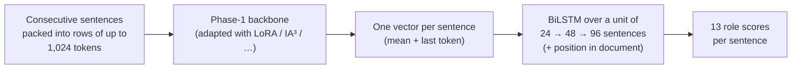

# Phase 3: Rhetorical Role Prediction

**Task.** Give every sentence of a judgment one of 13 rhetorical roles, such as Fact, Issue, ArgumentPetitioner,
Statute, PrecedentReliedUpon, RatioOfTheDecision or RulingByPresentCourt.
**Domains.** Two: Corporate Law (CL) and IT.
**Metric.** Macro-F1.
**Data.** 90 labelled judgments (18,987 sentences); the test set has **only 10 judgments**.

**Validation protocol.** With 10 test documents the leaderboard cannot separate close systems. Before training anything
we fixed a **5-fold document-level cross-validation (CV)** over the 90 labelled judgments, and every decision was made
on it. Results are cached per fold in a Hugging Face bucket, so later notebooks reuse earlier folds instead of retraining
them.

**Best score: 0.5418.** This is the MoE with IA³, 96-sentence context units and a sentence-position feature.

---

## The model

## The story, batch by batch

| Batch | Question | What we learned |
|---|---|---|
| **1** | One recipe, every technique, all five Phase-1 models; and one pooled model vs separate CL/IT models | MoE best; the techniques tie; separate models lose on CL, so **one pooled model** |
| **2** | Five notebooks in parallel: KD into GQA/LSTM, context study, separate domain models on the MoE, remaining techniques on the GQA | **Context is the lever.** More sentences per unit helped; a longer token window did not. The KD gain in CV was a leak and vanished on test. |
| **3** | Keep only strong backbones at 48-sentence units; ablate the MoE recipe | Context and the BiLSTM head carry the model; class weights hardly matter |
| **4** | A unit sees only part of a judgment, so add each sentence's **position** in the whole document; frozen-backbone controls | Position helps; a frozen MoE comes close to the tuned one |
| **5** | Last day: combine the winners and try the remaining ideas | Only longer units helped. Three seeds of one setup spread by 0.04 on test, which is larger than most differences. |

---

## Notebooks

Notebooks live in `notebooks/<folder>/`, and the folder names match the ones in `submissions/`, so a notebook and the zips it produced sit in the same-named folder. **Every folder has its own README** with a block diagram of the model, the setup and hyperparameters, and what the batch found; each `submissions/<folder>/` has a README listing its zips.

### Batch 1: every technique on every backbone
| Notebook | Backbone and setups |
|---|---|
| `batch1-every-technique/sweep-p3s-moe.ipynb` | **MoE**: full fine-tuning, LoRA, LoRMA, IA³ |
| `batch1-every-technique/sweep-p3s-gqa160.ipynb` | **GQA**: LoRA (pooled vs separate CL/IT), rsLoRA, LoRMA, QLoRA, AdaLoRA, prompt, prefix, IA³, full fine-tuning, frozen |
| `batch1-every-technique/sweep-p3s-mor.ipynb` | **LegalMoR**: LoRMA, LoRA, full fine-tuning |
| `batch1-every-technique/sweep-p3s-gdn.ipynb` | **GDN** encoder: LoRMA, LoRA, full fine-tuning, IA³ |
| `batch1-every-technique/sweep-p3s-lstm.ipynb` | **LSTM**: full fine-tuning, frozen backbone (it has no linear layers for LoRA-type methods) |

### Batch 2: five questions in parallel
| Notebook | Question |
|---|---|
| `batch2-kd-context-domains/sweep-p3s-kd-gqa160.ipynb` | **Knowledge distillation** MoE → GQA (teacher = MoE's held-out predictions; no test text) |
| `batch2-kd-context-domains/sweep-p3s-kd-lstm.ipynb` | KD MoE → LSTM |
| `batch2-kd-context-domains/sweep-p3s-moe-ctx.ipynb` | **Context study:** sentences alone, units of 12 / 48 sentences, 2,048-token window |
| `batch2-kd-context-domains/sweep-p3s-moe-typeb.ipynb` | Separate CL and IT models on the MoE ("Type B") |
| `batch2-kd-context-domains/sweep-p3s-gqa160-extra.ipynb` | Refit and submit QLoRA, AdaLoRA, prefix and prompt tuning on the GQA |

### Batch 3: strong backbones, longer context, ablations
| Notebook | What it does |
|---|---|
| `batch3-48-sentence-units-and-ablations/sweep-p3s-moe-s48.ipynb` | MoE techniques at 48-sentence units |
| `batch3-48-sentence-units-and-ablations/sweep-p3s-gqa160-s48.ipynb` | GQA techniques at 48-sentence units |
| `batch3-48-sentence-units-and-ablations/sweep-p3s-lstm-s48.ipynb` | LSTM at 48-sentence units |
| `batch3-48-sentence-units-and-ablations/sweep-p3s-moe-ablate.ipynb` | Ablations: linear head instead of BiLSTM, each sentence alone, no / inverse class weights |

### Batch 4: position feature and Phase-1 controls
| Notebook | What it does |
|---|---|
| `batch4-position-and-frozen/sweep-p3s-moe-pos.ipynb` | MoE + the sentence's position in the whole document |
| `batch4-position-and-frozen/sweep-p3s-gqa160-repr.ipynb` | GQA pooling variants (mean, last) and the position feature |
| `batch4-position-and-frozen/sweep-p3s-moe-frozen.ipynb` · `batch4-position-and-frozen/sweep-p3s-mor-frozen.ipynb` · `batch4-position-and-frozen/sweep-p3s-gdn-frozen.ipynb` | Frozen Phase-1 backbones with only the head trained: how useful are the Phase-1 representations on their own? |

### Batch 5: last day
| Notebook | What it does |
|---|---|
| `batch5-final-combinations/sweep-p3s-moe-combo1.ipynb` | LoRA variants: domain flag, inverse class weights, overlapping-window averaging, label smoothing, two extra seeds |
| `batch5-final-combinations/sweep-p3s-moe-combo2.ipynb` | IA³, rsLoRA, QLoRA, AdaLoRA and frozen, all with the position feature |
| `batch5-final-combinations/sweep-p3s-moe-long.ipynb` | **96- and 128-sentence units** (the final model) and the **random-initialisation control** |
| `batch5-final-combinations/sweep-p3s-kd-moe.ipynb` | Self-distillation from an ensemble of the five best MoE models |
| `batch5-final-combinations/p3s-ensemble-final.ipynb` | CPU only: greedy ensemble on CV, per-label bias check, error analysis (related roles, CL vs IT) and size/compute table |

---

## Submissions (`submissions/`), selected Codabench scores (10 test documents)

Submissions are grouped into **families** (one folder per batch of experiments, so the folders follow the story above):

| Folder in `submissions/` | What is inside | Files |
|---|---|---|
| `batch1-every-technique/` | Every technique on every backbone, one recipe | 15 |
| `batch2-kd-context-domains/` | Distillation, the context study, separate CL/IT models and the remaining GQA techniques | 14 |
| `batch3-48-sentence-units-and-ablations/` | Strong backbones at 48-sentence units, and the MoE ablations | 14 |
| `batch4-position-and-frozen/` | Sentence position feature, pooling variants and frozen-backbone controls | 8 |
| `batch5-final-combinations/` | Last day: combined recipes, 96/128-sentence units (final), self-distillation, ensemble | 22 |

| Submission | What it is | macro-F1 |
|---|---|---|
| `batch5-final-combinations/p3s_moe_long_pos_ia3_s96.zip` | **final**: MoE, IA³, 96-sentence units + position | **0.5418** |
| `batch4-position-and-frozen/p3s_moe_pos_pos_lora_s48.zip` | MoE, LoRA, 48 sentences + position | 0.5397 |
| `batch5-final-combinations/p3s_moe_combo2_pos_frozen.zip` | MoE **frozen**, only the head trained | 0.5376 |
| `batch5-final-combinations/p3s_moe_combo2_pos_qlora.zip` | MoE, QLoRA | 0.5274 |
| `batch5-final-combinations/p3s_ensemble_ens.zip` | greedy CV ensemble of 3 (best by CV) | 0.5184 |
| `batch2-kd-context-domains/p3s_moe_ctx_ctx_seq48.zip` | context study: 48-sentence units | 0.5128 |
| `batch1-every-technique/p3s_moe_lorma.zip` | batch 1, MoE LoRMA | 0.4879 |
| `batch3-48-sentence-units-and-ablations/p3s_gqa160_s48_full_ft_s48.zip` | best GQA | 0.4732 |
| `batch2-kd-context-domains/p3s_kd_gqa160_kd_full_ft.zip` | KD student (GQA) | 0.4631 |
| `batch3-48-sentence-units-and-ablations/p3s_lstm_s48_full_ft_s48.zip` | best LSTM | 0.4181 |
| `batch3-48-sentence-units-and-ablations/p3s_moe_ablate_abl_sentence_only.zip` | ablation: sentences alone, linear head | 0.4064 |
| `batch1-every-technique/p3s_mor_lora.zip` / `batch1-every-technique/submission_p3s_gdn_lorma.zip` | best MoR / GDN | 0.3486 / 0.3305 |
| `batch5-final-combinations/p3s_moe_long_rand_frozen_s48.zip` | **random-init control** (no Phase-1 weights) | 0.2584 |

**Key evidence:**
- **Phase-1 weights vs random initialisation:** 0.46 vs 0.26 (CV).
- **Context:** the score rises steadily from sentences read alone (0.441) to 128-sentence units (0.479) (CV).
- **Seed noise on test:** three seeds of one setup scored 0.4985 / 0.5209 / 0.5397.
