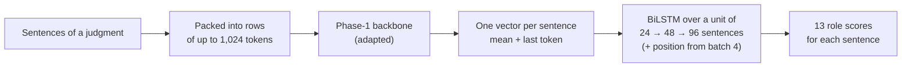

# Phase 3 · `batch1-every-technique`

**Question.** Which technique is best, on which of the five Phase-1 backbones, and should CL and IT have separate models? **Finding.** The MoE was best and the techniques tied. Separate CL/IT models lost on CL, so we kept **one pooled model**.

## Architecture

The pipeline all notebooks in this phase build on:

## Setup shared by these notebooks

- **Task framing:** every sentence of a judgment gets one of 13 roles. The Phase-1 backbone reads rows of up to 1,024 tokens, each row packing consecutive sentences; a sentence vector is the mean + last-token pooling of its tokens.
- **Head:** a BiLSTM over a *unit* of consecutive sentences (24 → 48 → 96 as batches progress), optionally with the sentence's position in the whole document.
- **Validation:** 5-fold document-level cross-validation over the 90 labelled judgments; every decision was made on it, and results are cached per fold.
- **Training:** AdamW (betas 0.9/0.98, weight decay 0.01), head learning rate 1e-3, backbone 3e-4 for PEFT and 3e-5 for full fine-tuning, 6% warm-up then linear decay, gradient clip 1.0, fp16, class weights (inverse square root of frequency). Hyperparameters are our placeholders and were not tuned.

## Notebooks in this folder

| Notebook | What it does |
|---|---|
| `sweep-p3s-gdn.ipynb` | **GDN** encoder: LoRMA, LoRA, full fine-tuning, IA³ |
| `sweep-p3s-gqa160.ipynb` | **GQA**: LoRA (pooled vs separate CL/IT), rsLoRA, LoRMA, QLoRA, AdaLoRA, prompt, prefix, IA³, full fine-tuning, frozen |
| `sweep-p3s-lstm.ipynb` | **LSTM**: full fine-tuning, frozen backbone (it has no linear layers for LoRA-type methods) |
| `sweep-p3s-moe.ipynb` | **MoE**: full fine-tuning, LoRA, LoRMA, IA³ |
| `sweep-p3s-mor.ipynb` | **LegalMoR**: LoRMA, LoRA, full fine-tuning |

Each notebook was run on Kaggle with "Run All" and is saved **with its outputs**, so the printed tables, curves and scores are the record of that run.

## Submissions produced

15 files in [`../../submissions/batch1-every-technique/`](../../submissions/batch1-every-technique/). See that folder's README for every file; the scores that the phase README lists are:

| File | What it is | Score |
|---|---|---|
| `p3s_moe_lorma.zip` | batch 1, MoE LoRMA | 0.4879 |
