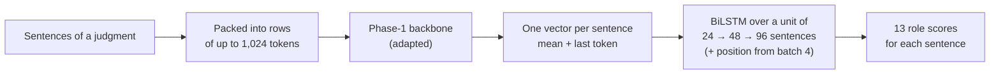

# Phase 3 · `batch2-kd-context-domains`

**Questions.** Does distillation help, how much does context matter, and are separate domain models better on the MoE? **Finding.** Context is the lever: more sentences per unit helped, a longer token window did not. The KD gain in CV was a leak and vanished on test.

## Architecture

The pipeline all notebooks in this phase build on:

## Setup shared by these notebooks

- **Task framing:** every sentence of a judgment gets one of 13 roles. The Phase-1 backbone reads rows of up to 1,024 tokens, each row packing consecutive sentences; a sentence vector is the mean + last-token pooling of its tokens.
- **Head:** a BiLSTM over a *unit* of consecutive sentences (24 → 48 → 96 as batches progress), optionally with the sentence's position in the whole document.
- **Validation:** 5-fold document-level cross-validation over the 90 labelled judgments; every decision was made on it, and results are cached per fold.
- **Training:** AdamW (betas 0.9/0.98, weight decay 0.01), head learning rate 1e-3, backbone 3e-4 for PEFT and 3e-5 for full fine-tuning, 6% warm-up then linear decay, gradient clip 1.0, fp16, class weights (inverse square root of frequency). Hyperparameters are our placeholders and were not tuned.

## Notebooks in this folder

| Notebook | What it does |
|---|---|
| `sweep-p3s-gqa160-extra.ipynb` | Refit and submit QLoRA, AdaLoRA, prefix and prompt tuning on the GQA |
| `sweep-p3s-kd-gqa160.ipynb` | **Knowledge distillation** MoE → GQA (teacher = MoE's held-out predictions; no test text) |
| `sweep-p3s-kd-lstm.ipynb` | KD MoE → LSTM |
| `sweep-p3s-moe-ctx.ipynb` | **Context study:** sentences alone, units of 12 / 48 sentences, 2,048-token window |
| `sweep-p3s-moe-typeb.ipynb` | Separate CL and IT models on the MoE ("Type B") |

Each notebook was run on Kaggle with "Run All" and is saved **with its outputs**, so the printed tables, curves and scores are the record of that run.

## Submissions produced

14 files in [`../../submissions/batch2-kd-context-domains/`](../../submissions/batch2-kd-context-domains/). See that folder's README for every file; the scores that the phase README lists are:

| File | What it is | Score |
|---|---|---|
| `p3s_kd_gqa160_kd_full_ft.zip` | KD student (GQA) | 0.4631 |
| `p3s_moe_ctx_ctx_seq48.zip` | context study: 48-sentence units | 0.5128 |
