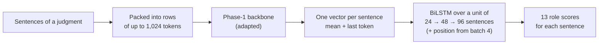

# Phase 3 · `batch3-48-sentence-units-and-ablations`

**Question.** With 48-sentence units, which backbones and techniques remain, and which parts of the MoE recipe matter? **Finding.** Context and the BiLSTM head carry the model; class weights hardly matter.

## Architecture

The pipeline all notebooks in this phase build on:

## Setup shared by these notebooks

- **Task framing:** every sentence of a judgment gets one of 13 roles. The Phase-1 backbone reads rows of up to 1,024 tokens, each row packing consecutive sentences; a sentence vector is the mean + last-token pooling of its tokens.
- **Head:** a BiLSTM over a *unit* of consecutive sentences (24 → 48 → 96 as batches progress), optionally with the sentence's position in the whole document.
- **Validation:** 5-fold document-level cross-validation over the 90 labelled judgments; every decision was made on it, and results are cached per fold.
- **Training:** AdamW (betas 0.9/0.98, weight decay 0.01), head learning rate 1e-3, backbone 3e-4 for PEFT and 3e-5 for full fine-tuning, 6% warm-up then linear decay, gradient clip 1.0, fp16, class weights (inverse square root of frequency). Hyperparameters are our placeholders and were not tuned.

## Notebooks in this folder

| Notebook | What it does |
|---|---|
| `sweep-p3s-gqa160-s48.ipynb` | GQA techniques at 48-sentence units |
| `sweep-p3s-lstm-s48.ipynb` | LSTM at 48-sentence units |
| `sweep-p3s-moe-ablate.ipynb` | Ablations: linear head instead of BiLSTM, each sentence alone, no / inverse class weights |
| `sweep-p3s-moe-s48.ipynb` | MoE techniques at 48-sentence units |

Each notebook was run on Kaggle with "Run All" and is saved **with its outputs**, so the printed tables, curves and scores are the record of that run.

## Submissions produced

14 files in [`../../submissions/batch3-48-sentence-units-and-ablations/`](../../submissions/batch3-48-sentence-units-and-ablations/). See that folder's README for every file; the scores that the phase README lists are:

| File | What it is | Score |
|---|---|---|
| `p3s_gqa160_s48_full_ft_s48.zip` | best GQA | 0.4732 |
| `p3s_lstm_s48_full_ft_s48.zip` | best LSTM | 0.4181 |
| `p3s_moe_ablate_abl_sentence_only.zip` | ablation: sentences alone, linear head | 0.4064 |
