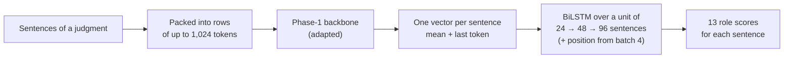
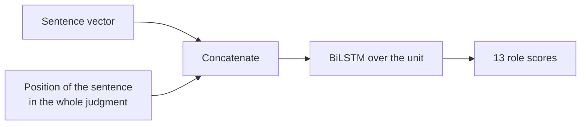

# Phase 3 · `batch4-position-and-frozen`

**Question.** A unit sees only part of a judgment, so does adding each sentence's **position** in the whole document help, and how useful are the Phase-1 representations alone? **Finding.** Position helps, and a frozen MoE with only the head trained comes close to the tuned one.

## Architecture

The pipeline all notebooks in this phase build on:

What batch 4 adds: the position of each sentence in the whole document.

## Setup shared by these notebooks

- **Task framing:** every sentence of a judgment gets one of 13 roles. The Phase-1 backbone reads rows of up to 1,024 tokens, each row packing consecutive sentences; a sentence vector is the mean + last-token pooling of its tokens.
- **Head:** a BiLSTM over a *unit* of consecutive sentences (24 → 48 → 96 as batches progress), optionally with the sentence's position in the whole document.
- **Validation:** 5-fold document-level cross-validation over the 90 labelled judgments; every decision was made on it, and results are cached per fold.
- **Training:** AdamW (betas 0.9/0.98, weight decay 0.01), head learning rate 1e-3, backbone 3e-4 for PEFT and 3e-5 for full fine-tuning, 6% warm-up then linear decay, gradient clip 1.0, fp16, class weights (inverse square root of frequency). Hyperparameters are our placeholders and were not tuned.

## Notebooks in this folder

| Notebook | What it does |
|---|---|
| `sweep-p3s-gdn-frozen.ipynb` | Frozen Phase-1 backbones with only the head trained: how useful are the Phase-1 representations on their own? |
| `sweep-p3s-gqa160-repr.ipynb` | GQA pooling variants (mean, last) and the position feature |
| `sweep-p3s-moe-frozen.ipynb` | Frozen Phase-1 backbones with only the head trained: how useful are the Phase-1 representations on their own? |
| `sweep-p3s-moe-pos.ipynb` | MoE + the sentence's position in the whole document |
| `sweep-p3s-mor-frozen.ipynb` | Frozen Phase-1 backbones with only the head trained: how useful are the Phase-1 representations on their own? |

Each notebook was run on Kaggle with "Run All" and is saved **with its outputs**, so the printed tables, curves and scores are the record of that run.

## Submissions produced

8 files in [`../../submissions/batch4-position-and-frozen/`](../../submissions/batch4-position-and-frozen/). See that folder's README for every file; the scores that the phase README lists are:

| File | What it is | Score |
|---|---|---|
| `p3s_moe_pos_pos_lora_s48.zip` | MoE, LoRA, 48 sentences + position | 0.5397 |
