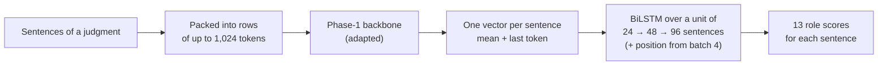

# Phase 3 · `batch5-final-combinations`

**Question.** Do the winners combine, and does any remaining idea help? **Finding.** Only longer units helped (96 sentences, the final model). Three seeds of one setup spread by 0.04 on test, larger than most differences. The random-initialisation control (0.26 vs 0.46 in CV) shows the Phase-1 weights matter.

## Architecture

The pipeline all notebooks in this phase build on:

## Setup shared by these notebooks

- **Task framing:** every sentence of a judgment gets one of 13 roles. The Phase-1 backbone reads rows of up to 1,024 tokens, each row packing consecutive sentences; a sentence vector is the mean + last-token pooling of its tokens.
- **Head:** a BiLSTM over a *unit* of consecutive sentences (24 → 48 → 96 as batches progress), optionally with the sentence's position in the whole document.
- **Validation:** 5-fold document-level cross-validation over the 90 labelled judgments; every decision was made on it, and results are cached per fold.
- **Training:** AdamW (betas 0.9/0.98, weight decay 0.01), head learning rate 1e-3, backbone 3e-4 for PEFT and 3e-5 for full fine-tuning, 6% warm-up then linear decay, gradient clip 1.0, fp16, class weights (inverse square root of frequency). Hyperparameters are our placeholders and were not tuned.

## Notebooks in this folder

| Notebook | What it does |
|---|---|
| `p3s-ensemble-final.ipynb` | CPU only: greedy ensemble on CV, per-label bias check, error analysis (related roles, CL vs IT) and size/compute table |
| `sweep-p3s-kd-moe.ipynb` | Self-distillation from an ensemble of the five best MoE models |
| `sweep-p3s-moe-combo1.ipynb` | LoRA variants: domain flag, inverse class weights, overlapping-window averaging, label smoothing, two extra seeds |
| `sweep-p3s-moe-combo2.ipynb` | IA³, rsLoRA, QLoRA, AdaLoRA and frozen, all with the position feature |
| `sweep-p3s-moe-long.ipynb` | **96- and 128-sentence units** (the final model) and the **random-initialisation control** |

Each notebook was run on Kaggle with "Run All" and is saved **with its outputs**, so the printed tables, curves and scores are the record of that run.

## Submissions produced

22 files in [`../../submissions/batch5-final-combinations/`](../../submissions/batch5-final-combinations/). See that folder's README for every file; the scores that the phase README lists are:

| File | What it is | Score |
|---|---|---|
| `p3s_ensemble_ens.zip` | greedy CV ensemble of 3 (best by CV) | 0.5184 |
| `p3s_moe_combo2_pos_frozen.zip` | MoE **frozen**, only the head trained | 0.5376 |
| `p3s_moe_combo2_pos_qlora.zip` | MoE, QLoRA | 0.5274 |
| `p3s_moe_long_pos_ia3_s96.zip` | **final**: MoE, IA³, 96-sentence units + position | 0.5418 |
| `p3s_moe_long_rand_frozen_s48.zip` | **random-init control** (no Phase-1 weights) | 0.2584 |
