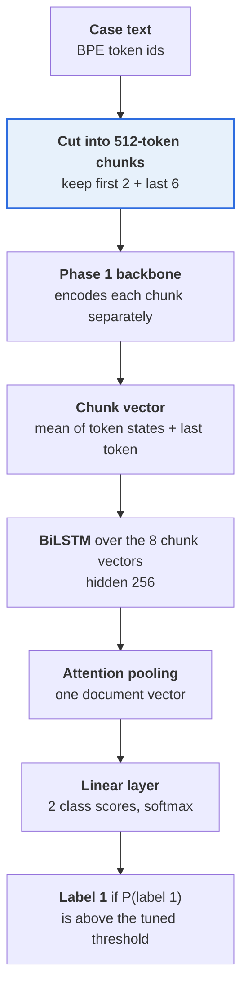
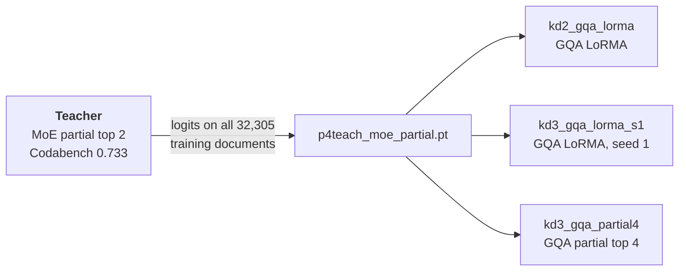
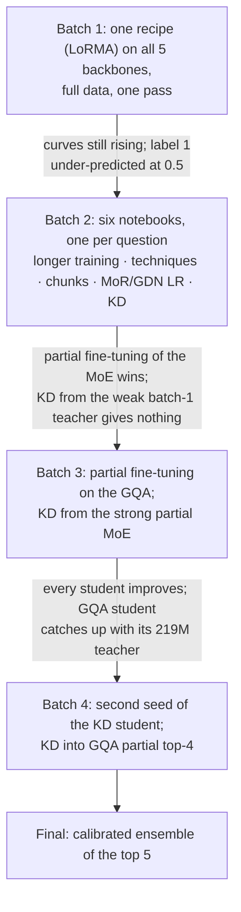
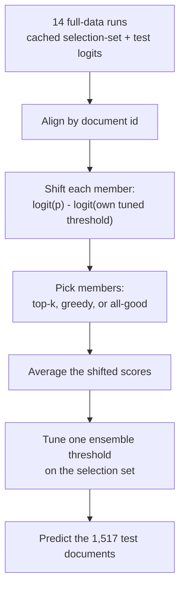

# Phase 4: Court Judgment Prediction (CJPE)

**Task.** Read an Indian Supreme Court case and predict its outcome (binary: 0 or 1).
**Metric.** Macro-F1 (the average of the F1 for class 0 and class 1). The official script also prints precision and recall of label 1.
**Data.** 37,387 training records (32,305 unique documents); test = 1,517 documents.

**Validation protocol.** All test documents also appear in `dev.json`, so we never used them. Every choice (epoch,
threshold, ensemble member) was made on the other **994 dev documents** (the "selection set", 497 per class).
Part-way through the project the course changed `dev.json` to hold only those 994 documents (1,988 records), so the
selection set stayed the same and all numbers stay comparable. After that change Codabench was the only test score.

**Best score: 0.7547.** This is a calibrated ensemble of five models: the MoE with partial fine-tuning and four GQA
models, three of them knowledge-distillation students. The best single model scored **0.7451**.

---

## The problem, and why it is hard

- **Long documents.** The median case is about 3,000 tokens and the longest are over 11,000. The Phase 1 decoders read at most 2,048 tokens per call, so a case has to be cut into pieces.
- **The order is usually missing.** The texts mostly stop before the court's operative order: 73.5% of selection-set documents contain no outcome phrase near the end. The model has to infer the outcome from the facts and the reasoning, not read it off the page.
- **Misleading words.** "Allowed" and "dismissed" often describe the *lower* court's decision.
- **Small tuning set.** Only 994 documents are available for choosing epochs, thresholds and members, so every selection-set score is slightly optimistic (by about 0.01 to 0.03 compared with Codabench).

---

## The model

Each case is read as 512-token chunks: the first 2 and the last 6, so 8 chunks and about 4,096 tokens. The Phase 1
backbone encodes every chunk. A BiLSTM with attention pooling combines the chunk vectors into one document vector, and
a linear layer gives the outcome. Because the models were miscalibrated, each run's decision threshold is tuned on the
selection set.



### The steps in detail

Settings are from the notebooks: `WINDOW=512`, `STRIDE=512`, `MAX_CHUNKS=8`, `SELECT="head_tail"`, `HEAD_CHUNKS=2`,
`POOL="mean+last"`, `DOC_HEAD="bilstm"`, `HEAD_LSTM_HIDDEN=256`, `HEAD_DROPOUT=0.1`.

1. **Tokenise.** The Phase 1 BPE tokenizer turns the text into ids. A document over 65,536 tokens keeps its first and last 32,768 (this rarely matters).
2. **Cut into chunks.** Consecutive 512-token spans with no overlap. If the last span would be short, it is shifted to end exactly at the document's end, so the final chunk is always a full 512 tokens. A document of 512 tokens or fewer is one chunk.
3. **Pick 8 chunks (`head_tail`).** If a document has 8 or fewer chunks, all are kept. Otherwise the **first 2 chunks and the last 6 chunks** are kept (about 1,024 + 3,072 tokens) and the middle is dropped. "2" and "6" count **chunks**, not tokens.
4. **Encode each chunk separately.** Each chunk is one backbone row. Every token position gets a hidden state (768-d).
5. **Chunk vector (`mean+last`).** The mean of the chunk's token states, concatenated with the state of the chunk's last token. In a causal model the last position has seen the whole chunk. This is the same pooling idea as Phase 3's sentence vectors.
6. **BiLSTM over the chunk vectors.** Chunks play the role that sentences played in Phase 3: chunk 5 can see chunks 4 and 6.
7. **Attention pooling.** A learned weighted average over the 8 BiLSTM outputs gives one document vector. (The standard form is a score per chunk, a softmax over chunks, and a weighted sum; the exact formula was not re-read from the code.)
8. **Linear layer, 2 class scores.** Softmax gives P(label 1). The loss is cross-entropy with `inv_sqrt` class weights (cap 10); the weights made almost no difference in the ablation.

### Context length: 512 is a choice, not a limit

The Phase 1 decoders have a **2,048-token context**, so 512-token chunks are a design choice. The likely reason is memory and
speed on a T4 (the runs peaked at 1.3 to 3 GB), but no reason is recorded and 2,048-token chunks were never tested. The
chunk ablations show that the *end* of the judgment matters, not that 512 is the best chunk size.

### Training recipe (base settings)

Micro-batch 1 with gradient accumulation 16, AdamW, fp16. Backbone learning rate by technique (partial 1e-4, LoRMA 3e-4),
head learning rate 1e-3. An "epoch" is 8,000 documents drawn from the shuffled training set, so 12 epochs = 3 passes
over the 32,305 documents. The epoch and threshold are chosen on the selection set. Hyper-parameter values were proposed
by the assistant and not tuned.

---

## Concepts used in this phase

### Threshold tuning (calibration)

The model outputs p = P(label 1). The default rule "predict 1 if p ≥ 0.5" under-predicted label 1: at 0.5, recall of
label 1 was 0.36 to 0.58 with precision 0.83 to 0.89, and false negatives outnumbered false positives 4 to 7 times. The
fix is to pick the threshold that maximises macro-F1 on the selection set. The tuned thresholds were 0.20 to 0.40.

The cost is optimism: the same 994 documents choose both the epoch and the threshold, so the selection-set F1 sits about
0.01 to 0.03 above the Codabench score. We report both.

**A batch 1 mistake, fixed.** Batch 1 selected epochs by F1 at 0.5. Because of the under-prediction, that kept the *worst*
epochs. From batch 2 on, epochs are chosen with the tuned threshold.

### Class-weighted cross-entropy

```math
L = -\,w_y\,\big[\,y \log p + (1-y)\log(1-p)\,\big]
```

### Partial fine-tuning, "top k"

The backbone is a stack of transformer blocks. Freeze the embeddings and all but the top *k* blocks; train the top *k*
blocks, the backbone's final modules, and the new head. A "layer" here is a whole block (attention, feed-forward and
norms), not just attention. In the code (`apply_technique`, branch `partial`) every backbone parameter is frozen, then
the last `k` blocks and the final modules are unfrozen, and the head is always trainable.

The backward pass stops at the lowest unfrozen block, so it is faster and uses less memory (MoE partial trains 1.7× faster
than MoE LoRMA).

| Backbone | Head only | Top 2 | Top 4 | Per block (derived) |
|---|---|---|---|---|
| GQA 111M | 3.7M | 16.1M | 28.6M | about 6.2M |
| MoE 219M | 3.7M | 46.9M | 90.0M | about 21.6M |

The MoE block is larger because its feed-forward holds many experts. The per-block figure is derived from the logged
parameter counts, not read from code.

### LoRMA

The low-rank adapter family (rank 16, alpha 32, variant "plus"). About 4.2M trained parameters: 1.94% of the MoE and 3.8%
of the GQA.

### Knowledge distillation (KD)

The student trains on the true label and on the teacher's soft probabilities, with α = 0.5 and temperature T = 2:

```math
L = (1-\alpha)\,\mathrm{CE}(y, p_s) + \alpha\, T^2\, \mathrm{KL}\!\big(\mathrm{softmax}(z_t/T)\,\big\|\,\mathrm{softmax}(z_s/T)\big)
```

Soft targets tell the student how sure the teacher was, which a hard label cannot. The teacher's logits are computed on
its *own* training documents, so they are over-confident; they still helped. (The loss is the standard form; it was not
re-read from the code.)



### Calibrated score averaging (the ensemble)

Each member has its own best threshold t<sub>m</sub>. Shift each member's logit so that threshold sits at 0, average the
shifted scores, and tune one threshold for the ensemble on the selection set:

```math
s_m = \mathrm{logit}(p_m) - \mathrm{logit}(t_m), \qquad s = \frac{1}{M}\sum_{m=1}^{M} s_m
```

This is **not** voting. Voting counts only each model's hard 0/1 decision and throws away its confidence; averaging keeps
confidence, and the shift puts differently calibrated members on one scale. (The formula is from the Round 3 notes; the
notebook cell with that exact line was cut off when it was read.)

### Noise yardsticks

One standard error of macro-F1 on 1,517 documents is about **0.013**. Run-to-run variance for identical settings (seed
only) is about **0.008**. Differences below about 0.03 between near-identical MoE configurations (one seed each) should be
read as noise.

---

## The story



| Stage | Best Codabench at that stage | What changed |
|---|---|---|
| Batch 1 | 0.630 (MoE LoRMA, one pass) | one recipe on every backbone |
| Batch 2 | 0.733 (MoE partial fine-tuning) | longer training, partial fine-tuning |
| Batch 3 | 0.737 (GQA LoRMA + KD) | KD from the strong teacher |
| Batch 4 | 0.745 (same recipe, seed 1) | a second seed |
| Final | **0.7547** (top5 ensemble) | calibrated averaging |

The biggest single jump (+0.10) came before any distillation. The ensemble's gain over the best single model is about
+0.01, close to seed noise.

---

## Notebooks

Notebooks live in `notebooks/<folder>/`, and the folder names match the ones in `submissions/`, so a notebook and the zips it produced sit in the same-named folder. **Every folder has its own README** with a block diagram of the model, the setup and hyper-parameters, and what the batch found; each `submissions/<folder>/` has a README listing its zips.

### Batch 1: one recipe on every Phase-1 model (full data, one pass)

**Question.** Which Phase 1 backbone transfers best? Each got LoRMA, full data, one pass (4 epochs of 8,000 documents).
The LSTM got full fine-tuning because it has no linear layers inside its recurrence for LoRMA to attach to.

| Notebook | What it does | Trainable | Codabench (tuned threshold) |
|---|---|---|---|
| `batch1-every-backbone/p4-moe.ipynb` | MoE + LoRMA. Also the first KD teacher. | 4.24M | 0.6263 |
| `batch1-every-backbone/p4-gqa.ipynb` | GQA + LoRMA | 4.24M | 0.5997 |
| `batch1-every-backbone/p4-lstm.ipynb` | LSTM, full fine-tuning (no linear layers for LoRMA) | 89.6M | 0.5608 |
| `batch1-every-backbone/p4-gdn.ipynb` | GDN encoder + LoRMA | 4.63M | 0.5483 |
| `batch1-every-backbone/p4-mor.ipynb` | LegalMoR + LoRMA (stayed at chance) | 4.05M | 0.3910 |

**What batch 1 showed:**
- Every learning curve was still rising, so one pass is too short.
- At a 0.5 threshold the models under-predicted label 1, so selecting epochs at 0.5 had kept the *worst* epoch (the saved MoE and GQA checkpoints were earlier, weaker epochs).

From here on, epochs and thresholds are chosen with the threshold tuned on the selection set.

### Batch 2: six notebooks in parallel, one per open question

| Notebook | Question | Answer |
|---|---|---|
| `batch2-open-questions/p4-moe-full.ipynb` | Does longer training (12 × 8,000 documents = 3 passes) with threshold-tuned selection help? | Yes: 0.630 → 0.682. Gains stop near epoch 7 while the train loss keeps falling (0.23): memorisation. |
| `batch2-open-questions/p4-moe-tech.ipynb` | Seven techniques on a 4,000-document subset. | **Partial fine-tuning of the top 2 MoE layers** wins and is promoted to full data: **0.7330**. |
| `batch2-open-questions/p4-moe-ablate.ipynb` | Which chunks matter, which head, class weighting, is Phase 1 needed? | The end of the judgment; head and weights barely matter; Phase 1 is needed. |
| `batch2-open-questions/p4-mor-lr.ipynb` | Why did MoR not learn? Higher learning rates, full and partial fine-tuning. | Nothing helped. Best 0.5184. |
| `batch2-open-questions/p4-gdn-lr.ipynb` | The same question for the GDN. | Best 0.5451. |
| `batch2-open-questions/p4-kd-gqa.ipynb` | **Knowledge distillation** from the batch-1 MoE into the GQA, beside a no-KD control. | No benefit (below). |

**Technique sweep on the 4,000-document subset** (MoE, tuned F1 on the selection set):

| Setup | Trainable | Tuned F1 | Note |
|---|---|---|---|
| partial (top 2) | 46.9M (21.4%) | 0.656 | best; 2.0 GB |
| full fine-tuning | 191.7M | 0.652 | unstable, best epoch 2 of 5, 5.2 GB |
| Houlsby adapters | 5.3M | 0.635 | |
| LoRMA | 4.2M | 0.633 | |
| frozen (head only) | 3.7M | 0.614 | |
| AdaLoRA | 4.7M | 0.613 | |
| BitFit | 4.0M | 0.611 | |

On 4,000 documents the head on frozen Phase 1 features already does most of the work, and updating more parameters wins.
Training-set size matters more than technique: MoE partial went from 0.632 (4,000 documents) to 0.733 (32,305
documents), worth about +0.10.

**Chunk and head ablations** (mostly 4 chunks of 512 tokens, subset):
- The **last chunk alone** matches any multi-chunk choice (Codabench 0.614). The first four chunks alone are far worse (they predict a constant). The end of the judgment carries the signal.
- 8 chunks, 4 chunks and 1 chunk are about equal at this budget; overlap and uniform sampling add nothing.
- The head (BiLSTM, mean, attention) and class weights differ by at most 0.005 on the selection set: no reliable effect.
- **Phase 1 transfer:** a randomly initialised MoE reaches 0.533 tuned F1, against 0.631 with the Phase 1 weights.
- These tests used 512-token chunks. They show the end matters, not that 512 is optimal.

**MoR and GDN.** Training loss stayed at 0.67 to 0.69 (chance is ln 2 = 0.693) and the predictions were constant. The
Phase 1 language-model loss on the case text is high for them (MoR 6.01 nats, GDN 4.47, MoE 3.81), so the Phase 1
backbones are the likely cause; this was not tested. We report that MoR and GDN do not transfer to CJPE in our setup.

**KD from the weak teacher.** The batch-1 MoE teacher scored 0.630. The GQA LoRMA student scored 0.685 with KD and 0.693
without it. The difference of −0.008 is inside one standard error: no benefit.

**What batch 2 showed:**
- Partial fine-tuning won (0.733).
- The end of the judgment carries most of the signal.
- MoR and GDN stayed far behind.
- With 3 passes the 111M GQA LoRMA (0.693) beat the 219M MoE LoRMA (0.682) at 2.5× the speed and half the memory, so the batch 1 ranking was an artefact of under-training.

### Batch 3: follow both leads

| Notebook | What it does |
|---|---|
| `batch3-partial-ft-and-strong-teacher/p4-moe-partial2.ipynb` | Rebuilds the partially fine-tuned MoE from its saved weights (it reproduced its dev scores exactly: 0.7233 at 0.5, 0.7523 tuned), runs it over all 32,305 training documents and saves its logits (about 26 minutes): the **strong teacher file** `p4teach_moe_partial.pt`. Also trains partial top-2 / top-4 variants with 4 or 8 chunks. |
| `batch3-partial-ft-and-strong-teacher/p4-gqa-partial.ipynb` | Partial fine-tuning (top 2 and top 4) and full fine-tuning on the GQA |
| `batch3-partial-ft-and-strong-teacher/p4-kd-gqa2.ipynb` | KD from the strong MoE teacher into GQA LoRMA (**0.7370**) and GQA partial top-2, each beside a no-KD control |

**MoE variants (Codabench):** top 4 with 4 chunks 0.716; top 2 with 4 chunks 0.703; top 4 with 8 chunks 0.697; the earlier
top 2 with 8 chunks 0.733. Nothing beats top 2 with 8 chunks, and differences below about 0.03 between near-identical
configurations look like noise (one seed each).

**GQA partial fine-tuning (Codabench):**

| Run | Trainable | Codabench | Peak memory |
|---|---|---|---|
| partial top 4 | 28.6M | 0.708 | 1.32 GB |
| LoRMA (from batch 2) | 4.2M | 0.693 | 1.31 GB |
| partial top 2 | 16.1M | 0.692 | 0.89 GB |
| full fine-tuning | 84.1M | 0.689 | 2.57 GB |

More unfrozen layers helps a little on the GQA; full fine-tuning is no better than the parameter-efficient methods.

**Strong-teacher KD (teacher = MoE partial, 0.733):**

| Student | No KD | With KD | Gain |
|---|---|---|---|
| GQA LoRMA | 0.693 | 0.737 | +0.044 |
| GQA partial top 2 | 0.692 | 0.727 | +0.035 |

Both gains are about three standard errors, so they are real; the weak-teacher result was noise. The LoRMA student trains
4.2M parameters on a 111M backbone against the teacher's 46.9M on 219M. It trains 1.6× faster, infers 1.5× faster and uses
0.66× the memory, and it **matches** its teacher (0.737 against 0.733, within noise).

### Batch 4: seed noise and more ensemble members

| Notebook | What it does |
|---|---|
| `batch4-seed-and-partial4-student/p4-kd-gqa3.ipynb` | The best KD run repeated with a second seed, and KD into GQA partial top-4 (the best single model on the selection set) |

| Run | Setup | Training | Selection-set F1 | Codabench |
|---|---|---|---|---|
| `kd3_gqa_lorma_s1` | LoRMA + KD, seed 1 | 12 × 8,000 documents | 0.7473 | **0.7451** |
| `kd3_gqa_partial4` | partial top 4 + KD | 8 × 8,000 documents | **0.7643** | 0.7382 |

- **Seed noise.** The same configuration with seed 0 scored 0.737 and with seed 1 scored 0.745 (selection-set scores identical, 0.7475 and 0.7473), so seed variance is about 0.008, well below the KD gain of 0.03 to 0.05.
- **Partial top 4 + KD** has the best selection-set score of any run (0.764) but only 0.738 on Codabench: the largest selection-to-Codabench gap among the KD runs (0.026), a sign of over-fitting the 994 documents. It trains in half the time of the LoRMA student (94 against 182 minutes) and infers 15% faster.
- **KD helps every student tried:** LoRMA (+0.044, and +0.052 with seed 1), partial top 2 (+0.035), partial top 4 (+0.030, from 0.708).

**The teacher of the three final KD students.** All three (`kd2_gqa_lorma`, `kd3_gqa_lorma_s1`, `kd3_gqa_partial4`) were
distilled from the MoE partial (top 2) model. The weaker batch 2 KD run (`kd_gqa_lorma`, 0.685) used the batch-1 MoE LoRMA
teacher and is not in the final ensemble. For `kd2_gqa_lorma` the teacher is stated in the notes, not checked in the
notebook settings.

### Analysis and final ensemble (CPU only, nothing retrained)

| Notebook | What it does |
|---|---|
| `final-ensembles/phase-4-error-analysis.ipynb` | Confusion at tuned thresholds, F1 by document length, outcome phrases near the end, where the attention looks, model disagreement |
| `final-ensembles/phase-4-final-ensemble.ipynb` | Shifts each member so its own tuned threshold sits at 0, averages, and tunes the ensemble threshold. It checks honestly by choosing on one half of the selection set and scoring the other. |



**The honest check.** Members and threshold are chosen on a random half of the selection set and scored on the other
half, 20 times. This addresses the optimism problem.

| Ensemble | Members | Honest F1 (half-split) |
|---|---|---|
| **top5 (final)** | `kd3_gqa_partial4`, MoE partial (`t_partial__full`), `kd2_gqa_lorma`, `kd3_gqa_lorma_s1`, `gqa_partial4` | **0.771** |
| top3 | `kd3_gqa_partial4`, MoE partial, `kd2_gqa_lorma` | 0.767 |
| greedy | `kd3_gqa_partial4`, MoE partial, `kd3_gqa_lorma_s1` | 0.760 |
| all 14 | every member | 0.760 |
| best single | `kd3_gqa_partial4` | 0.740 |

- Averaging gains about **+0.03** under the honest check.
- A few strong, different members beat the greedy search (it over-fits the half it is chosen on) and beat averaging all 14 (weak members dilute).
- Selection rules in the notebook: top *k* by selection-set F1; greedy adds a member only if the tuned F1 improves by more than 0.002 (up to 6 members); "all good" keeps members whose own F1 is at least 0.69.
- The Codabench scores of top3, greedy and all-good were marked pending in the notes; top5 scored **0.7547**.
- **Caveat.** top5 contains the teacher plus three of its students, so the members are not independent. The Codabench gain over the best single model is about +0.01 (0.7451 → 0.7547).

---

## What the error analysis found

(Selection set, each model at its own tuned threshold.)

- **Confusion.** With a tuned threshold the errors are balanced (FP ≈ FN). At 0.5 the same models had 4 to 7 times more false negatives than false positives. KD cuts false positives most (GQA LoRMA: 164 → 127).
- **Length.** Documents that fit in the 4,096 tokens read score 0.756; longer ones score 0.732. The weakest models lose most on the longest quartile, and KD removes most of that drop (GQA LoRMA 0.637 → 0.727). The MoE partial model is the most uniform across lengths (0.743 to 0.758).
- **Outcome phrases near the end.** "Set aside", "quashed" and "remanded" are strong label-1 cues (the model is right 87 to 89% of the time). "Allowed" and "dismissed" are ambiguous (label-1 rates 0.60 and 0.33) because they often describe the lower court's decision. "Disposed of" and "partly" are the hardest (error 0.38 and 0.50, few documents).
- **Attention by position.** Weight rises toward the end of the judgment: the last 10% gets 1.7× uniform weight on correct predictions but only 1.34× on errors, where attention is flatter. This agrees with the chunk ablation.
- **Disagreement.** The models disagree on 16 to 27% of documents, and all 7 compared models are wrong together on only 5.7%, so there is large headroom for combination.
- **Failure themes.** (a) Outcome words that refer to the lower court. (b) Negated reasoning ("not right in dismissing"). (c) Endings on procedure or statutory interpretation with no outcome cue. (d) Long documents whose middle is never read.

---

## Submissions (`submissions/`)

Submissions are grouped into **families** (one folder per batch of experiments, so the folders follow the story above):

| Folder in `submissions/` | What is inside | Files |
|---|---|---|
| `batch1-every-backbone/` | One recipe (LoRMA) on every Phase-1 model | 10 |
| `batch2-open-questions/` | Longer training, techniques, chunk ablations, MoR/GDN learning rates, first KD | 20 |
| `batch3-partial-ft-and-strong-teacher/` | Partial fine-tuning on GQA, KD from the strong MoE teacher | 8 |
| `batch4-seed-and-partial4-student/` | Second seed of the best KD student, KD into GQA partial top-4 | 2 |
| `final-ensembles/` | The calibrated ensembles (top5 is the final) | 5 |
| `examples/` | An unzipped prediction file, to show the format | 1 |

Each training notebook writes two zips per setup: `_thr05` (threshold 0.5) and `_tuned` (threshold tuned on the
selection set).

| Submission | What it is | macro-F1 |
|---|---|---|
| `final-ensembles/p4_ensemble_top5.zip` | **final**: MoE partial + GQA partial-4 (with and without KD) + two GQA LoRMA KD students | **0.7547** |
| `batch4-seed-and-partial4-student/p4_kd_gqa3_kd3_gqa_lorma_s1_tuned.zip` | GQA LoRMA KD student, second seed (best single model) | 0.7451 |
| `batch4-seed-and-partial4-student/p4_kd_gqa3_kd3_gqa_partial4_tuned.zip` | GQA partial top-4 KD student | 0.7382 |
| `batch3-partial-ft-and-strong-teacher/p4_kd_gqa2_kd2_gqa_lorma_tuned.zip` | GQA LoRMA KD student (strong teacher) | 0.7370 |
| `batch2-open-questions/p4_moe_tech_t_partial__full_tuned.zip` | MoE partial top-2, full data (the teacher) | 0.7330 |
| `batch2-open-questions/p4_kd_gqa_kd_gqa_lorma_tuned.zip` | GQA LoRMA KD student (weak batch-1 teacher) | 0.6849 |
| `batch1-every-backbone/p4_moe_moe_lorma_thr05.zip` | batch-1 MoE LoRMA | 0.6301 |

The other ensemble zips are `top3`, `greedy`, `all_good` and `best_single`.

`examples/prediction_unzipped_example.json` is an unzipped prediction file (1,517 test documents).

---

## Numbers to remember

| Item | Value |
|---|---|
| Data | 32,305 unique training documents; 1,517 test; 994 selection set |
| Chunking | 8 chunks × 512 tokens (first 2 + last 6), about 4,096 tokens |
| Pooling and head | mean + last token; BiLSTM hidden 256; attention; 2-way linear |
| Final submission | calibrated top5 ensemble, Codabench **0.7547** (honest half-split estimate 0.771) |
| Best single model | GQA LoRMA + KD, seed 1: **0.7451** (seed 0: 0.7370) |
| Teacher | MoE partial fine-tuning, top 2 blocks: 0.733 (46.9M trained of 219M) |
| Student | GQA LoRMA: 4.2M trained of 111M |
| Tuned thresholds | 0.20 to 0.40 (the default 0.5 under-predicts label 1) |
| Standard error of macro-F1 (1,517 documents) | about 0.013 |
| Seed variance, identical settings | about 0.008 |
| Training-set size effect | MoE partial 0.632 (4,000 documents) → 0.733 (32,305 documents) |
| Phase 1 transfer | random-init MoE 0.533 against 0.631 with Phase 1 weights (subset) |

---

## FAQs

**Why 512-token chunks if the context is 2,048?** A practical choice, probably memory and speed on a T4. It was not tested
against longer chunks. The ablation shows the end of the judgment matters, not that 512 is optimal.

**Does "first 2 and last 6" mean tokens?** No, **chunks**. The first 2 chunks (about 1,024 tokens) and the last 6 chunks
(about 3,072 tokens) are kept and the middle is dropped. Within each chunk, every token contributes to the chunk vector.

**Why did KD fail at first and then work?** The first teacher was a weak one-pass checkpoint (0.630) and the student
already reached 0.693 without it. A strong teacher (0.733) gave +0.03 to +0.05 across three students.

**Does the student beat the teacher?** It matches it: 0.737 and 0.745 against 0.733, within noise.

**Why did MoR and GDN fail?** Loss stayed at chance under every technique and learning rate. The likely cause is the
Phase 1 backbones (high language-model loss on case text); this was not tested.

**Why the last chunks?** The last chunk alone matches 4 or 8 chunks, the first chunks alone are far worse, and the
attention concentrates at the end of the judgment.

**What does "partial top 4" mean?** Freeze everything except the top 4 transformer blocks (attention, feed-forward and
norms), the final modules and the head. On the GQA that is 28.6M trained parameters.

**Is the selection-set score trustworthy?** It is optimistic by 0.01 to 0.03 because the same 994 documents choose the
epoch and the threshold. Codabench is the real number.

**Why averaging and not voting?** Averaging keeps each model's confidence, and the calibration shift puts differently
calibrated members on one scale.

**What are the ensemble's weak points?** The members are not independent (the teacher plus three of its students), and
the ensemble threshold is tuned on the same 994 documents.

**Why partial fine-tuning?** It won the technique sweep, trains 1.7× faster than LoRMA on the same model (the backward
pass stops early) and used 2.0 GB.

---

## Limitations

- One seed per configuration (except the KD LoRMA student); differences below about 0.03 on the MoE are within noise.
- The selection set is small (994) and is reused for the epoch, the threshold and the member choice.
- 512-token chunks and the 8-chunk budget were never varied against longer chunks.
- The middle of long documents is never read (37% of selection-set documents exceed the 4,096 tokens read).
- Hyper-parameters were proposed by the assistant and not tuned.
- The Codabench `thr05` and `tuned` uploads of `gqa_lorma_nokd` look swapped (0.6932 and 0.6860); a re-upload would confirm.
- Which label means "appeal allowed", the exact attention-pooling formula and the exact KD loss are given in their standard forms and were not re-read from the code.

---

**Error analysis in one line.** Most texts stop before the court's order. Phrases like "set aside" or "quashed" near the
end are reliable cues, but "allowed" and "dismissed" often describe the *lower* court's decision.
