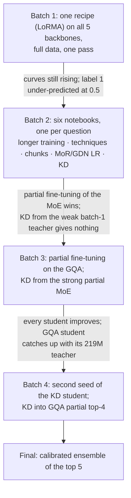

# Phase 4: Court Judgment Prediction (CJPE)

**Task.** Read an Indian Supreme Court case and predict its outcome (binary: 0 or 1).
**Metric.** Macro-F1.
**Data.** 37,387 training records (32,305 unique documents); test = 1,517 documents.

**Validation protocol.** All test documents also appear in `dev.json`, so we never used them. Every choice (epoch,
threshold, ensemble member) was made on the other **994 dev documents** (the "selection set").

**Best score: 0.7547.** This is a calibrated ensemble of five models: the MoE with partial fine-tuning and four GQA
models, three of them knowledge-distillation students.

---

## The model

Each case is read as 512-token chunks: the first 2 and the last 6, so 8 chunks and about 4,096 tokens. The Phase-1
backbone encodes every chunk. A BiLSTM with attention pooling combines the chunks into one document vector, and a
linear layer gives the outcome. Because the models were miscalibrated, each run's decision threshold is tuned on the
selection set.

## The story

---

## Notebooks

Notebooks live in `notebooks/<folder>/`, and the folder names match the ones in `submissions/`, so a notebook and the zips it produced sit in the same-named folder. **Every folder has its own README** with a block diagram of the model, the setup and hyperparameters, and what the batch found; each `submissions/<folder>/` has a README listing its zips.

### Batch 1: one recipe on every Phase-1 model (full data, one pass)
| Notebook | What it does | Codabench (tuned threshold) |
|---|---|---|
| `batch1-every-backbone/p4-moe.ipynb` | MoE + LoRMA. Also the first KD teacher. | 0.6263 |
| `batch1-every-backbone/p4-gqa.ipynb` | GQA + LoRMA | 0.5997 |
| `batch1-every-backbone/p4-lstm.ipynb` | LSTM, full fine-tuning (no linear layers for LoRMA) | 0.5608 |
| `batch1-every-backbone/p4-gdn.ipynb` | GDN encoder + LoRMA | 0.5483 |
| `batch1-every-backbone/p4-mor.ipynb` | LegalMoR + LoRMA (stayed at chance) | 0.3910 |

**What batch 1 showed:**
- Every learning curve was still rising.
- At a 0.5 threshold the models under-predicted label 1, so selecting epochs at 0.5 had kept the *worst* epoch.

From here on, epochs and thresholds are chosen with the threshold tuned on the selection set.

### Batch 2: six notebooks in parallel, one per open question
| Notebook | Question |
|---|---|
| `batch2-open-questions/p4-moe-full.ipynb` | Does longer training (12 × 8,000 documents) with threshold-tuned selection help? |
| `batch2-open-questions/p4-moe-tech.ipynb` | Seven techniques on a 4,000-document subset (LoRMA, AdaLoRA, Houlsby, BitFit, partial, full fine-tuning, frozen). The best, **partial fine-tuning of the top 2 MoE layers**, is promoted to full data (0.7330). |
| `batch2-open-questions/p4-moe-ablate.ipynb` | Which chunks matter (first, last, head + tail, overlap), the attention head, class weighting, and a random-initialisation control |
| `batch2-open-questions/p4-mor-lr.ipynb` | Why did MoR not learn? Higher learning rates, full and partial fine-tuning (best 0.5184) |
| `batch2-open-questions/p4-gdn-lr.ipynb` | The same question for the GDN |
| `batch2-open-questions/p4-kd-gqa.ipynb` | **Knowledge distillation** from the batch-1 MoE into the GQA, beside a no-KD control |

**What batch 2 showed:**
- Partial fine-tuning won.
- The end of the judgment carries most of the signal.
- MoR and GDN stayed far behind.
- KD from the *weak* batch-1 teacher gave nothing.

### Batch 3: follow both leads
| Notebook | What it does |
|---|---|
| `batch3-partial-ft-and-strong-teacher/p4-moe-partial2.ipynb` | Writes the **strong teacher file** from the partially fine-tuned MoE (rebuilt from its saved weights), plus partial top-2 / top-4 variants |
| `batch3-partial-ft-and-strong-teacher/p4-gqa-partial.ipynb` | Partial fine-tuning (top 2 and top 4) and full fine-tuning on the GQA |
| `batch3-partial-ft-and-strong-teacher/p4-kd-gqa2.ipynb` | KD from the strong MoE teacher into GQA LoRMA (**0.7370**) and GQA partial top-2 |

With the stronger teacher every student improved, and the 111M GQA LoRMA student caught up with its 219M teacher.

### Batch 4: seed noise and more ensemble members
| Notebook | What it does |
|---|---|
| `batch4-seed-and-partial4-student/p4-kd-gqa3.ipynb` | The best KD run repeated with a second seed, and KD into GQA partial top-4 (the best single model on the selection set) |

### Analysis and final ensemble (CPU only)
| Notebook | What it does |
|---|---|
| `final-ensembles/phase-4-error-analysis.ipynb` | Confusion at tuned thresholds, F1 by document length, outcome phrases near the end, where the attention looks, model disagreement |
| `final-ensembles/phase-4-final-ensemble.ipynb` | Shifts each member so its own tuned threshold sits at 0, averages, and tunes the ensemble threshold. It checks honestly by choosing on one half of the selection set and scoring the other. |

---

## Submissions (`submissions/`)

Submissions are grouped into **families** (one folder per batch of experiments, so the folders follow the story above):

| Folder in `submissions/` | What is inside | Files |
|---|---|---|
| `batch1-every-backbone/` | One recipe (LoRMA) on every Phase-1 model | 10 |
| `batch2-open-questions/` | Longer training, techniques, chunk ablations, MoR/GDN learning rates, first KD | 20 |
| `batch3-partial-ft-and-strong-teacher/` | Partial fine-tuning on GQA, KD from the strong MoE teacher | 8 |
| `batch4-seed-and-partial4-student/` | Second seed of the best KD student, KD into GQA partial top-4 | 2 |
| `final-ensembles/` | The calibrated ensembles (top5 is the final) | 5 |
| `examples/` | An unzipped prediction file, to show the format | 1 |

Each training notebook writes two zips per setup: `_thr05` (threshold 0.5) and `_tuned` (threshold tuned on the
selection set).

| Submission | What it is | macro-F1 |
|---|---|---|
| `final-ensembles/p4_ensemble_top5.zip` | **final**: MoE partial + GQA partial-4 (with and without KD) + two GQA LoRMA KD students | **0.7547** |
| `batch4-seed-and-partial4-student/p4_kd_gqa3_kd3_gqa_lorma_s1_tuned.zip` | GQA LoRMA KD student, second seed (best single model) | 0.7451 |
| `batch3-partial-ft-and-strong-teacher/p4_kd_gqa2_kd2_gqa_lorma_tuned.zip` | GQA LoRMA KD student (strong teacher) | 0.7370 |
| `batch2-open-questions/p4_moe_tech_t_partial__full_tuned.zip` | MoE partial top-2, full data (the teacher) | 0.7330 |
| `batch2-open-questions/p4_kd_gqa_kd_gqa_lorma_tuned.zip` | GQA LoRMA KD student (weak batch-1 teacher) | 0.6849 |
| `batch1-every-backbone/p4_moe_moe_lorma_thr05.zip` | batch-1 MoE LoRMA | 0.6301 |

The other ensemble zips are `top3`, `greedy`, `all_good` and `best_single`.

`examples/prediction_unzipped_example.json` is an unzipped prediction file (1,517 test documents).

**Error analysis in one line.** Most texts stop before the court's order. Phrases like "set aside" or "quashed" near the
end are reliable cues, but "allowed" and "dismissed" often describe the *lower* court's decision.
