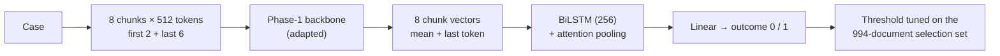

# Phase 4 · `batch1-every-backbone`

**Question.** How does one common recipe (LoRMA) do on every Phase-1 model? **Finding.** Every learning curve was still rising, and at a 0.5 threshold the models under-predicted label 1, so choosing epochs at 0.5 had kept the worst epoch. From batch 2 on, epochs and thresholds are chosen with the threshold tuned on the selection set. MoR stayed at chance (0.3910).

## Architecture

The pipeline all notebooks in this phase build on:

## Setup shared by these notebooks

- **Input:** each case is read as 512-token chunks: the first 2 and the last 6 (8 chunks, about 4,096 tokens).
- **Model:** the Phase-1 backbone encodes every chunk (mean + last-token pooling); a BiLSTM (hidden 256) with attention pooling combines the chunk vectors; a linear layer gives the outcome.
- **Training:** class-weighted cross-entropy (inverse square root), AdamW, head learning rate 1e-3, backbone 3e-4 (LoRMA) or 3e-5 (full fine-tuning), 6% warm-up then linear decay, fp16, batch 1 × accumulation 16, activation checkpointing. An "epoch" is 8,000 documents drawn from the shuffled training set.
- **Selection:** the 994 dev documents that are not test documents. The decision threshold is tuned there for every run. Hyperparameters are our placeholders and were not tuned.

## Notebooks in this folder

| Notebook | What it does |
|---|---|
| `p4-gdn.ipynb` | GDN encoder + LoRMA | 0.5483 |
| `p4-gqa.ipynb` | GQA + LoRMA | 0.5997 |
| `p4-lstm.ipynb` | LSTM, full fine-tuning (no linear layers for LoRMA) | 0.5608 |
| `p4-moe.ipynb` | MoE + LoRMA. Also the first KD teacher. | 0.6263 |
| `p4-mor.ipynb` | LegalMoR + LoRMA (stayed at chance) | 0.3910 |

Each notebook was run on Kaggle with "Run All" and is saved **with its outputs**, so the printed tables, curves and scores are the record of that run.

## Submissions produced

10 files in [`../../submissions/batch1-every-backbone/`](../../submissions/batch1-every-backbone/). See that folder's README for every file; the scores that the phase README lists are:

| File | What it is | Score |
|---|---|---|
| `p4_moe_moe_lorma_thr05.zip` | batch-1 MoE LoRMA | 0.6301 |
