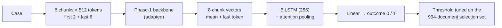

# Phase 4 · `batch2-open-questions`

**Questions (one notebook each).** Does longer training help? Which technique is best? Which chunks matter? Why did MoR and GDN not learn? Does KD from the batch-1 teacher help? **Finding.** Partial fine-tuning of the top 2 MoE layers won (0.7330); the end of the judgment carries most of the signal; MoR and GDN stayed far behind; KD from the weak batch-1 teacher gave nothing.

## Architecture

The pipeline all notebooks in this phase build on:

## Setup shared by these notebooks

- **Input:** each case is read as 512-token chunks: the first 2 and the last 6 (8 chunks, about 4,096 tokens).
- **Model:** the Phase-1 backbone encodes every chunk (mean + last-token pooling); a BiLSTM (hidden 256) with attention pooling combines the chunk vectors; a linear layer gives the outcome.
- **Training:** class-weighted cross-entropy (inverse square root), AdamW, head learning rate 1e-3, backbone 3e-4 (LoRMA) or 3e-5 (full fine-tuning), 6% warm-up then linear decay, fp16, batch 1 × accumulation 16, activation checkpointing. An "epoch" is 8,000 documents drawn from the shuffled training set.
- **Selection:** the 994 dev documents that are not test documents. The decision threshold is tuned there for every run. Hyperparameters are our placeholders and were not tuned.

## Notebooks in this folder

| Notebook | What it does |
|---|---|
| `p4-gdn-lr.ipynb` | The same question for the GDN |
| `p4-kd-gqa.ipynb` | **Knowledge distillation** from the batch-1 MoE into the GQA, beside a no-KD control |
| `p4-moe-ablate.ipynb` | Which chunks matter (first, last, head + tail, overlap), the attention head, class weighting, and a random-initialisation control |
| `p4-moe-full.ipynb` | Does longer training (12 × 8,000 documents) with threshold-tuned selection help? |
| `p4-moe-tech.ipynb` | Seven techniques on a 4,000-document subset (LoRMA, AdaLoRA, Houlsby, BitFit, partial, full fine-tuning, frozen). The best, **partial fine-tuning of the top 2 MoE layers**, is promoted to full data (0.7330). |
| `p4-mor-lr.ipynb` | Why did MoR not learn? Higher learning rates, full and partial fine-tuning (best 0.5184) |

Each notebook was run on Kaggle with "Run All" and is saved **with its outputs**, so the printed tables, curves and scores are the record of that run.

## Submissions produced

20 files in [`../../submissions/batch2-open-questions/`](../../submissions/batch2-open-questions/). See that folder's README for every file; the scores that the phase README lists are:

| File | What it is | Score |
|---|---|---|
| `p4_kd_gqa_kd_gqa_lorma_tuned.zip` | GQA LoRMA KD student (weak batch-1 teacher) | 0.6849 |
| `p4_moe_tech_t_partial__full_tuned.zip` | MoE partial top-2, full data (the teacher) | 0.7330 |
