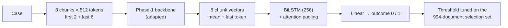
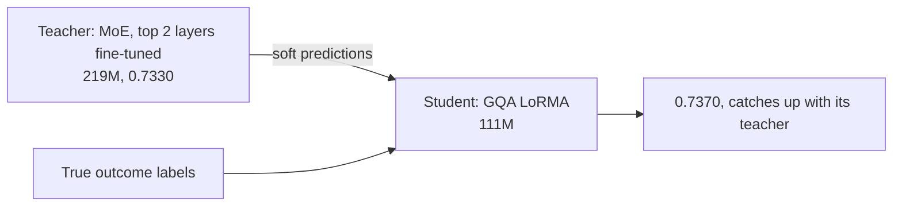

# Phase 4 · `batch3-partial-ft-and-strong-teacher`

**Question.** Does partial fine-tuning carry over to the GQA, and does KD work from the strong MoE teacher? **Finding.** Every student improved, and the 111M GQA LoRMA student (0.7370) caught up with its 219M teacher.

## Architecture

The pipeline all notebooks in this phase build on:

What batch 3 adds: knowledge distillation from the strong, partially fine-tuned MoE into the GQA.

## Setup shared by these notebooks

- **Input:** each case is read as 512-token chunks: the first 2 and the last 6 (8 chunks, about 4,096 tokens).
- **Model:** the Phase-1 backbone encodes every chunk (mean + last-token pooling); a BiLSTM (hidden 256) with attention pooling combines the chunk vectors; a linear layer gives the outcome.
- **Training:** class-weighted cross-entropy (inverse square root), AdamW, head learning rate 1e-3, backbone 3e-4 (LoRMA) or 3e-5 (full fine-tuning), 6% warm-up then linear decay, fp16, batch 1 × accumulation 16, activation checkpointing. An "epoch" is 8,000 documents drawn from the shuffled training set.
- **Selection:** the 994 dev documents that are not test documents. The decision threshold is tuned there for every run. Hyperparameters are our placeholders and were not tuned.

## Notebooks in this folder

| Notebook | What it does |
|---|---|
| `p4-gqa-partial.ipynb` | Partial fine-tuning (top 2 and top 4) and full fine-tuning on the GQA |
| `p4-kd-gqa2.ipynb` | KD from the strong MoE teacher into GQA LoRMA (**0.7370**) and GQA partial top-2 |
| `p4-moe-partial2.ipynb` | Writes the **strong teacher file** from the partially fine-tuned MoE (rebuilt from its saved weights), plus partial top-2 / top-4 variants |

Each notebook was run on Kaggle with "Run All" and is saved **with its outputs**, so the printed tables, curves and scores are the record of that run.

## Submissions produced

8 files in [`../../submissions/batch3-partial-ft-and-strong-teacher/`](../../submissions/batch3-partial-ft-and-strong-teacher/). See that folder's README for every file; the scores that the phase README lists are:

| File | What it is | Score |
|---|---|---|
| `p4_kd_gqa2_kd2_gqa_lorma_tuned.zip` | GQA LoRMA KD student (strong teacher) | 0.7370 |
