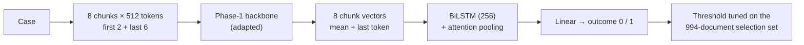

# Phase 4 · `batch4-seed-and-partial4-student`

**Question.** How big is seed noise on the best KD run, and can KD into GQA partial top-4 add ensemble members? **Finding.** The second seed of the GQA LoRMA student scored 0.7451, the best single model; the partial top-4 student was the best single model on the selection set.

## Architecture

The pipeline all notebooks in this phase build on:

## Setup shared by these notebooks

- **Input:** each case is read as 512-token chunks: the first 2 and the last 6 (8 chunks, about 4,096 tokens).
- **Model:** the Phase-1 backbone encodes every chunk (mean + last-token pooling); a BiLSTM (hidden 256) with attention pooling combines the chunk vectors; a linear layer gives the outcome.
- **Training:** class-weighted cross-entropy (inverse square root), AdamW, head learning rate 1e-3, backbone 3e-4 (LoRMA) or 3e-5 (full fine-tuning), 6% warm-up then linear decay, fp16, batch 1 × accumulation 16, activation checkpointing. An "epoch" is 8,000 documents drawn from the shuffled training set.
- **Selection:** the 994 dev documents that are not test documents. The decision threshold is tuned there for every run. Hyperparameters are our placeholders and were not tuned.

## Notebooks in this folder

| Notebook | What it does |
|---|---|
| `p4-kd-gqa3.ipynb` | The best KD run repeated with a second seed, and KD into GQA partial top-4 (the best single model on the selection set) |

Each notebook was run on Kaggle with "Run All" and is saved **with its outputs**, so the printed tables, curves and scores are the record of that run.

## Submissions produced

2 files in [`../../submissions/batch4-seed-and-partial4-student/`](../../submissions/batch4-seed-and-partial4-student/). See that folder's README for every file; the scores that the phase README lists are:

| File | What it is | Score |
|---|---|---|
| `p4_kd_gqa3_kd3_gqa_lorma_s1_tuned.zip` | GQA LoRMA KD student, second seed (best single model) | 0.7451 |
