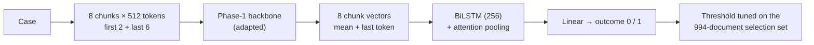

# Phase 4 · `final-ensembles`

Analysis and the final ensemble run on CPU only. The ensemble shifts each member so its own tuned threshold sits at 0, averages them, and tunes the ensemble threshold. It is checked honestly by choosing on one half of the selection set and scoring the other. The final ensemble of 5 scored **0.7547**.

## Architecture

The pipeline all notebooks in this phase build on:

## Setup shared by these notebooks

- **Input:** each case is read as 512-token chunks: the first 2 and the last 6 (8 chunks, about 4,096 tokens).
- **Model:** the Phase-1 backbone encodes every chunk (mean + last-token pooling); a BiLSTM (hidden 256) with attention pooling combines the chunk vectors; a linear layer gives the outcome.
- **Training:** class-weighted cross-entropy (inverse square root), AdamW, head learning rate 1e-3, backbone 3e-4 (LoRMA) or 3e-5 (full fine-tuning), 6% warm-up then linear decay, fp16, batch 1 × accumulation 16, activation checkpointing. An "epoch" is 8,000 documents drawn from the shuffled training set.
- **Selection:** the 994 dev documents that are not test documents. The decision threshold is tuned there for every run. Hyperparameters are our placeholders and were not tuned.

## Notebooks in this folder

| Notebook | What it does |
|---|---|
| `phase-4-error-analysis.ipynb` | Confusion at tuned thresholds, F1 by document length, outcome phrases near the end, where the attention looks, model disagreement |
| `phase-4-final-ensemble.ipynb` | Shifts each member so its own tuned threshold sits at 0, averages, and tunes the ensemble threshold. It checks honestly by choosing on one half of the selection set and scoring the other. |

Each notebook was run on Kaggle with "Run All" and is saved **with its outputs**, so the printed tables, curves and scores are the record of that run.

## Submissions produced

5 files in [`../../submissions/final-ensembles/`](../../submissions/final-ensembles/). See that folder's README for every file; the scores that the phase README lists are:

| File | What it is | Score |
|---|---|---|
| `p4_ensemble_top5.zip` | **final**: MoE partial + GQA partial-4 (with and without KD) + two GQA LoRMA KD students | 0.7547 |
