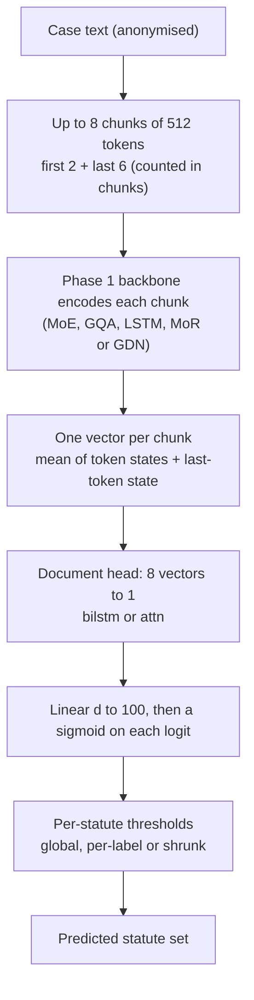
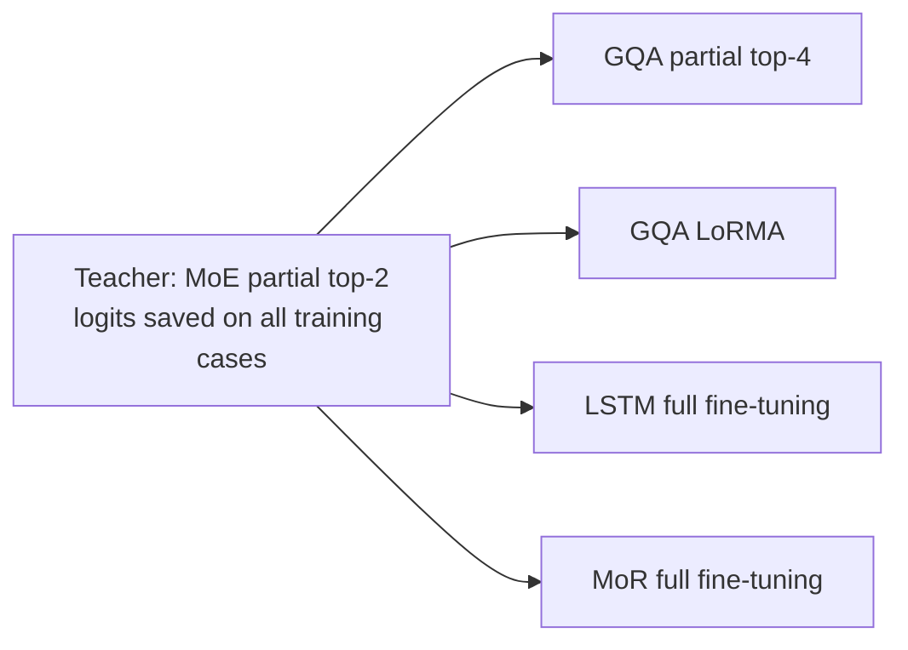
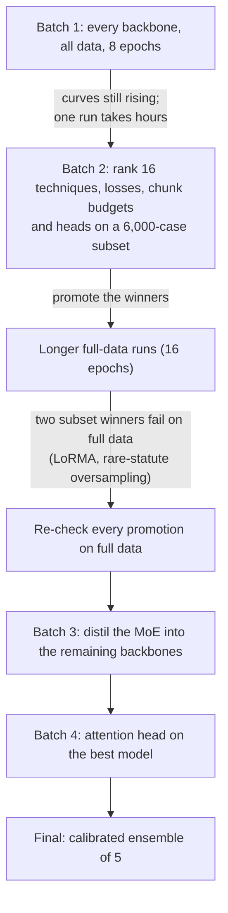
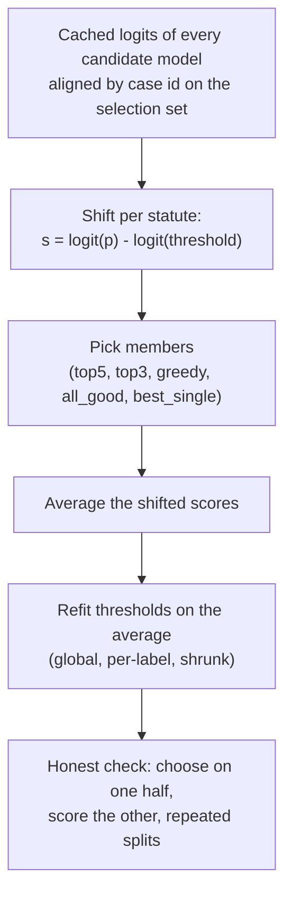

# Phase 5: Legal Statute Identification (LSI)
 
**Task.** Given a Supreme Court case, predict which of **100 statutes** it cites. This is **multi-label**: a case cites 3.7 statutes on average, so each of the 100 statutes is its own yes/no question.
**Metric.** Macro-F1 (primary), with micro-F1 and subset accuracy as secondary metrics.
**Data.** 42,750 training cases, 10,181 dev cases, 13,019 test cases.
 
**Validation protocol.** Some dev cases also occur in test, so every selection step uses only the **10,079 dev cases that are not in test** (the "selection set"). Thresholds matter a lot here, so we report an **honest** score: thresholds are fitted on one half of the selection set and scored on the other half. This predicted the Codabench score within ±0.006 for every one of 30+ runs.
 
**Best score: 0.3952 (Codabench).** It is the average of five calibrated full-data models, with per-statute thresholds shrunk halfway towards a global threshold. The best single model scores 0.3812.
 
---
 
## 1. The problem, and why it is hard
 
### What a statute is
 
A **statute** is a written law passed by a legislature, such as a section of the Indian Penal Code, an article of the Constitution, or a section of the Income Tax Act. Each of our 100 classes (ids 0 to 99) is one provision that cases commonly cite. A judgment cites a statute whenever the court says something like "under Section 302 of the IPC ...".
 
> The id-to-name mapping is not part of our project files, so this README does not say which id is which law.
 
### The task
 
Read the case text and predict the **set** of statutes the judgment cites. The text is **anonymised**: citations are replaced by `<ENTITY>`, `<SECTION>` and `<ACT>`. The model cannot copy a citation. It has to infer the relevant law from the facts and the legal reasoning, like a lawyer asking "this is a dowry harassment matter, so which sections apply?".
 
### Why it is hard
 
- **Rare statutes.** Some statutes have few positives. Macro-F1 counts a rare statute as much as a frequent one, so ignoring rare statutes is punished.
- **Heavy imbalance.** About 96 of the 100 statutes are absent from a typical case. A model trained without weighting learns to say "no" to everything.
- **Co-occurrence.** Statutes are cited in chains (for example a charge section plus its procedure section), so errors are correlated.
- **Length.** Median length is 540 BPE tokens in train and 779 in test, and 11.6% of test cases exceed 4,096 tokens.
### The data
 
| Item | Value |
|---|---|
| Train / dev / test | 42,750 / 10,181 / 13,019 cases |
| Statutes per case | 3.7 in train, 3.9 in dev; 21% of train cases cite exactly one |
| Per statute | at least 200 train cases and at least 50 dev cases |
| Repeated texts | 90 train-dev, 117 train-test, 67 dev-test |
| **Selection set** | **10,079 dev cases** (the 67 dev texts that also occur in test, 102 cases, are excluded from every selection step) |
 
Train cases that duplicate test texts were kept, since they are legitimate training data.
 
### The metrics
 
For statute *l*, with true positives, false positives and false negatives counted over cases:
 
```math
F1_l = \frac{2\,TP_l}{2\,TP_l + FP_l + FN_l}, \qquad \text{macro-F1} = \frac{1}{100}\sum_{l=1}^{100} F1_l
```
 
- **Macro-F1** averages the 100 per-statute F1 scores.
- **Micro-F1** pools all case × statute decisions into one F1.
- **Subset accuracy** requires the predicted set to equal the gold set exactly. It is very harsh (about 0.05 for our best model).
---
 
## 2. The model
 
This is the Phase 4 document model with a new output layer, a new loss and per-statute thresholds. Checked against `p5_core`.
 

 
### Step by step
 
1. **Chunk.** A case becomes at most 8 chunks of 512 tokens: the first 2 and the last 6 chunks. For a long case this keeps the opening (the facts and parties) and the ending (the reasoning and the order). The chunks are counted as chunks, not tokens.
2. **Encode.** The Phase 1 backbone reads each chunk and produces token states.
3. **Chunk vector.** The mean of the token states is joined with the last-token state (`mean+last`).
4. **Document head.** The head turns the 8 chunk vectors into one document vector (see below).
5. **Output.** A `Linear(d → 100)` gives 100 logits and a sigmoid is applied to each.
6. **Thresholds.** A statute is predicted if its probability passes its own threshold.
### Why sigmoid and not softmax
 
Several statutes can be true at once, so the outputs must be **independent**. A softmax forces the probabilities to sum to 1, which is wrong here.
 
### Output bias initialisation
 
`init_bias` sets each statute's output bias to the logit of its training frequency. Training starts at the prior for each statute, not at p = 0.5 for all 100.
 
### The document heads (`DocHead`)
 
"Head" means the small top part of the model. It is **not** multi-head attention, and it only ever sees the 8 chunk vectors, never raw tokens. The backbone does its own attention inside each 512-token chunk.
 
| Head | What it does |
|---|---|
| `bilstm` (Phase 4 default) | BiLSTM (hidden 256) over the 8 chunk vectors, then attention pooling, then Linear |
| `attn` (**winner at full scale**) | Attention pooling directly on the 8 chunk vectors, then Linear. No BiLSTM. |
| `mean` | Average the 8 chunk vectors |
| `chunk_max`, `chunk_mean` | Score every chunk for every statute, then take the max or the mean over chunks |
| `label_attn` | One attention query per statute (a separate head, tested in the subset ablations) |
| `label_mix` (optional layer) | Co-occurrence mixing across statutes. No gain. |
 
**Attention pooling** (read from the code): a small scorer (`Linear d→128`, `tanh`, `Linear 128→1`) gives each chunk a score, a softmax over the 8 chunks gives weights that sum to 1, and the document vector is the weighted sum.
 
```math
a = \operatorname{softmax}_i\big(w_2^\top \tanh(W_1 v_i)\big), \qquad v_{doc} = \sum_{i=1}^{8} a_i\, v_i
```
 
The `attn` head is the `bilstm` head **without the BiLSTM**. The BiLSTM lets chunks talk to each other in order before pooling. The attention head pools the chunk vectors directly. It is not the transformer's output matrix `Wo`: its final `Linear(d → 100)` is a classification layer, while `Wo` lives inside each backbone layer.
 
---
 
## 3. Concepts and maths
 
### 3.1 Loss: binary cross-entropy with a square-root positive weight
 
Plain BCE ignores rare positives. With N cases and n<sub>l</sub> cases containing statute *l*:
 
```math
pw_l = \min\!\Big(\big(\tfrac{N-n_l}{n_l}\big)^{0.5},\,10\Big)\ \text{then divided by the mean of all } pw, \qquad
\mathcal{L} = 10 \cdot \mathrm{BCE}(z, y;\ pos\_weight = pw)
```
 
The power 0.5 is the inverse square root of the odds (`PW_POWER = 0.5`, `LOSS_SCALE = 10`). A full inverse (power 1) over-corrects.
 
| Loss (MoE, 6,000-case subset) | Honest macro-F1 |
|---|---|
| **BCE with √ weights (used)** | **0.2596** |
| Full inverse weights | 0.2478 |
| Plain BCE | 0.2333 |
| Focal loss | 0.2187 |
| Label smoothing 0.1 | 0.2077 |
| Asymmetric loss (ASL) | 0.1737 |
 
Label smoothing hurts because it caps confidence on the roughly 96 absent statutes, which then creep towards the threshold.
 
### 3.2 Thresholds: the largest single lever
 
After the sigmoid, a statute is predicted if its probability exceeds its threshold (`fit_thresholds`, grid 0.05 to 0.95 in steps of 0.01).
 
| Strategy | How the threshold is set |
|---|---|
| **Global** | One threshold for all 100 statutes, chosen to maximise macro-F1 |
| **Per-label** | Each statute gets its own, chosen on a smoothed F1 curve |
| **Shrunk** | Halfway between the two |
 
```math
t_l = 0.5\, t_l^{\text{per-label}} + 0.5\, t^{\text{global}}
```
 
Shrinking trades a little bias for much less variance on rare statutes, whose per-label thresholds are noisy.
 
- **Why not 0.5.** At a fixed 0.5 the main model scores 0.285 honest, against 0.378 with a tuned global threshold. Per-statute thresholds range from 0.05 to 0.68 (median 0.16) and are lower for rarer statutes.
- **At-least-one rule** (`apply_thr`). Every case has at least one statute, so if none passes its threshold the statute with the largest margin p − t is predicted. It adds +0.0001 macro-F1.
- **Caps hurt.** Limiting predictions to 8, 6 or 4 statutes per case gives 0.3874, 0.3811 and 0.3613.
### 3.3 Honest evaluation (`cross_fit`)
 
Tuning thresholds and scoring on the same cases is optimistic: per-statute thresholds overfit by about 0.014. So thresholds are fitted on one random half of the selection set and scored on the other, in both directions, over repeated splits. This predicted Codabench within ±0.006 on every run (mean difference −0.001).
 
### 3.4 Knowledge distillation (per statute)
 
A teacher's tempered sigmoid is the soft target for the student's tempered sigmoid, statute by statute.
 
```math
\mathcal{L} = (1-\lambda)\,\mathrm{BCE}_w(z_s, y) + \lambda\, T^2\, \mathrm{BCE}\big(z_s/T,\ \sigma(z_t/T)\big)
```
 
We use λ = 0.5 and T = 2 in all main runs. The teacher's logits on all training cases are saved by the teacher's own run (`SAVE_TRAIN_LOGITS`), so no teacher forward pass is needed while training students.
 

 
**KD ablation** (GQA student, 6,000-case subset, honest global macro-F1):
 
| Setup | τ | λ | Honest F1 |
|---|---|---|---|
| No KD | – | 0 | 0.2261 |
| τ = 1 | 1 | 0.5 | 0.2576 |
| Default | 2 | 0.5 | 0.2609 |
| τ = 4 | 4 | 0.5 | 0.2215 (worse than no KD) |
| λ = 0.75 | 2 | 0.75 | 0.2638 |
| Teacher only | 2 | 1.0 | 0.2588 |
 
τ = 4 hurts because a high temperature pulls every teacher score towards 0.5, which is a misleading target for the absent statutes. Even teacher-only (no gold labels) beats gold-only.
 
### 3.5 Calibrated score averaging (the ensemble)
 
Each model has its own best threshold per statute, so raw probabilities are not comparable. Shift each logit so its own decision boundary sits at 0, then average:
 
```math
s_{m,l} = \operatorname{logit}(p_{m,l}) - \operatorname{logit}(t_{m,l}), \qquad s_l = \frac{1}{M}\sum_{m=1}^{M} s_{m,l}
```
 
Now s > 0 means "yes" for every model, and the size of s says how far past its own boundary a model is. Thresholds (global, per-label, shrunk) are then **refitted** on the averaged score.
 
**Worked example (statute 5).** Model A has p = 0.12 and threshold 0.10, so s = +0.21 (leans yes). Model B has p = 0.28 and threshold 0.30, so s = −0.09 (leans no). The averaged s is +0.06, a weak yes. Averaging raw probabilities (0.20) would sit on neither model's boundary.
 
A **majority vote of 13 models** scores only 0.3785, worse than the best single model, so averaging calibrated scores matters.
 
### 3.6 Training setup
 
- Micro-batch 1 with gradient accumulation 16, AdamW, fp16. Learning rates: 3e-4 in general, head 1e-3, backbone 1e-4 for partial fine-tuning and 3e-5 for full fine-tuning.
- An **"epoch"** is 6,000 cases from a reshuffled stream, so 8 epochs is 1.1 passes over the 42,750 training cases and 16 epochs is 2.2 passes.
- The epoch is chosen by macro-F1 at the best global threshold on a fixed 2,000-case sample of the selection set.
- Subset ablations use a fixed 6,000-case subset, 5 epochs of 1,500 cases, with the same seed and budget for every setup.
- All hyper-parameters are our placeholders and were not tuned.
---
 
## 4. The story
 

 
| Stage | Question | Answer |
|---|---|---|
| Batch 1 | How does each backbone do on all the data? | MoE > GQA > LSTM > MoR > GDN. Curves were still rising. |
| Batch 2 (subset) | Which technique, loss, chunk budget and head? | LoRA family ≈ full fine-tuning; √ weights; 8 chunks; attention head beats BiLSTM |
| Batch 2 (promotion) | Do the winners survive full data? | Partial beat LoRMA on full data. KD students match the teacher. |
| Batch 3 | Does KD help every backbone? | Yes, the weakest most (MoR +0.033) |
| Batch 4 | Attention head? Rare oversampling? | Head helps at full scale; oversampling hurts |
| Final | Can models be combined? | Calibrated averaging gives +0.010 on dev |
 
**Three lessons that shaped the phase:**
 
1. **Subset rankings do not always survive full data.** On 6,000 cases LoRMA matched partial fine-tuning and rare-statute oversampling helped, but on full data partial fine-tuning won and oversampling hurt.
2. **Thresholds are the largest single lever.** They moved macro-F1 more than any loss function.
3. **Distillation helped every student, the weakest most.**
---
 
## 5. Notebooks
 
Notebooks live in `notebooks/<folder>/`, and the folder names match the ones in `submissions/`, so a notebook and the zips it produced sit in the same-named folder. **Every folder has its own README** with a block diagram of the model, the setup and hyperparameters, and what the batch found. Each `submissions/<folder>/` has a README listing its zips.
 
### Setup: `0-setup`
 
| Notebook | What it does |
|---|---|
| `p5-data-inspect.ipynb` | CPU-only data check: fields, overlaps between splits, labels per case, statute frequencies, case lengths, trivial baselines. This is where the 67 dev/test text overlaps were found. |
 
### Batch 1: every backbone on all training cases (8 epochs)
 
| Notebook | What it does | Honest shrunk F1 |
|---|---|---|
| `p5-moe.ipynb` | MoE, partial fine-tuning of the top 2 layers. Also the **KD teacher** (saves its training logits). | 0.3596 |
| `p5-gqa.ipynb` | GQA with LoRMA (compulsory) and partial top 4 | 0.3304 / 0.3426 |
| `p5-lstm.ipynb` | LSTM full fine-tuning, plus a frozen-backbone control | 0.2668 / 0.2146 |
| `p5-gdn.ipynb` | GDN encoder with LoRMA | 0.1306 |
| `p5-mor.ipynb` | LegalMoR, partial top 4 | 0.1905 |
| `p5-kd.ipynb` | **Knowledge distillation** MoE → GQA (mandatory experiment) | see Batch 2 |
| `p5-kd-lstm.ipynb` | KD MoE → LSTM, beside the no-KD control | see Batch 3 |
 
**What it showed.** All curves were still rising, so 8 epochs was too short. The ranking MoE > GQA > LSTM > MoR > GDN follows Phase 1 quality, and even a frozen LSTM backbone with only the head trained reaches 0.21, so the Phase 1 representations carry real signal.
 
### Batch 2: subset ablations, then promotion to full data
 
A full run takes hours, so many ideas were first tested on a fixed 6,000-case subset.
 
| Notebook | What it does |
|---|---|
| `p5-ablate-tech-moe.ipynb` | Adaptation techniques side by side on the MoE |
| `p5-ablate-more-moe.ipynb` | More techniques: LoRA, rsLoRA, IA³, Pfeiffer adapters, label smoothing |
| `p5-ablate-lorma-moe.ipynb` | LoRMA variants: rank 8 / 32, LoRMA-π, q/v projections only |
| `p5-ablate-design-moe.ipynb` | Losses, document heads, which chunks to read, window size, random-init control. `p5-ablate-design-moe-resumed.ipynb` is a second run that resumed from the cache. |
| `p5-ablate-extra-moe.ipynb` | Further ablations on the same subset |
| `p5-ablate-kd.ipynb` | KD ablation with the GQA student |
| `p5-moe-long.ipynb` | **Promotion:** MoE partial top 2, 16 epochs (the stronger teacher) |
| `p5-moe-lorma.ipynb` | MoE LoRMA with the same budget: does the subset result hold on full data? (No.) |
| `p5-gqa-long.ipynb` | GQA partial top 4, LoRMA and LoRA, 16 epochs |
| `p5-kd-long.ipynb` | KD from the longer-trained MoE into the GQA students |
| `p5-mor2.ipynb` | MoR with LoRMA (learning rate 1e-3) and full fine-tuning |
| `p5-gdn2.ipynb` | GDN with partial and full fine-tuning |
 
**Techniques on the MoE subset (honest global macro-F1):**
 
| Technique | F1 | Technique | F1 |
|---|---|---|---|
| rsLoRA | 0.2697 | Houlsby adapters | 0.2627 |
| LoRA | 0.2683 | Pfeiffer adapters | 0.2632 |
| Full FT, LoRMA, QLoRA | 0.2667 | BitFit | 0.2594 |
| LoRMA r32 | 0.2692 | Partial | 0.2587 |
| LoRMA-π | 0.2632 | IA³ | 0.2480 |
| AdaLoRA | 0.2353 | Frozen | 0.2199 |
| Prompt tuning | 0.2180 | Prefix tuning | 0.2176 |
 
The LoRA family matches full fine-tuning within about 0.003, using about 2% of the parameters and half the memory (full fine-tuning peaked at 5.2 GB, LoRMA at 2.4 GB).
 
**Design ablations (MoE subset):**
 
- **Heads.** Attention 0.2868, mean 0.2849, chunk-mean 0.2846, per-statute attention and chunk-max 0.2797, all above the BiLSTM head at 0.2596. Attention minus BiLSTM is +0.0149, with a 95% interval that excludes 0.
- **Chunk budget.** 1 chunk 0.2308, 4 chunks 0.251 to 0.257, 8 chunks 0.2596, all chunks up to 16k tokens 0.2582. Reading the whole case is no better than 8 head+tail chunks, and which 4 chunks are used (first, last, uniform, cue-based) is within noise.
- **Phase 1 value.** Random initialisation 0.101, frozen Phase 1 0.220, fine-tuned 0.26 to 0.27.
**Promotion to full data (16 epochs = 2.2 passes), honest global macro-F1:**
 
| Run | F1 |
|---|---|
| MoE partial top 2 | 0.3732 |
| MoE LoRMA | 0.3637 |
| GQA partial top 4 | 0.3582 |
| GQA LoRA | 0.3468 |
| GQA LoRMA | 0.3423 |
 
**Lesson 1.** On the subset LoRMA matched partial, but on full data partial won (MoE +0.0061, bootstrap interval [+0.0019, +0.0106]). More data favours the method with more trainable capacity (46.9M against 4.3M parameters). MoE LoRMA still reaches 97.5% of partial with 4.3M trainable parameters, but trains 70% longer (438 against 258 minutes), because gradients flow through all layers.
 
**KD at 16 epochs (honest shrunk F1):**
 
| Student | With KD | Without KD |
|---|---|---|
| GQA partial top 4 | 0.3762 | 0.3652 |
| GQA LoRMA | 0.3608 | 0.3513 |
 
The 111M GQA student is statistically indistinguishable from its 218.7M MoE teacher (difference +0.0014, interval [−0.0029, +0.0058]), at half the parameters, twice the inference speed (62 against 32 cases/s) and 93 against 258 training minutes.
 
### Batch 3: distil into the remaining students
 
| Notebook | What it does |
|---|---|
| `p5-lstm-long.ipynb` | LSTM full fine-tuning + KD, **13 epochs** (16 needed about 12.5 hours and did not fit Kaggle's 12-hour limit). `p5-lstm-long-16ep-interrupted.ipynb` is the first attempt, cut off by that limit. |
| `p5-mor-long.ipynb` | MoR full fine-tuning, with and without KD |
 
| Run | Honest shrunk F1 |
|---|---|
| LSTM full FT + KD | 0.3100 |
| MoR full FT + KD | 0.3002 |
| MoR full FT, no KD | 0.2668 |
 
**The weaker the student, the bigger the KD gain:** GQA +0.010 to +0.011, LSTM +0.022 to +0.028, MoR +0.033 to +0.037. There is simply more to learn from the teacher.
 
### Batch 4: attention head and rare statutes
 
| Notebook | What it does |
|---|---|
| `p5-moe-attn.ipynb` | MoE partial top 2 with the **attention head** (best single MoE, `moe_attn_long`, 0.3812) |
| `p5-moe-attn-rare.ipynb` | The same + rare-statute oversampling (`SAMPLING="rare"`, `RARE_POWER` 0.5) |
| `p5-kd-attn.ipynb` | The two GQA KD students with the attention head |
 
- **Attention head.** It confirmed the subset result at full scale: 0.3792 → 0.3842 shrunk, and `moe_attn_long` became the best single model.
- **Rare oversampling.** It helped on the subset (+0.012) but **hurt on full data (−0.038)**. The same rare cases were drawn repeatedly and memorised: training loss was 0.39 against 0.47 without it.
- **KD students with the attention head.** Partial improved slightly (0.3777). LoRMA got worse (0.3511), because with LoRMA almost all trainable capacity sits in the head (0.85M with attention against 4.3M with the BiLSTM head).
**Lesson 2.** Subset rankings do not always survive full data: rare oversampling and LoRMA both won on the subset and lost at scale.
 
### Cost of the full-data runs
 
| Run | Trained params | Peak train GB | Train min | Inference cases/s |
|---|---|---|---|---|
| `moe_attn_long` | 43.5M | 1.9 | 255 | 32 |
| `kd_gqa_partial4_long` | 28.6M | 1.3 | 93 | 62 |
| `kd_gqa_lorma_long` | 4.29M | 1.3 | 133 | 54 |
| `kd_lstm_full_ft_long` | 89.6M | 2.0 | 527 | 19 |
| `kd_mor_full_ft_long` | 93.9M | 2.5 | 186 | 49 |
 
### Analysis and final ensemble (CPU only): `final-ensembles`
 
| Notebook | What it does |
|---|---|
| `p5-results-and-error-analysis.ipynb` | Every run in one table; threshold strategies; per-statute F1 vs training support; co-predicted statute chains; where the head looks |
| `p5-final-ensemble.ipynb` | Shifts each member so its per-statute threshold sits at 0, averages, picks thresholds, and runs an honest half-split check |
 
---
 
## 6. The final ensemble
 
Nothing is retrained. Each model saved its logits on the selection set, and the ensemble notebook only loads and combines them.
 

 
| Rule | Members | Honest dev F1 | Codabench |
|---|---|---|---|
| **top5** (final) | `moe_attn_long`, `moe_partial2_long`, `kd_gqa_partial4_attn_long`, `kd_gqa_partial4_long`, `moe_lorma_long` | 0.3987 | **0.3952** |
| top3 | the 3 best members | 0.3986 | 0.3946 |
| greedy | `moe_attn` + `kd_gqa_partial4_long` (`MIN_GAIN` 0.002, `MAX_MEMBERS` 6) | 0.3986 | 0.3932 |
| all_good | every member within 3% of the best | 0.3975 | 0.3933 |
| best single | `moe_attn` | 0.3881 | 0.3818 |
 
Ensembling beats the best single model by about +0.010 on dev (about 4 standard deviations) and +0.012 to +0.014 on Codabench.
 
### Error analysis
 
- **Rare statutes.** Mean F1 by training-support quartile is 0.274 (rarest), 0.380, 0.391 and 0.517 (most frequent). The correlation with log support is 0.525. The weak GDN scores 0.020 on the rarest quartile.
- **Frequent statutes absorb errors.** Common substitutions are 12 → 5, 14 → 5, 39 → 5 and 13 → 5. The hardest statutes are 8 (90% missed), 84, 2, 52 and 99. The easiest are 28, 34 and 20.
- **Chains are over-predicted.** For statutes 89 and 90 the gold Jaccard is 0.62 and the predicted Jaccard is 0.79.
- **Exact-set accuracy falls with the number of gold statutes:** 0.118 for one, 0.094 for two, 0.039 for three to four, 0.019 for five to seven, 0 for eight or more. The model over-predicts for single-statute cases (2.99 against 1) and under-predicts for 8 or more (6.76 against 9.74).
- **Length.** Longer cases are easier (samples-F1 from 0.353 for 283 tokens or fewer up to 0.568 above 2,193), because they hold more evidence.
- **Attention weights** favour the start (1.15× uniform) and the end (1.14×).
- **Calibration.** ECE is 0.012. Temperature scaling and per-statute Platt scaling improve ECE and log-loss, but macro-F1 does not change, because tuned thresholds already absorb the calibration.
---
 
## 7. Submissions (`submissions/`)
 
Submissions are grouped into **families** (one folder per batch of experiments, so the folders follow the story above):
 
| Folder in `submissions/` | What is inside | Files |
|---|---|---|
| `batch1-every-backbone/` | Every backbone on all data, 8 epochs, plus the first KD runs | 10 |
| `batch2-ablations-and-promotion/` | Winners of the subset ablations re-run on full data (16 epochs) | 11 |
| `batch3-distil-into-remaining/` | LSTM and MoR with and without KD, longer runs | 3 |
| `batch4-attention-head-and-rare/` | Attention head on the MoE, rare-statute oversampling, attention KD students | 4 |
| `final-ensembles/` | The calibrated ensembles (top5 is the final) | 5 |
 
Zip suffixes give the threshold strategy: `_per_label` (one threshold per statute) or `_shrunk` (per-statute thresholds shrunk towards a global one).
 
The brief requires one submission per Phase 1 architecture, plus the best result:
 
| Submission | What it is | macro-F1 |
|---|---|---|
| `final-ensembles/p5_ensemble_top5.zip` | **final**: average of 5 calibrated models | **0.3952** |
| `batch4-attention-head-and-rare/p5_moe_attn_moe_attn_long_shrunk.zip` | MoE (attention head, 16 epochs) | 0.3812 |
| `batch2-ablations-and-promotion/p5_kd_long_kd_gqa_lorma_long_shrunk.zip` | GQA LoRMA + KD (no KD: 0.3481) | 0.3595 |
| `batch3-distil-into-remaining/p5_lstm_long_kd_lstm_full_ft_long_shrunk.zip` | LSTM + KD | 0.3094 |
| `batch3-distil-into-remaining/p5_mor_long_kd_mor_full_ft_long_shrunk.zip` | MoR + KD (no KD: 0.2745) | 0.3053 |
 
Other notable runs:
 
| Submission | macro-F1 |
|---|---|
| `p5_moe_long_moe_partial2_long_shrunk` | 0.3763 |
| `p5_moe_lorma_moe_lorma_long_shrunk` | 0.3723 |
| `p5_kd_attn_kd_gqa_partial4_attn_long_shrunk` | 0.3722 |
| `p5_kd_long_kd_gqa_partial4_long_shrunk` (no KD: 0.3653) | 0.3720 |
| `p5_gqa_long_gqa_lorma_long_shrunk` | 0.3481 |
| `p5_moe_attn_rare_moe_attn_rare_long_shrunk` | 0.3433 |
| `p5_gdn2_gdn_partial4_per_label` / `gdn_full_ft` | 0.1663 / 0.1575 |
| `p5_mor2_mor_lorma_per_label` | 0.1327 |
 
The test confirms every KD gain: GQA partial 0.3653 → 0.3720, GQA LoRMA 0.3481 → 0.3595, MoR 0.2745 → 0.3053, LSTM (8 epochs) 0.2685 → 0.2932. The other ensemble zips (`top3`, `greedy`, `all_good`, `best_single`) are in `final-ensembles/`.
 
---
 
## 8. Numbers to remember
 
| Item | Value |
|---|---|
| Statutes / per case | 100 / about 3.7 |
| Train / dev / test | 42,750 / 10,181 / 13,019 |
| Selection set | 10,079 dev cases |
| Chunking | 8 × 512 tokens (first 2 + last 6) |
| Loss weight | √(neg/pos), capped at 10 |
| KD | T = 2, λ = 0.5, per-statute sigmoid |
| **Final** | top5 ensemble, **0.3952** |
| Best single | `moe_attn_long`, 0.3812 |
| Honest-to-Codabench gap | within ±0.006 on every run |
| Run-to-run noise | about 0.002 typical, up to 0.009 on the subset |
 
## 9. FAQ
 
- **Why sigmoids and not softmax?** Several statutes can be true at once, so the outputs must be independent.
- **Why not threshold at 0.5?** Positive weights over-predict at 0.5 and macro-F1 needs recall on rare statutes: 0.285 at a fixed 0.5 against 0.378 tuned.
- **What is "shrunk" and why?** Per-statute thresholds are noisy for rare statutes, so we average each with the global threshold: a little bias for much less variance.
- **Why is the validation honest?** Thresholds are fitted on one half and scored on the other, and it predicted Codabench within ±0.006.
- **Why did LoRMA win on the subset and lose on full data?** More data favours the method with more trainable capacity.
- **Why did rare oversampling fail?** It repeated the same rare cases, which were memorised.
- **Why does KD help the weaker students more?** There is more to learn from the teacher: MoR +0.033, GQA +0.010.
- **Why average scores and not vote?** Voting 13 models scored 0.3785, below the best single model.
- **Is the student as good as the teacher?** The 111M GQA student is statistically tied with the 218.7M MoE teacher (+0.0014, interval spans 0), at twice the inference speed.
- **What does "attention head" mean?** The document head is attention pooling directly on the 8 chunk vectors, with no BiLSTM. It is not multi-head attention and not `Wo`.
## 10. Limitations
 
- **One seed per setup.** Differences below about 0.005 on full data and about 0.01 on the subset are within noise unless a bootstrap interval excludes 0.
- **Hyper-parameters were not tuned.**
- **Statute names.** The id-to-name mapping is not part of our project files, so the error analysis refers to statutes by id only.
- **Subset conclusions can reverse.** LoRMA and rare oversampling did, which is why every promotion was re-checked on full data.
- **The honest score is an estimate.** It predicted Codabench well on our runs, but it uses the same selection set for choosing members and thresholds.
