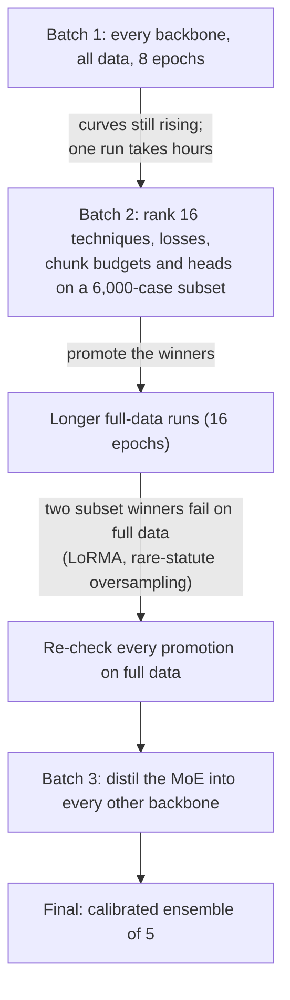

# Phase 5: Legal Statute Identification (LSI)

**Task.** Predict which of 100 statutes a case cites. This is multi-label: a case cites 3.7 statutes on average.
**Metric.** Macro-F1, with micro-F1 and subset accuracy as secondary metrics.
**Data.** 42,750 training cases; test = 13,019 cases.

**Validation protocol.** Some dev cases also occur in test, so we used only the **10,079 dev cases that are not in
test** (the "selection set"). Thresholds matter a lot here, so we report an **honest** score: thresholds are fitted on
one half of the selection set and scored on the other half. This predicted Codabench within 0.006 for every run.

**Best score: 0.3952.** This is an average of five calibrated full-data models with per-statute thresholds shrunk
halfway towards a global threshold.

---

## The model

This is the Phase-4 document model with a new output layer. Each case is read as eight 512-token chunks (first 2 and
last 6). The Phase-1 backbone encodes every chunk, and a BiLSTM or attention head combines them.
- **Output:** 100 sigmoid outputs.
- **Loss:** binary cross-entropy with positive weights √(neg/pos).
- **Thresholds:** one per statute.

## The story

**Three lessons that shaped the phase:**
1. **Subset rankings do not always survive full data.** On 6,000 cases LoRMA matched partial fine-tuning, but on full data partial fine-tuning won.
2. **Thresholds are the largest single lever.** They moved macro-F1 more than any loss function. We compared global, per-statute and *shrunk* thresholds, each scored honestly.
3. **Distillation helped every student, the weakest most.**

---

## Notebooks

Notebooks live in `notebooks/<folder>/`, and the folder names match the ones in `submissions/`, so a notebook and the zips it produced sit in the same-named folder. **Every folder has its own README** with a block diagram of the model, the setup and hyperparameters, and what the batch found; each `submissions/<folder>/` has a README listing its zips.

### Setup
| Notebook | What it does |
|---|---|
| `0-setup/p5-data-inspect.ipynb` | Fields, overlaps between splits, labels per case, statute frequencies, case lengths (CPU) |

### Batch 1: every backbone on all training cases
| Notebook | What it does |
|---|---|
| `batch1-every-backbone/p5-moe.ipynb` | MoE, partial fine-tuning of the top 2 layers (best Phase-4 setup). It is also the KD teacher. |
| `batch1-every-backbone/p5-gqa.ipynb` | GQA with LoRMA (compulsory) and partial fine-tuning (top 4) |
| `batch1-every-backbone/p5-lstm.ipynb` | LSTM, full fine-tuning, plus a frozen-backbone control |
| `batch1-every-backbone/p5-gdn.ipynb` | GDN encoder with LoRMA |
| `batch1-every-backbone/p5-mor.ipynb` | LegalMoR, partial fine-tuning (top 4) |
| `batch1-every-backbone/p5-kd.ipynb` | **Knowledge distillation** MoE → GQA (mandatory experiment) |
| `batch1-every-backbone/p5-kd-lstm.ipynb` | KD MoE → LSTM, beside the no-KD control |

### Batch 2: subset ablations (6,000 cases, fixed seed and budget), then full-data promotion
| Notebook | What it does |
|---|---|
| `batch2-ablations-and-promotion/p5-ablate-tech-moe.ipynb` | Adaptation techniques side by side on the MoE |
| `batch2-ablations-and-promotion/p5-ablate-more-moe.ipynb` | More techniques: LoRA, rsLoRA, IA³, Pfeiffer adapters, label smoothing |
| `batch2-ablations-and-promotion/p5-ablate-lorma-moe.ipynb` | LoRMA variants: rank 8 / 32, LoRMA-π, q/v projections only |
| `batch2-ablations-and-promotion/p5-ablate-design-moe.ipynb` | Losses, document heads, which chunks to read, window size, random-init control. `batch2-ablations-and-promotion/p5-ablate-design-moe-resumed.ipynb` is a second run that resumed from the cache. |
| `batch2-ablations-and-promotion/p5-ablate-extra-moe.ipynb` | Further ablations on the same subset |
| `batch2-ablations-and-promotion/p5-ablate-kd.ipynb` | KD ablation with the GQA student |
| `batch2-ablations-and-promotion/p5-moe-long.ipynb` | **Promotion:** MoE partial top-2, 16 epochs (the stronger teacher) |
| `batch2-ablations-and-promotion/p5-moe-lorma.ipynb` | MoE LoRMA with the same budget: does the subset result hold on full data? (No.) |
| `batch2-ablations-and-promotion/p5-gqa-long.ipynb` | GQA partial-4, LoRMA and LoRA, 16 epochs |
| `batch2-ablations-and-promotion/p5-kd-long.ipynb` | KD from the longer-trained MoE into the GQA students |
| `batch2-ablations-and-promotion/p5-mor2.ipynb` | MoR with LoRMA (learning rate 1e-3) and full fine-tuning |
| `batch2-ablations-and-promotion/p5-gdn2.ipynb` | GDN with partial and full fine-tuning |

### Batch 3: distil into the remaining students
| Notebook | What it does |
|---|---|
| `batch3-distil-into-remaining/p5-lstm-long.ipynb` | LSTM full fine-tuning + KD, 13 epochs (fits one Kaggle session). `batch3-distil-into-remaining/p5-lstm-long-16ep-interrupted.ipynb` is the first attempt, cut off by the 12-hour limit. |
| `batch3-distil-into-remaining/p5-mor-long.ipynb` | MoR full fine-tuning, with and without KD |

### Batch 4–5: head and rare statutes on the best model
| Notebook | What it does |
|---|---|
| `batch4-attention-head-and-rare/p5-moe-attn.ipynb` | MoE partial top-2 with an **attention head** over chunks (best single MoE, 0.3812) |
| `batch4-attention-head-and-rare/p5-moe-attn-rare.ipynb` | The same + rare-statute oversampling (helped on the subset, hurt on full data) |
| `batch4-attention-head-and-rare/p5-kd-attn.ipynb` | The two GQA KD students with the attention head |

### Analysis and final ensemble (CPU only)
| Notebook | What it does |
|---|---|
| `final-ensembles/p5-results-and-error-analysis.ipynb` | Every run in one table; threshold strategies; per-statute F1 vs training support; co-predicted statute chains; where the head looks |
| `final-ensembles/p5-final-ensemble.ipynb` | Shifts each member so its per-statute threshold sits at 0, averages, picks thresholds, and runs an honest half-split check |

---

## Submissions (`submissions/`)

Submissions are grouped into **families** (one folder per batch of experiments, so the folders follow the story above):

| Folder in `submissions/` | What is inside | Files |
|---|---|---|
| `batch1-every-backbone/` | Every backbone on all data, 8 epochs, plus the first KD runs | 10 |
| `batch2-ablations-and-promotion/` | Winners of the subset ablations re-run on full data (16 epochs) | 11 |
| `batch3-distil-into-remaining/` | LSTM and MoR with and without KD, longer runs | 3 |
| `batch4-attention-head-and-rare/` | Attention head on the MoE, rare-statute oversampling, attention KD students | 4 |
| `final-ensembles/` | The calibrated ensembles (top5 is the final) | 5 |

Zip suffixes give the threshold strategy: `_per_label` (one threshold per statute) or `_shrunk` (per-statute thresholds
shrunk towards a global one).

| Submission | What it is | macro-F1 |
|---|---|---|
| `final-ensembles/p5_ensemble_top5.zip` | **final**: average of 5 calibrated models | **0.3952** |
| `batch4-attention-head-and-rare/p5_moe_attn_moe_attn_long_shrunk.zip` | best single MoE (attention head, 16 epochs) | 0.3812 |
| `batch2-ablations-and-promotion/p5_kd_long_kd_gqa_partial4_long_shrunk.zip` | GQA partial-4 + KD (no KD: 0.3653) | 0.3720 |
| `batch2-ablations-and-promotion/p5_kd_long_kd_gqa_lorma_long_shrunk.zip` | GQA LoRMA + KD (no KD: 0.3481) | 0.3595 |
| `batch3-distil-into-remaining/p5_lstm_long_kd_lstm_full_ft_long_shrunk.zip` | LSTM + KD | 0.3094 |
| `batch3-distil-into-remaining/p5_mor_long_kd_mor_full_ft_long_shrunk.zip` | MoR + KD (no KD: 0.2745) | 0.3053 |

The other ensemble zips are `top3`, `greedy`, `all_good` and `best_single`; they beat the best single model by
+0.012 to +0.014.

**Error analysis in one line.** Frequent statutes absorb errors, co-occurring statutes are predicted as whole chains, and
the rarest quarter of statutes scores about half as well as the most frequent quarter.
