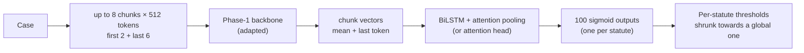

# Phase 5 · `batch1-every-backbone`

**Question.** How does each Phase-1 backbone do on all training cases (8 epochs), and does KD from the MoE help? **Finding.** All curves were still rising and a single run takes hours, so batch 2 ranked techniques on a 6,000-case subset instead.

## Architecture

The pipeline all notebooks in this phase build on:

## Setup shared by these notebooks

- **Input:** each case is read as at most eight 512-token chunks (first 2 + last 6 for long cases); the Phase-1 backbone encodes each chunk (mean + last-token pooling).
- **Head:** a BiLSTM with attention pooling (batch 4 on adds an attention head variant) → 100 sigmoid outputs.
- **Loss:** binary cross-entropy with positive weights √(neg/pos), capped at 10.
- **Training:** AdamW, batch 1 × accumulation 16, fp16. An "epoch" is 6,000 cases drawn from a reshuffled stream (8 epochs ≈ 1.1 passes over the data, 16 ≈ 2.2). Epochs are chosen by macro-F1 on a 2,000-case sample of the selection set.
- **Thresholds:** global, per-statute, or *shrunk* (halfway to the global one), each scored honestly: fitted on one half of the 10,079-case selection set and scored on the other. Hyperparameters are our placeholders and were not tuned.

## Notebooks in this folder

| Notebook | What it does |
|---|---|
| `p5-gdn.ipynb` | GDN encoder with LoRMA |
| `p5-gqa.ipynb` | GQA with LoRMA (compulsory) and partial fine-tuning (top 4) |
| `p5-kd-lstm.ipynb` | KD MoE → LSTM, beside the no-KD control |
| `p5-kd.ipynb` | **Knowledge distillation** MoE → GQA (mandatory experiment) |
| `p5-lstm.ipynb` | LSTM, full fine-tuning, plus a frozen-backbone control |
| `p5-moe.ipynb` | MoE, partial fine-tuning of the top 2 layers (best Phase-4 setup). It is also the KD teacher. |
| `p5-mor.ipynb` | LegalMoR, partial fine-tuning (top 4) |

Each notebook was run on Kaggle with "Run All" and is saved **with its outputs**, so the printed tables, curves and scores are the record of that run.

## Submissions produced

10 files in [`../../submissions/batch1-every-backbone/`](../../submissions/batch1-every-backbone/). See that folder's README for every file; the scores that the phase README lists are:

