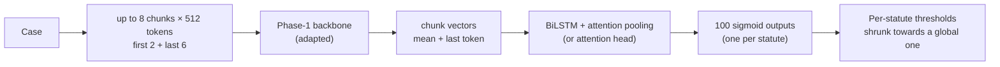

# Phase 5 · `batch2-ablations-and-promotion`

**Question.** Which techniques, losses, chunk budgets and heads are best on a 6,000-case subset, and do the winners survive on full data (16 epochs)? **Finding.** Two subset winners failed on full data (LoRMA and rare-statute oversampling): partial fine-tuning won on full data. Every promotion was therefore re-checked.

## Architecture

The pipeline all notebooks in this phase build on:

## Setup shared by these notebooks

- **Input:** each case is read as at most eight 512-token chunks (first 2 + last 6 for long cases); the Phase-1 backbone encodes each chunk (mean + last-token pooling).
- **Head:** a BiLSTM with attention pooling (batch 4 on adds an attention head variant) → 100 sigmoid outputs.
- **Loss:** binary cross-entropy with positive weights √(neg/pos), capped at 10.
- **Training:** AdamW, batch 1 × accumulation 16, fp16. An "epoch" is 6,000 cases drawn from a reshuffled stream (8 epochs ≈ 1.1 passes over the data, 16 ≈ 2.2). Epochs are chosen by macro-F1 on a 2,000-case sample of the selection set.
- **Thresholds:** global, per-statute, or *shrunk* (halfway to the global one), each scored honestly: fitted on one half of the 10,079-case selection set and scored on the other. Hyperparameters are our placeholders and were not tuned.

## Notebooks in this folder

| Notebook | What it does |
|---|---|
| `p5-ablate-design-moe-resumed.ipynb` |  |
| `p5-ablate-design-moe.ipynb` | Losses, document heads, which chunks to read, window size, random-init control. `batch2-ablations-and-promotion/p5-ablate-design-moe-resumed.ipynb` is a second run that resumed from the cache. |
| `p5-ablate-extra-moe.ipynb` | Further ablations on the same subset |
| `p5-ablate-kd.ipynb` | KD ablation with the GQA student |
| `p5-ablate-lorma-moe.ipynb` | LoRMA variants: rank 8 / 32, LoRMA-π, q/v projections only |
| `p5-ablate-more-moe.ipynb` | More techniques: LoRA, rsLoRA, IA³, Pfeiffer adapters, label smoothing |
| `p5-ablate-tech-moe.ipynb` | Adaptation techniques side by side on the MoE |
| `p5-gdn2.ipynb` | GDN with partial and full fine-tuning |
| `p5-gqa-long.ipynb` | GQA partial-4, LoRMA and LoRA, 16 epochs |
| `p5-kd-long.ipynb` | KD from the longer-trained MoE into the GQA students |
| `p5-moe-long.ipynb` | **Promotion:** MoE partial top-2, 16 epochs (the stronger teacher) |
| `p5-moe-lorma.ipynb` | MoE LoRMA with the same budget: does the subset result hold on full data? (No.) |
| `p5-mor2.ipynb` | MoR with LoRMA (learning rate 1e-3) and full fine-tuning |

Each notebook was run on Kaggle with "Run All" and is saved **with its outputs**, so the printed tables, curves and scores are the record of that run.

## Submissions produced

11 files in [`../../submissions/batch2-ablations-and-promotion/`](../../submissions/batch2-ablations-and-promotion/). See that folder's README for every file; the scores that the phase README lists are:

| File | What it is | Score |
|---|---|---|
| `p5_kd_long_kd_gqa_lorma_long_shrunk.zip` | GQA LoRMA + KD (no KD: 0.3481) | 0.3595 |
| `p5_kd_long_kd_gqa_partial4_long_shrunk.zip` | GQA partial-4 + KD (no KD: 0.3653) | 0.3720 |
