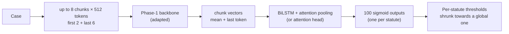
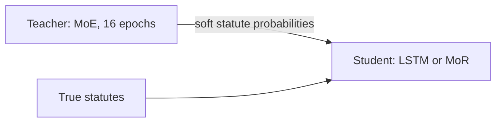

# Phase 5 · `batch3-distil-into-remaining`

**Question.** Does distilling the MoE into the LSTM and MoR help? **Finding.** Yes, KD helped every student, the weakest most (MoR 0.2745 → 0.3053). The LSTM ran 13 epochs to fit one Kaggle session; its 16-epoch first attempt was cut off by the 12-hour limit.

## Architecture

The pipeline all notebooks in this phase build on:

Distillation: the MoE teacher guides the weaker student.

## Setup shared by these notebooks

- **Input:** each case is read as at most eight 512-token chunks (first 2 + last 6 for long cases); the Phase-1 backbone encodes each chunk (mean + last-token pooling).
- **Head:** a BiLSTM with attention pooling (batch 4 on adds an attention head variant) → 100 sigmoid outputs.
- **Loss:** binary cross-entropy with positive weights √(neg/pos), capped at 10.
- **Training:** AdamW, batch 1 × accumulation 16, fp16. An "epoch" is 6,000 cases drawn from a reshuffled stream (8 epochs ≈ 1.1 passes over the data, 16 ≈ 2.2). Epochs are chosen by macro-F1 on a 2,000-case sample of the selection set.
- **Thresholds:** global, per-statute, or *shrunk* (halfway to the global one), each scored honestly: fitted on one half of the 10,079-case selection set and scored on the other. Hyperparameters are our placeholders and were not tuned.

## Notebooks in this folder

| Notebook | What it does |
|---|---|
| `p5-lstm-long-16ep-interrupted.ipynb` |  |
| `p5-lstm-long.ipynb` | LSTM full fine-tuning + KD, 13 epochs (fits one Kaggle session). `batch3-distil-into-remaining/p5-lstm-long-16ep-interrupted.ipynb` is the first attempt, cut off by the 12-hour limit. |
| `p5-mor-long.ipynb` | MoR full fine-tuning, with and without KD |

Each notebook was run on Kaggle with "Run All" and is saved **with its outputs**, so the printed tables, curves and scores are the record of that run.

## Submissions produced

3 files in [`../../submissions/batch3-distil-into-remaining/`](../../submissions/batch3-distil-into-remaining/). See that folder's README for every file; the scores that the phase README lists are:

| File | What it is | Score |
|---|---|---|
| `p5_lstm_long_kd_lstm_full_ft_long_shrunk.zip` | LSTM + KD | 0.3094 |
| `p5_mor_long_kd_mor_full_ft_long_shrunk.zip` | MoR + KD (no KD: 0.2745) | 0.3053 |
