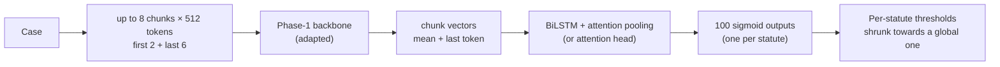
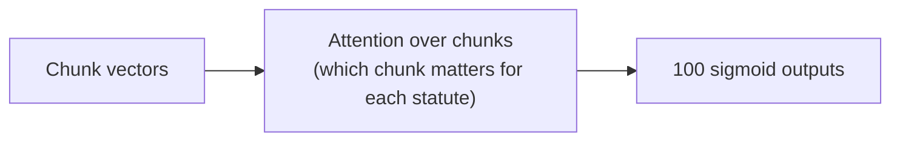

# Phase 5 · `batch4-attention-head-and-rare`

**Question.** Does an attention head over the chunks, or rare-statute oversampling, improve the best model? **Finding.** The attention head gave the best single MoE (0.3812); oversampling helped on the subset but hurt on full data.

## Architecture

The pipeline all notebooks in this phase build on:

What batch 4 changes: an attention head over the chunks instead of a BiLSTM.

## Setup shared by these notebooks

- **Input:** each case is read as at most eight 512-token chunks (first 2 + last 6 for long cases); the Phase-1 backbone encodes each chunk (mean + last-token pooling).
- **Head:** a BiLSTM with attention pooling (batch 4 on adds an attention head variant) → 100 sigmoid outputs.
- **Loss:** binary cross-entropy with positive weights √(neg/pos), capped at 10.
- **Training:** AdamW, batch 1 × accumulation 16, fp16. An "epoch" is 6,000 cases drawn from a reshuffled stream (8 epochs ≈ 1.1 passes over the data, 16 ≈ 2.2). Epochs are chosen by macro-F1 on a 2,000-case sample of the selection set.
- **Thresholds:** global, per-statute, or *shrunk* (halfway to the global one), each scored honestly: fitted on one half of the 10,079-case selection set and scored on the other. Hyperparameters are our placeholders and were not tuned.

## Notebooks in this folder

| Notebook | What it does |
|---|---|
| `p5-kd-attn.ipynb` | The two GQA KD students with the attention head |
| `p5-moe-attn-rare.ipynb` | The same + rare-statute oversampling (helped on the subset, hurt on full data) |
| `p5-moe-attn.ipynb` | MoE partial top-2 with an **attention head** over chunks (best single MoE, 0.3812) |

Each notebook was run on Kaggle with "Run All" and is saved **with its outputs**, so the printed tables, curves and scores are the record of that run.

## Submissions produced

4 files in [`../../submissions/batch4-attention-head-and-rare/`](../../submissions/batch4-attention-head-and-rare/). See that folder's README for every file; the scores that the phase README lists are:

| File | What it is | Score |
|---|---|---|
| `p5_moe_attn_moe_attn_long_shrunk.zip` | best single MoE (attention head, 16 epochs) | 0.3812 |
