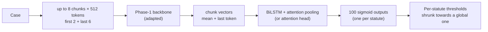

# Phase 5 · `final-ensembles`

Analysis and the final ensemble run on CPU only. Each member is shifted so its per-statute threshold sits at 0, the members are averaged, and thresholds are chosen with an honest half-split check. The average of 5 calibrated models scored **0.3952**.

## Architecture

The pipeline all notebooks in this phase build on:

## Setup shared by these notebooks

- **Input:** each case is read as at most eight 512-token chunks (first 2 + last 6 for long cases); the Phase-1 backbone encodes each chunk (mean + last-token pooling).
- **Head:** a BiLSTM with attention pooling (batch 4 on adds an attention head variant) → 100 sigmoid outputs.
- **Loss:** binary cross-entropy with positive weights √(neg/pos), capped at 10.
- **Training:** AdamW, batch 1 × accumulation 16, fp16. An "epoch" is 6,000 cases drawn from a reshuffled stream (8 epochs ≈ 1.1 passes over the data, 16 ≈ 2.2). Epochs are chosen by macro-F1 on a 2,000-case sample of the selection set.
- **Thresholds:** global, per-statute, or *shrunk* (halfway to the global one), each scored honestly: fitted on one half of the 10,079-case selection set and scored on the other. Hyperparameters are our placeholders and were not tuned.

## Notebooks in this folder

| Notebook | What it does |
|---|---|
| `p5-final-ensemble.ipynb` | Shifts each member so its per-statute threshold sits at 0, averages, picks thresholds, and runs an honest half-split check |
| `p5-results-and-error-analysis.ipynb` | Every run in one table; threshold strategies; per-statute F1 vs training support; co-predicted statute chains; where the head looks |

Each notebook was run on Kaggle with "Run All" and is saved **with its outputs**, so the printed tables, curves and scores are the record of that run.

## Submissions produced

5 files in [`../../submissions/final-ensembles/`](../../submissions/final-ensembles/). See that folder's README for every file; the scores that the phase README lists are:

| File | What it is | Score |
|---|---|---|
| `p5_ensemble_top5.zip` | **final**: average of 5 calibrated models | 0.3952 |
