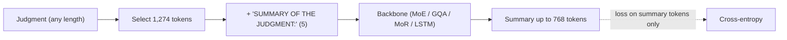
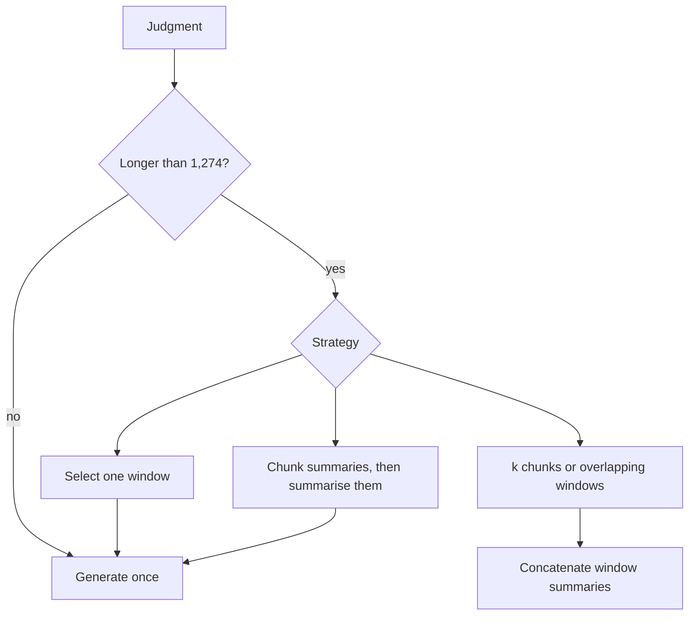
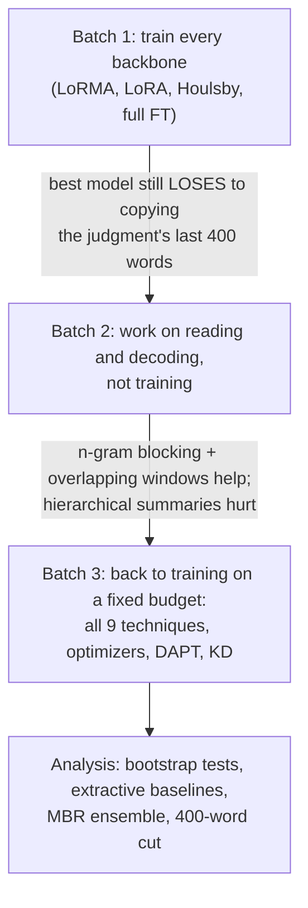
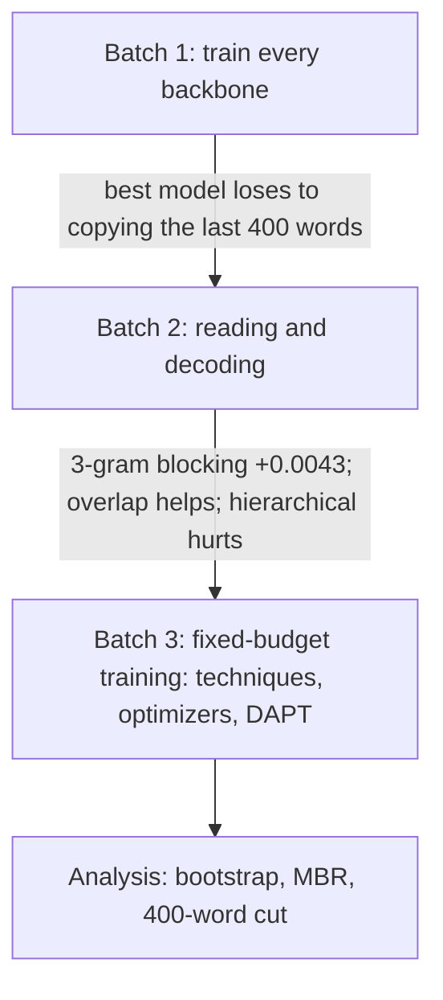

# Phase 6: Abstractive Summarisation
 
**Task.** Write a summary of an Indian judgment.
**Metric.** BERTScore F1 (primary), with ROUGE-1 / ROUGE-L as secondary metrics.
**Data.** 7,030 judgment–summary pairs; test = 100 judgments.
 
**Validation protocol.** 300 training documents were held out and never trained on; generation was scored on 100 of
them with the course's evaluation code. Dev predicted Codabench within 0.003 in every comparison.
 
**Best score: 0.8393.** This is the MoE with LoRMA. It summarises three overlapping windows with 3-gram blocking,
concatenates them, and cuts the result to 400 words.
 
---
 
## Problem and metrics
 
### Data
- Median judgment: 3,129 words. Median reference summary: 638 words.
- Reference summaries are largely extractive (they copy phrases from the judgment, especially from the end).
### BERTScore
- F1 of token-level cosine matches using `roberta-large`, `lang=en`, no baseline rescaling, so scores are compressed (about 0.80 and up).
- The scorer **truncates at about 510 tokens (about 400 words)**. Anything generated after that is not scored.
### ROUGE and diagnostics
- ROUGE-1 and ROUGE-L use the course evaluator's own LCS implementation.
- Diagnostics: `rep4` (share of repeated 4-grams), `novel3` (share of new 3-grams), `num!doc` (numbers in the summary that are not in the document), `refnum` (numbers in the reference).
### Extractive baselines (dev, 100 documents)
 
| Baseline | BERTScore |
|---|---|
| tail 400 words | 0.8370 |
| tail 640 words | 0.8354 |
| lead 640 words | 0.8331 |
| head+tail 640 words | 0.8331 |
| lead 400 words | 0.8329 |
 
The trivial baseline "copy the last 400 words" beat every batch-1 model. That is the turning point of the phase.
 
---
 
---
 
## The model
 
The task is framed as decoder-only continuation: the document (1,274 tokens), then the prompt `SUMMARY OF THE
JUDGMENT:`, then the summary. The loss is computed on the summary only. The GDN encoder–decoder is the exception: its
encoder reads the document and its decoder writes the summary.
 
## Token budget and training recipe
 
Decoder-only models (MoE, GQA, MoR) and the LSTM are trained as language models on one sequence:
 
```
[selected judgment text] SUMMARY OF THE JUDGMENT: [summary] </s>
```
 
- The loss is computed on the **summary tokens only**.
- `</s>` is added only if the summary was not truncated.
- GDN is an encoder-decoder: the encoder reads the judgment (chunks of 1,019 = 1,024 - 5 tokens), the decoder writes the summary.
```math
2048 = 1274\ (\text{document}) + 5\ (\text{separator}) + 768\ (\text{summary}) + 1\ (\text{end token})
```
 
Two separate budgets:
- **Documents** are compared to 1,274. If longer, a selection strategy (section 4) picks 1,274 tokens.
- **Reference summaries** are compared to 768. Only 58% fit; longer ones are truncated for training. The 768 slots are reserved even for short summaries.
- Documents over 32,768 tokens keep their first and last halves before any selection.
- The separator length of 5 was derived from the numbers, not read directly.

 
### Training recipe
- Micro-batch 1 x accumulation 16, AdamW (0.9, 0.98), weight decay 0.01, fp16.
- 5% warm-up, then linear decay.
- Learning rate: 3e-4 (LoRA-type), 5e-4 (adapters), 3e-5 (full fine-tuning).
- 3 epochs (an epoch is a full pass over 6,728 documents). The checkpoint is chosen by teacher-forced dev loss.
### Techniques
LoRA, LoRMA (multiplicative, plus variant, r = 16, alpha = 32), Houlsby adapters (bottleneck 64, about 99K parameters each, 16 adapters, about 1.59M), full fine-tuning, Pfeiffer, QLoRA, AdaLoRA, prompt tuning, prefix tuning. The LSTM has only full fine-tuning.
 
| Run | Trainable parameters |
|---|---|
| MoE LoRMA | 0.49M |
| MoR LoRMA | 0.31M |
| GDN LoRMA | 1.38M |
| GQA Houlsby | 1.59M |
| GQA full FT | 111.1M |
 
---
 
---
 
## Decoding
 
- Greedy, `MIN_NEW` 454 and `MAX_NEW` 768 tokens.
- **No-repeat n-gram blocking** (generated tokens only): forbid any n-gram already generated.
- Repetition penalty (divide logits of seen tokens), top-p sampling.
- KV cache everywhere except MoR, which recomputes everything each step (0.04 documents/s).
| GQA, no-repeat setting | Dev BERTScore | rep4 |
|---|---|---|
| none | 0.7650 | 0.935 |
| 4-gram | 0.8308 | |
| **3-gram** | **0.8354** | |
| 2-gram | 0.8341 | |
 
Without blocking the model loops. Blocking fixed degenerate repetition and was the largest single gain for every model.
 
---
 
---
 
## Reading long documents (the part with the most doubts)
 
Training only sees 1,274 tokens. How the judgment is cut down matters.
 
### Selection (one window, used at training and inference)
 
| Strategy | What it keeps |
|---|---|
| `head` | first 1,274 tokens |
| `tail` | last 1,274 tokens |
| `head_tail` 70:30 | 891 first + 383 last (**training default**) |
| `importance` | highest-scoring blocks (see below); first 128 tokens always kept |
| `sections` | blocks with the most cue tokens; first 128 and last 254 tokens kept |
 
### The importance score is TF-IDF weighting
 
```math
\text{score}(\text{block}) = \frac{\sum_{t \in \text{block}} \log(1+\text{tf}_t)\cdot \text{idf}_t}{\sqrt{\text{len}}}, \qquad
\text{idf}_t = \log\frac{1+N}{1+\text{df}_t} + 1
```
 
It is not graph centrality and not a learned model. The `sections` score is cue-token count divided by the square root of length.
 
### Multi-prompt reading (inference only)
- **Chunk-wise:** split into k chunks, summarise each, concatenate. Each chunk gets `MAX_NEW // k` and `MIN_NEW // k` tokens (256 / 151 for k = 3).
- **Overlapping windows:** windows of 1,274 tokens with stride 637, last window end-aligned, at most 3. With more than 3 candidate windows, 3 evenly spread ones are taken, including first and last (the notes say "consecutive", the code spreads them).
- **Hierarchical:** a second pass summarises the joined chunk summaries.
### Worked example: a 3,350-token judgment
 
| Window | Tokens |
|---|---|
| w1 | 0 to 1,274 |
| w2 | 1,274 to 2,548 (chunks) |
| w3 | 2,076 to 3,350 (end-aligned) |
| overlap w2/w3 | 2,076 to 2,548 |
 
For a 6,000-token judgment the starts are 0, 2,548 and 4,726. Only about 3,800 tokens are ever read, so overlap only helps medium-length judgments, and the longest third remains worst.
 

 
---
 
---
 
## Knowledge distillation
 
- **Sequence-level:** the MoE teacher summarised 2,500 training documents (107 minutes); the student trains on teacher summaries.
- **Word-level:** the teacher saves its top-16 log-probabilities per position. Both distributions are restricted to those 16 tokens and renormalised.
```math
L = (1-\alpha)\,\text{CE} + \alpha\, T^2\, \text{KL}(p_T \,\|\, p_S),\qquad \alpha = 0.5,\ T = 2
```
 
| Run | Dev | Codabench |
|---|---|---|
| GQA LoRMA (no KD) | 0.8279 | 0.8277 |
| GQA LoRMA + sequence-KD | 0.8185 | 0.8195 |
| GQA Houlsby + word-KD (no-repeat 3, 3 chunks) | 0.8395 | 0.8374 |
| LSTM, no KD (rep. penalty 1.2 + no-repeat 3) | 0.8150 | |
| LSTM, KD (same decoding) | 0.8153 | 0.8174 |
 
Sequence-level KD hurt (the student copies the teacher's style). Word-level was neutral on the GQA. The LSTM showed no real KD benefit.
 
---
 
---
 
## The story
 

 
**The turning point.** After batch 1 the best model still lost to a trivial extractive baseline: the last 400 words of
the judgment. Two facts explain this:
- the reference summaries are largely extractive;
- BERTScore reads only about 400 words.
So batch 2 changed *how the model reads and decodes* instead of how it is trained. This produced most of the phase's
gains:
- **n-gram blocking**, and **3-gram blocking** in particular, was the largest single gain for every model;
- **overlapping windows** let the model cover more of the judgment.
---
 
## Notebooks
 
Notebooks live in `notebooks/<folder>/`, and the folder names match the ones in `submissions/`, so a notebook and the zips it produced sit in the same-named folder. **Every folder has its own README** with a block diagram of the model, the setup and hyperparameters, and what the batch found; each `submissions/<folder>/` has a README listing its zips.
 
### Setup
| Notebook | What it does |
|---|---|
| `0-setup/p6-data-inspect.ipynb` | Document and summary lengths, compression, how extractive the summaries are (CPU) |
 
### Batch 1: train every backbone
| Notebook | What it does |
|---|---|
| `batch1-every-backbone/p6-moe.ipynb` | MoE with LoRMA and LoRA. Also the KD teacher: it summarises 2,500 training documents for the students. |
| `batch1-every-backbone/p6-gqa.ipynb` | GQA with LoRMA, LoRA, Houlsby adapters and full fine-tuning; then sequence-level KD |
| `batch1-every-backbone/p6-gdn.ipynb` | GDN encoder–decoder with LoRMA and LoRA |
| `batch1-every-backbone/p6-mor.ipynb` | LegalMoR with LoRMA and LoRA |
| `batch1-every-backbone/p6-lstm.ipynb` | LSTM full fine-tuning (+ KD). Took about 4.5 h per epoch and could not finish in 12 h. |
| `batch1-every-backbone/p6-lstm2.ipynb` | LSTM re-run within one session: 2,500 documents, with and without KD |
 
#### Batch 1 results (3 epochs, greedy, no-repeat 4)
 
| Setup | Dev | Codabench |
|---|---|---|
| MoE LoRMA | 0.8326 | 0.8302 |
| MoE LoRA | 0.8290 | 0.8298 |
| GQA full FT | 0.8308 | 0.8302 |
| GQA Houlsby | 0.8314 | 0.8280 |
| GQA LoRMA | 0.8279 | 0.8277 |
| GQA LoRA | 0.8272 | 0.8268 |
| GQA + sequence-KD | 0.8185 | 0.8195 |
| LSTM (2,500 docs) | 0.8067 | 0.8037 |
| GDN LoRMA | 0.8004 | 0.8011 |
| GDN LoRA | 0.7903 | 0.7892 |
| MoR LoRMA (60 dev docs) | 0.7944 | 0.7921 |
 
### Batch 2: reading and decoding
| Notebook | What it does |
|---|---|
| `batch2-reading-and-decoding/p6-decode-moe.ipynb` | Teacher job for word-level KD (top-16 log-probs) + decoding study on the MoE: blocking, chunking |
| `batch2-reading-and-decoding/p6-decode-gqa.ipynb` | Decoding on the saved GQA weights: length, n-gram blocking, repetition penalty, sampling, which part of the judgment to read |
| `batch2-reading-and-decoding/p6-kd-logit-gqa.ipynb` | **Word-level KD**: the MoE teacher's probabilities → GQA students (LoRMA, Houlsby) |
| `batch2-reading-and-decoding/p6-gdn2.ipynb` | GDN with Houlsby adapters and full fine-tuning |
 
#### Batch 2 results (same MoE weights, only decoding changes)
 
| MoE decoding | Dev | Codabench |
|---|---|---|
| base | 0.8326 | 0.8302 |
| **no-repeat 3** | **0.8370** | **0.8355** |
| 3 chunks (no-repeat 4) | 0.8354 | 0.8324 |
| top-p sampling | 0.8351 | |
| repetition penalty 1.2 | 0.8344 | |
| 300 to 450 tokens | 0.8335 | |
| importance input | 0.8313 | |
 
- No-repeat 3 beat any technique difference on the GQA.
- Repetition penalty 1.2 doubles numbers not in the document (0.348 to 0.551).
- Halving output length changes BERTScore by only +0.0009 and runs 1.8x faster.
- GDN full FT and Houlsby lowered loss (3.39, 3.46 vs 3.55) but not BERTScore.
### Batch 3: more decoding, and back to training on a fixed budget
| Notebook | What it does |
|---|---|
| `batch3-more-decoding-and-dapt/p6-decode-moe2.ipynb` | Around the best setting: chunks, **overlapping windows**, hierarchical summaries |
| `batch3-more-decoding-and-dapt/p6-decode-gdn.ipynb` | Decoding study on the GDN (repetition penalty + blocking) |
| `batch3-more-decoding-and-dapt/p6-decode-lstm.ipynb` | Decoding study on the LSTM (KD and non-KD weights) |
| `batch3-more-decoding-and-dapt/p6-ablate-gqa.ipynb` | All 9 techniques of the brief on one budget (1,500 docs × 2 epochs), plus long-document input strategies |
| `batch3-more-decoding-and-dapt/p6-dapt-gqa.ipynb` | Domain-adaptive pretraining before fine-tuning; a small hyperparameter check (learning rate, rank, batch) |
| `batch3-more-decoding-and-dapt/p6-opt-moe.ipynb` | Optimizers on the best model: AdamW, Adam, RMSprop, Lion, Muon, SGD-Nesterov, Adafactor |
 
#### Batch 3 results
 
**MoE, no-repeat 3 (dev):** overlap 0.8396, 3 chunks 0.8394, head+tail 50:50 0.8362, sections 0.8354, repetition penalty 1.1 0.8349, no-repeat 2 0.8347, hierarchical 0.8316.
 
**GDN:** best is repetition penalty 1.2 + no-repeat 3 (0.8143 dev, 0.8129 Codabench). Two chunks hurt (0.7977 vs 0.8004).
**LSTM:** repetition penalty 1.2 + no-repeat 3 gives 0.8194 (+0.013 over base).
 
**Technique ablation (GQA, 1,500 documents x 2 epochs, 100 dev documents):**
 
| Setup | Dev |
|---|---|
| Houlsby | 0.8238 |
| full FT | 0.8221 |
| LoRMA (reference) | 0.8210 |
| head input | 0.8208 |
| Pfeiffer | 0.8203 |
| QLoRA | 0.8194 |
| LoRA | 0.8188 |
| importance input | 0.8186 |
| tail only | 0.8121 |
| 512-token budget | 0.8116 |
| AdaLoRA | 0.7936 |
| prefix | 0.7908 |
| prompt | 0.7871 |
| random init | 0.7401 |
 
- Significant: tail only (-0.0089), 512 budget (-0.0094), Houlsby vs LoRMA (+0.0028, p 0.03), random init (-0.0820).
- Not significant: head (-0.0001), importance (-0.0024), QLoRA vs LoRA (+0.0006).
**Hyper-parameters (GQA LoRMA):** rank 64 (0.8259), LR 1e-3 (0.8257), batch 4 (0.8252) help over reference 0.8221; rank 4 (0.8155), LR 1e-4 (0.8140), batch 64 (0.8134) hurt. Codabench: reference 0.8218, LR 1e-3 0.8247, rank 64 0.8239.
 
**DAPT:** held-out LM loss 3.420 to 3.182 (full FT) / 3.224 (Houlsby), but BERTScore +0.0005 (not significant); Codabench full FT 0.8298, Houlsby 0.8288. Lower loss did not become a better summary.
 
**Optimizers (MoE LoRMA, 1,500 documents):** Adam 0.8364 = AdamW 0.8363 > RMSprop 0.8354 > Lion 0.8333 > Muon 0.8327 > SGD-Nesterov 0.8311 >> Adafactor 0.7914. Muon had the lowest loss (2.759 vs 2.814) but not the best score.
 
### Analysis (no training)
| Notebook | What it does |
|---|---|
| `final-analysis/p6-analysis.ipynb` | Every result with bootstrap confidence intervals, extractive baselines, paired tests, length analysis, factuality proxies, the **MBR ensemble** and the **400-word cut** (final submission) |
 
#### Analysis results
 
| Paired bootstrap | Difference |
|---|---|
| LoRMA vs LoRA, MoE | +0.0036 (p 0.004) |
| LoRMA vs LoRA, GDN | +0.0101 (p < 0.001) |
| LoRMA vs LoRA, MoR | +0.0020 (p 0.05) |
| LoRMA vs LoRA, GQA | +0.0007 (n.s.) |
| Full FT vs Houlsby, GQA | -0.0006 (n.s.) |
| Full FT vs LoRMA | +0.0029 (p 0.02) |
| Overlap vs single window, MoE | +0.0027 (p 0.009) |
| Hierarchical, MoE / GQA | -0.0053 / -0.0071 |
| MoE vs GQA | +0.0018 (p 0.09, n.s.) |
 
**By document length (BERTScore, short / medium / long thirds, cut points 2,482 and 4,027 tokens):**
 
| System | Short | Medium | Long |
|---|---|---|---|
| MoE single window | 0.8351 | 0.8318 | 0.8311 |
| MoE overlapping chunks | 0.8426 | 0.8409 | 0.8354 |
| GQA single window | 0.8354 | 0.8324 | 0.8246 |
| GQA chunks | 0.8341 | 0.8373 | 0.8301 |
 
**Length:** BERTScore peaks at 0.5 to 0.8x reference length (0.8259); ROUGE-1 at 0.8 to 1.2x (0.4745).
 
**Factuality proxies:** `num!doc` is 0 for extractive, 0.372 for MoE, 0.334 to 0.389 for GQA, 0.59 to 0.68 for LSTM, 0.69 to 0.84 for GDN, about 0.5 for hierarchical. About half of generated legal references are not in the document; MoE legal-reference recall is 0.427 (sections input 0.458).
 
**MBR ensemble.** For each document, among the top-8 systems' summaries pick the one with the highest mean BERTScore against the other candidates. Pools top 3/4/5/6/8: 0.8399 / 0.8398 / 0.8398 / 0.8404 / 0.8408 dev; oracle 0.8469; Codabench 0.8387. It picks the MoE for 93% of dev and 98% of test documents, so it is nearly the MoE alone.
 
**400-word cut.** BERTScore +0.0011 to +0.0012 (Codabench 0.8382 to 0.8393), ROUGE-1 -0.025 (0.482 to 0.457). It is a metric effect because the scorer truncates.
 

 
---
 
---
 
## Submissions (`submissions/`), selected Codabench scores
 
Submissions are grouped into **families** (one folder per batch of experiments, so the folders follow the story above):
 
| Folder in `submissions/` | What is inside | Files |
|---|---|---|
| `batch1-every-backbone/` | Train every backbone (LoRMA, LoRA, Houlsby, full FT), LSTM re-run, sequence-level KD | 13 |
| `batch2-reading-and-decoding/` | Decoding on the MoE and GQA, word-level KD, GDN adapters | 9 |
| `batch3-more-decoding-and-dapt/` | Overlapping windows, GDN and LSTM decoding, DAPT and the hyperparameter check | 15 |
| `final-analysis/` | MBR ensemble and the 400-word cut (the final submission) | 2 |
 
| Submission | What it is | BERTScore F1 |
|---|---|---|
| `final-analysis/p6_postproc_dec_moe2_norep3_overlap3_first_400_words.zip` | **final**: MoE LoRMA, 3 overlapping windows, 3-gram blocking, cut to 400 words | **0.8393** |
| `final-analysis/p6_ensemble_mbr8.zip` | MBR ensemble over the 8 best systems | 0.8387 |
| `batch3-more-decoding-and-dapt/p6_decode_moe2_norep3_overlap3.zip` | MoE, overlapping windows (before the cut) | 0.8382 |
| `batch2-reading-and-decoding/p6_decode_gqa_kdlhb_norep3_chunks3.zip` | GQA Houlsby + word-level KD (best student, half the size) | 0.8374 |
| `batch1-every-backbone/p6_moe_moe_lorma.zip` | batch-1 MoE LoRMA | 0.8302 |
| `batch1-every-backbone/p6_gqa_gqa_full_ft.zip` / `batch1-every-backbone/p6_gqa_gqa_houlsby.zip` / `batch1-every-backbone/p6_gqa_gqa_lorma.zip` | batch-1 GQA techniques | 0.8302 / 0.8280 / 0.8277 |
| `batch1-every-backbone/p6_gqa_kd_gqa_lorma.zip` | sequence-level KD (hurt) | 0.8195 |
| `batch3-more-decoding-and-dapt/p6_decode_lstm_kd_reppen1.2_norep3.zip` | best LSTM | 0.8174 |
| `batch3-more-decoding-and-dapt/p6_decode_gdn_lorma_reppen1.2_norep3.zip` | best GDN | 0.8129 |
| `batch1-every-backbone/p6_mor_mor_lorma.zip` | MoR LoRMA | 0.7921 |
 
The `p6_dapt_gqa_hp_*` zips are the hyperparameter check: reference 0.8218, LR 1e-3 0.8247, rank 64 0.8239.
 
**What did not work:**
- **Hierarchical summaries** (summarising the chunk summaries) lost information.
- **Sequence-level KD** made the student copy the teacher's style.
- **Prompt and prefix tuning** could not steer a small LM to a long output.
The 400-word cut raises BERTScore only because the scorer truncates. ROUGE-1 drops.
 
### Cost (T4, full data, 3 epochs)
 
| Run | Peak GB | Train min | Docs/s generating |
|---|---|---|---|
| MoE LoRMA | 3.2 | 57.1 | 0.22 |
| GQA full FT | 5.1 | 37.3 | 1.22 |
| GQA Houlsby | 4.1 | 29.8 | 0.82 |
| GQA LoRMA | 4.1 | 30.8 | 0.81 |
| GDN LoRMA | 2.4 | 110.1 | 0.98 |
| KD LSTM | 3.1 | 105.4 | 0.21 |
| MoR LoRMA | 2.5 | 38.0 | 0.04 |
 
---
 
---
 
## FAQ
 
**Why check the document against 1,274 and the summary against 768?** They are two parts of one 2,048-token sequence. The summary space is always reserved.
 
**Why did decoding matter more than training?** The summaries are largely extractive and models looped; blocking raised the GQA from 0.7650 to 0.8354.
 
**Is the 400-word cut a better summary?** No. It raises BERTScore only because the scorer truncates; ROUGE-1 falls.
 
**Why did hierarchical summaries fail?** Summarising summaries lost detail and invented numbers.
 
**Why did MBR not beat the MoE?** It chose the MoE for 93% to 98% of documents.
 
## Limits and not verified
 
- Numbers come from the project notes and were not re-run for this README.
- The notes' analysis file says its conclusions are for the student to verify.
- Some Round 1 Codabench entries showed "Failed"; check that the final four show "Finished".
- The notes' log says `p6-decode-gqa` ran in Round 3; the repo files it under batch 2.
- The claim that the 400-word cut keeps about 1.7 windows' worth of summary is an inference, not measured.
- Only about 3,800 tokens of a long judgment are read; the longest third is weakest.
 
