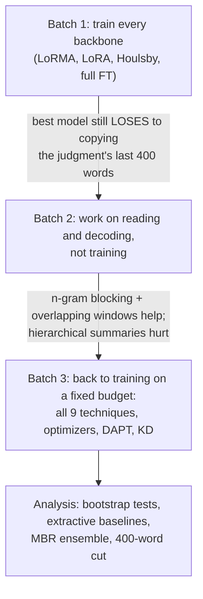

# Phase 6: Abstractive Summarisation

**Task.** Write a summary of an Indian judgment.
**Metric.** BERTScore F1 (primary), with ROUGE-1 / ROUGE-L as secondary metrics.
**Data.** 7,030 judgment–summary pairs; test = 100 judgments.

**Validation protocol.** 300 training documents were held out and never trained on; generation was scored on 100 of
them with the course's evaluation code. Dev predicted Codabench within 0.003 in every comparison.

**Best score: 0.8393.** This is the MoE with LoRMA. It summarises three overlapping windows with 3-gram blocking,
concatenates them, and cuts the result to 400 words.

---

## The model

The task is framed as decoder-only continuation: the document (1,274 tokens), then the prompt `SUMMARY OF THE
JUDGMENT:`, then the summary. The loss is computed on the summary only. The GDN encoder–decoder is the exception: its
encoder reads the document and its decoder writes the summary.

## The story

**The turning point.** After batch 1 the best model still lost to a trivial extractive baseline: the last 400 words of
the judgment. Two facts explain this:
- the reference summaries are largely extractive;
- BERTScore reads only about 400 words.

So batch 2 changed *how the model reads and decodes* instead of how it is trained. This produced most of the phase's
gains:
- **n-gram blocking**, and **3-gram blocking** in particular, was the largest single gain for every model;
- **overlapping windows** let the model cover more of the judgment.

---

## Notebooks

Notebooks live in `notebooks/<folder>/`, and the folder names match the ones in `submissions/`, so a notebook and the zips it produced sit in the same-named folder. **Every folder has its own README** with a block diagram of the model, the setup and hyperparameters, and what the batch found; each `submissions/<folder>/` has a README listing its zips.

### Setup
| Notebook | What it does |
|---|---|
| `0-setup/p6-data-inspect.ipynb` | Document and summary lengths, compression, how extractive the summaries are (CPU) |

### Batch 1: train every backbone
| Notebook | What it does |
|---|---|
| `batch1-every-backbone/p6-moe.ipynb` | MoE with LoRMA and LoRA. Also the KD teacher: it summarises 2,500 training documents for the students. |
| `batch1-every-backbone/p6-gqa.ipynb` | GQA with LoRMA, LoRA, Houlsby adapters and full fine-tuning; then sequence-level KD |
| `batch1-every-backbone/p6-gdn.ipynb` | GDN encoder–decoder with LoRMA and LoRA |
| `batch1-every-backbone/p6-mor.ipynb` | LegalMoR with LoRMA and LoRA |
| `batch1-every-backbone/p6-lstm.ipynb` | LSTM full fine-tuning (+ KD). Took about 4.5 h per epoch and could not finish in 12 h. |
| `batch1-every-backbone/p6-lstm2.ipynb` | LSTM re-run within one session: 2,500 documents, with and without KD |

### Batch 2: reading and decoding
| Notebook | What it does |
|---|---|
| `batch2-reading-and-decoding/p6-decode-moe.ipynb` | Teacher job for word-level KD (top-16 log-probs) + decoding study on the MoE: blocking, chunking |
| `batch2-reading-and-decoding/p6-decode-gqa.ipynb` | Decoding on the saved GQA weights: length, n-gram blocking, repetition penalty, sampling, which part of the judgment to read |
| `batch2-reading-and-decoding/p6-kd-logit-gqa.ipynb` | **Word-level KD**: the MoE teacher's probabilities → GQA students (LoRMA, Houlsby) |
| `batch2-reading-and-decoding/p6-gdn2.ipynb` | GDN with Houlsby adapters and full fine-tuning |

### Batch 3: more decoding, and back to training on a fixed budget
| Notebook | What it does |
|---|---|
| `batch3-more-decoding-and-dapt/p6-decode-moe2.ipynb` | Around the best setting: chunks, **overlapping windows**, hierarchical summaries |
| `batch3-more-decoding-and-dapt/p6-decode-gdn.ipynb` | Decoding study on the GDN (repetition penalty + blocking) |
| `batch3-more-decoding-and-dapt/p6-decode-lstm.ipynb` | Decoding study on the LSTM (KD and non-KD weights) |
| `batch3-more-decoding-and-dapt/p6-ablate-gqa.ipynb` | All 9 techniques of the brief on one budget (1,500 docs × 2 epochs), plus long-document input strategies |
| `batch3-more-decoding-and-dapt/p6-dapt-gqa.ipynb` | Domain-adaptive pretraining before fine-tuning; a small hyperparameter check (learning rate, rank, batch) |
| `batch3-more-decoding-and-dapt/p6-opt-moe.ipynb` | Optimizers on the best model: AdamW, Adam, RMSprop, Lion, Muon, SGD-Nesterov, Adafactor |

### Analysis (no training)
| Notebook | What it does |
|---|---|
| `final-analysis/p6-analysis.ipynb` | Every result with bootstrap confidence intervals, extractive baselines, paired tests, length analysis, factuality proxies, the **MBR ensemble** and the **400-word cut** (final submission) |

---

## Submissions (`submissions/`), selected Codabench scores

Submissions are grouped into **families** (one folder per batch of experiments, so the folders follow the story above):

| Folder in `submissions/` | What is inside | Files |
|---|---|---|
| `batch1-every-backbone/` | Train every backbone (LoRMA, LoRA, Houlsby, full FT), LSTM re-run, sequence-level KD | 13 |
| `batch2-reading-and-decoding/` | Decoding on the MoE and GQA, word-level KD, GDN adapters | 9 |
| `batch3-more-decoding-and-dapt/` | Overlapping windows, GDN and LSTM decoding, DAPT and the hyperparameter check | 15 |
| `final-analysis/` | MBR ensemble and the 400-word cut (the final submission) | 2 |

| Submission | What it is | BERTScore F1 |
|---|---|---|
| `final-analysis/p6_postproc_dec_moe2_norep3_overlap3_first_400_words.zip` | **final**: MoE LoRMA, 3 overlapping windows, 3-gram blocking, cut to 400 words | **0.8393** |
| `final-analysis/p6_ensemble_mbr8.zip` | MBR ensemble over the 8 best systems | 0.8387 |
| `batch3-more-decoding-and-dapt/p6_decode_moe2_norep3_overlap3.zip` | MoE, overlapping windows (before the cut) | 0.8382 |
| `batch2-reading-and-decoding/p6_decode_gqa_kdlhb_norep3_chunks3.zip` | GQA Houlsby + word-level KD (best student, half the size) | 0.8374 |
| `batch1-every-backbone/p6_moe_moe_lorma.zip` | batch-1 MoE LoRMA | 0.8302 |
| `batch1-every-backbone/p6_gqa_gqa_full_ft.zip` / `batch1-every-backbone/p6_gqa_gqa_houlsby.zip` / `batch1-every-backbone/p6_gqa_gqa_lorma.zip` | batch-1 GQA techniques | 0.8302 / 0.8280 / 0.8277 |
| `batch1-every-backbone/p6_gqa_kd_gqa_lorma.zip` | sequence-level KD (hurt) | 0.8195 |
| `batch3-more-decoding-and-dapt/p6_decode_lstm_kd_reppen1.2_norep3.zip` | best LSTM | 0.8174 |
| `batch3-more-decoding-and-dapt/p6_decode_gdn_lorma_reppen1.2_norep3.zip` | best GDN | 0.8129 |
| `batch1-every-backbone/p6_mor_mor_lorma.zip` | MoR LoRMA | 0.7921 |

The `p6_dapt_gqa_hp_*` zips are the hyperparameter check: reference 0.8218, LR 1e-3 0.8247, rank 64 0.8239.

**What did not work:**
- **Hierarchical summaries** (summarising the chunk summaries) lost information.
- **Sequence-level KD** made the student copy the teacher's style.
- **Prompt and prefix tuning** could not steer a small LM to a long output.

The 400-word cut raises BERTScore only because the scorer truncates. ROUGE-1 drops.
