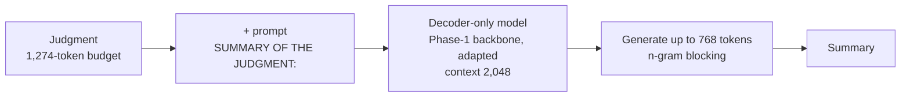

# Phase 6 · `batch1-every-backbone`

**Question.** How does each backbone do with each technique (LoRMA, LoRA, Houlsby, full fine-tuning), and does sequence-level KD help? **Finding.** The best model (MoE 0.8302) still lost to a trivial baseline, the last 400 words of the judgment. Sequence-level KD made the student copy the teacher's style (0.8195). The LSTM took about 4.5 hours per epoch, so `p6-lstm2` re-ran it on 2,500 documents.

## Architecture

The pipeline all notebooks in this phase build on:

## Setup shared by these notebooks

- **Framing:** decoder-only continuation. The sequence is the selected document (budget 1,274 tokens, head and tail 70:30), the prompt `SUMMARY OF THE JUDGMENT:`, then the summary (at most 768 tokens). The context is 2,048 tokens and the loss is computed on the summary only. The GDN encoder–decoder instead encodes up to 1,024 document tokens and decodes up to 768.
- **Training (batch 1):** 3 epochs over 6,728 training documents, batch 16 via accumulation; learning rate 3e-4 for LoRA-type methods, 5e-4 for adapters, 3e-5 for full fine-tuning.
- **Validation:** 300 training documents are held out and never trained on (fixed seed); generation is scored on 100 of them with the course's evaluation code (BERTScore F1 with roberta-large).
- **Generation:** greedy, with an n-gram repeat block; batch 2 and 3 vary it. Hyperparameters are our placeholders and were not tuned.

## Notebooks in this folder

| Notebook | What it does |
|---|---|
| `p6-gdn.ipynb` | GDN encoder–decoder with LoRMA and LoRA |
| `p6-gqa.ipynb` | GQA with LoRMA, LoRA, Houlsby adapters and full fine-tuning; then sequence-level KD |
| `p6-lstm.ipynb` | LSTM full fine-tuning (+ KD). Took about 4.5 h per epoch and could not finish in 12 h. |
| `p6-lstm2.ipynb` | LSTM re-run within one session: 2,500 documents, with and without KD |
| `p6-moe.ipynb` | MoE with LoRMA and LoRA. Also the KD teacher: it summarises 2,500 training documents for the students. |
| `p6-mor.ipynb` | LegalMoR with LoRMA and LoRA |

Each notebook was run on Kaggle with "Run All" and is saved **with its outputs**, so the printed tables, curves and scores are the record of that run.

## Submissions produced

13 files in [`../../submissions/batch1-every-backbone/`](../../submissions/batch1-every-backbone/). See that folder's README for every file; the scores that the phase README lists are:

| File | What it is | Score |
|---|---|---|
| `p6_gqa_kd_gqa_lorma.zip` | sequence-level KD (hurt) | 0.8195 |
| `p6_moe_moe_lorma.zip` | batch-1 MoE LoRMA | 0.8302 |
| `p6_mor_mor_lorma.zip` | MoR LoRMA | 0.7921 |
