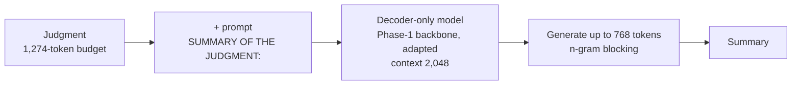
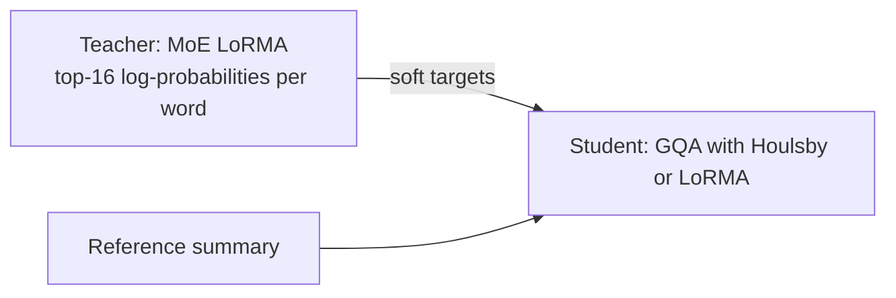

# Phase 6 · `batch2-reading-and-decoding`

**Question.** Since training did not beat the extractive baseline, does changing how the model reads and decodes help? **Finding.** N-gram blocking (3-gram in particular) was the largest single gain for every model, and chunked reading helped; hierarchical summaries hurt. Word-level KD gave the best student, a half-size GQA with Houlsby adapters (0.8374).

## Architecture

The pipeline all notebooks in this phase build on:

Word-level distillation: the student learns the teacher's next-word probabilities.

## Setup shared by these notebooks

- **Framing:** decoder-only continuation. The sequence is the selected document (budget 1,274 tokens, head and tail 70:30), the prompt `SUMMARY OF THE JUDGMENT:`, then the summary (at most 768 tokens). The context is 2,048 tokens and the loss is computed on the summary only. The GDN encoder–decoder instead encodes up to 1,024 document tokens and decodes up to 768.
- **Training (batch 1):** 3 epochs over 6,728 training documents, batch 16 via accumulation; learning rate 3e-4 for LoRA-type methods, 5e-4 for adapters, 3e-5 for full fine-tuning.
- **Validation:** 300 training documents are held out and never trained on (fixed seed); generation is scored on 100 of them with the course's evaluation code (BERTScore F1 with roberta-large).
- **Generation:** greedy, with an n-gram repeat block; batch 2 and 3 vary it. Hyperparameters are our placeholders and were not tuned.

## Notebooks in this folder

| Notebook | What it does |
|---|---|
| `p6-decode-gqa.ipynb` | Decoding on the saved GQA weights: length, n-gram blocking, repetition penalty, sampling, which part of the judgment to read |
| `p6-decode-moe.ipynb` | Teacher job for word-level KD (top-16 log-probs) + decoding study on the MoE: blocking, chunking |
| `p6-gdn2.ipynb` | GDN with Houlsby adapters and full fine-tuning |
| `p6-kd-logit-gqa.ipynb` | **Word-level KD**: the MoE teacher's probabilities → GQA students (LoRMA, Houlsby) |

Each notebook was run on Kaggle with "Run All" and is saved **with its outputs**, so the printed tables, curves and scores are the record of that run.

## Submissions produced

9 files in [`../../submissions/batch2-reading-and-decoding/`](../../submissions/batch2-reading-and-decoding/). See that folder's README for every file; the scores that the phase README lists are:

| File | What it is | Score |
|---|---|---|
| `p6_decode_gqa_kdlhb_norep3_chunks3.zip` | GQA Houlsby + word-level KD (best student, half the size) | 0.8374 |
