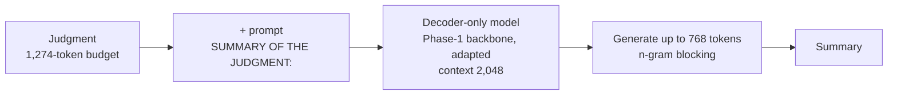
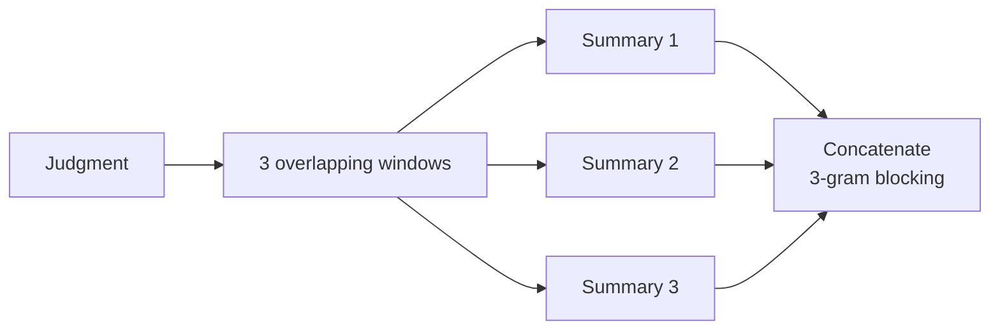

# Phase 6 · `batch3-more-decoding-and-dapt`

**Question.** Do overlapping windows, all 9 techniques on one budget, domain-adaptive pretraining, or other optimizers help? **Finding.** Overlapping windows gave the best system (0.8382 before the cut). Domain-adaptive pretraining and the optimizer choice changed little. `p6-ablate-gqa` and `p6-opt-moe` produced tables rather than submissions.

## Architecture

The pipeline all notebooks in this phase build on:

Overlapping windows: the best reading strategy of the phase.

## Setup shared by these notebooks

- **Framing:** decoder-only continuation. The sequence is the selected document (budget 1,274 tokens, head and tail 70:30), the prompt `SUMMARY OF THE JUDGMENT:`, then the summary (at most 768 tokens). The context is 2,048 tokens and the loss is computed on the summary only. The GDN encoder–decoder instead encodes up to 1,024 document tokens and decodes up to 768.
- **Training (batch 1):** 3 epochs over 6,728 training documents, batch 16 via accumulation; learning rate 3e-4 for LoRA-type methods, 5e-4 for adapters, 3e-5 for full fine-tuning.
- **Validation:** 300 training documents are held out and never trained on (fixed seed); generation is scored on 100 of them with the course's evaluation code (BERTScore F1 with roberta-large).
- **Generation:** greedy, with an n-gram repeat block; batch 2 and 3 vary it. Hyperparameters are our placeholders and were not tuned.

## Notebooks in this folder

| Notebook | What it does |
|---|---|
| `p6-ablate-gqa.ipynb` | All 9 techniques of the brief on one budget (1,500 docs × 2 epochs), plus long-document input strategies |
| `p6-dapt-gqa.ipynb` | Domain-adaptive pretraining before fine-tuning; a small hyperparameter check (learning rate, rank, batch) |
| `p6-decode-gdn.ipynb` | Decoding study on the GDN (repetition penalty + blocking) |
| `p6-decode-lstm.ipynb` | Decoding study on the LSTM (KD and non-KD weights) |
| `p6-decode-moe2.ipynb` | Around the best setting: chunks, **overlapping windows**, hierarchical summaries |
| `p6-opt-moe.ipynb` | Optimizers on the best model: AdamW, Adam, RMSprop, Lion, Muon, SGD-Nesterov, Adafactor |

Each notebook was run on Kaggle with "Run All" and is saved **with its outputs**, so the printed tables, curves and scores are the record of that run.

## Submissions produced

15 files in [`../../submissions/batch3-more-decoding-and-dapt/`](../../submissions/batch3-more-decoding-and-dapt/). See that folder's README for every file; the scores that the phase README lists are:

| File | What it is | Score |
|---|---|---|
| `p6_decode_gdn_lorma_reppen1.2_norep3.zip` | best GDN | 0.8129 |
| `p6_decode_lstm_kd_reppen1.2_norep3.zip` | best LSTM | 0.8174 |
| `p6_decode_moe2_norep3_overlap3.zip` | MoE, overlapping windows (before the cut) | 0.8382 |
