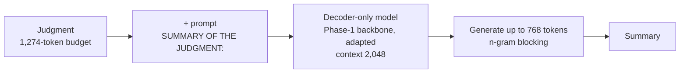
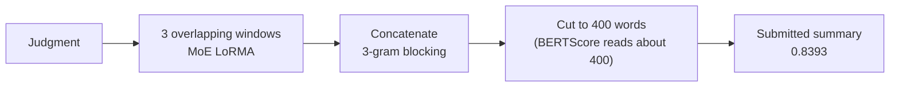

# Phase 6 · `final-analysis`

Analysis without training: every result with bootstrap confidence intervals, extractive baselines, paired tests, length analysis, the MBR ensemble and the 400-word cut. The cut raises BERTScore only because the scorer truncates at about 400 words (ROUGE-1 drops). **Final: 0.8393.**

## Architecture

The pipeline all notebooks in this phase build on:

The final submission pipeline.

## Setup shared by these notebooks

- **Framing:** decoder-only continuation. The sequence is the selected document (budget 1,274 tokens, head and tail 70:30), the prompt `SUMMARY OF THE JUDGMENT:`, then the summary (at most 768 tokens). The context is 2,048 tokens and the loss is computed on the summary only. The GDN encoder–decoder instead encodes up to 1,024 document tokens and decodes up to 768.
- **Training (batch 1):** 3 epochs over 6,728 training documents, batch 16 via accumulation; learning rate 3e-4 for LoRA-type methods, 5e-4 for adapters, 3e-5 for full fine-tuning.
- **Validation:** 300 training documents are held out and never trained on (fixed seed); generation is scored on 100 of them with the course's evaluation code (BERTScore F1 with roberta-large).
- **Generation:** greedy, with an n-gram repeat block; batch 2 and 3 vary it. Hyperparameters are our placeholders and were not tuned.

## Notebooks in this folder

| Notebook | What it does |
|---|---|
| `p6-analysis.ipynb` | Every result with bootstrap confidence intervals, extractive baselines, paired tests, length analysis, factuality proxies, the **MBR ensemble** and the **400-word cut** (final submission) |

Each notebook was run on Kaggle with "Run All" and is saved **with its outputs**, so the printed tables, curves and scores are the record of that run.

## Submissions produced

2 files in [`../../submissions/final-analysis/`](../../submissions/final-analysis/). See that folder's README for every file; the scores that the phase README lists are:

| File | What it is | Score |
|---|---|---|
| `p6_ensemble_mbr8.zip` | MBR ensemble over the 8 best systems | 0.8387 |
| `p6_postproc_dec_moe2_norep3_overlap3_first_400_words.zip` | **final**: MoE LoRMA, 3 overlapping windows, 3-gram blocking, cut to 400 words | 0.8393 |
