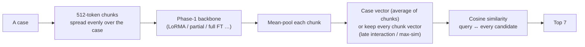
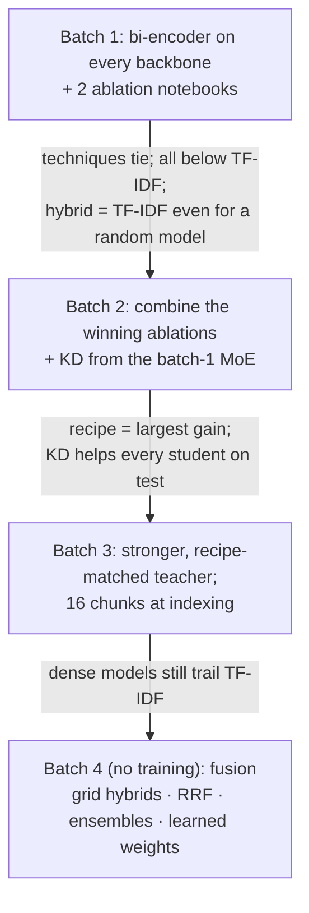

# Phase 7: Prior Case Retrieval (PCR)

**Task.** Given a query case, rank the candidate cases of the same split's pool and return the 7 most relevant prior
cases.
**Metric.** Micro-F1@7 (primary), with P@7 and R@7 as secondary metrics.
**Data.** 827 training queries (4,320 candidates); dev 118 queries (1,023 candidates); test 237 queries (1,727 candidates).

**Validation protocol.** The official dev split. A query has a median of 5 relevant cases, so even a perfect top-7
scores only 0.618.

**Best score: 0.4448.** This is a learned combination of TF-IDF, BM25 and our dense Phase-1 retrievers, which also uses
a citation link found in Supreme Court headers.
- **Leak-free result:** the same model without the header feature scores **0.4294**.
- **Best result using only Phase-1 models:** **0.3479**.

---

## The model (bi-encoder)

Training uses InfoNCE or ListNet over in-batch negatives, plus one TF-IDF hard negative.

## The story

**Data check first.** Two facts came out of inspecting the data:
- Every query also sits in its own candidate pool, so it must be removed from its own ranking.
- Supreme Court headers list citations that **directly link about a tenth of the relevant pairs**.

We kept the text as given for submissions and also trained a header-stripped copy to measure the leak. Length-normalised
**TF-IDF** (words + word pairs) beat BM25 by a wide margin and became the baseline every model had to beat.

| Batch | What it showed |
|---|---|
| **1** | Every dense model stayed below TF-IDF, and the adaptation techniques tied. Adding TF-IDF to *any* model, even a random one, gave the same hybrid score, so the dense part was not being used. The leads came from the ablations: chunks spread evenly over the case, ListNet over all relevant cases, no projection and late interaction each helped. In-batch negatives were essential; TF-IDF hard negatives were no better than random ones. |
| **2** | Combining those choices was the largest gain of the phase (MoE 0.301 → 0.328 test). KD looked like noise on dev but **helped every student on test** (+0.008 to +0.018). |
| **3** | A stronger teacher, trained with the same recipe as its students, plus reading 16 chunks per case. The distilled 111M GQA matched its 219M teacher on dev. |
| **4** | Learned logistic weights beat every fixed-weight hybrid. Scored honestly by 5×2-fold cross-validation over dev queries, the estimate matched test within 0.002. Rank fusion and gradient-boosted trees did worse. |

---

## Notebooks

Notebooks live in `notebooks/<folder>/`, and the folder names match the ones in `submissions/`, so a notebook and the zips it produced sit in the same-named folder. **Every folder has its own README** with a block diagram of the model, the setup and hyperparameters, and what the batch found; each `submissions/<folder>/` has a README listing its zips.

### Batch 1: every backbone, plus ablations
| Notebook | What it does |
|---|---|
| `batch1-every-backbone/p7-moe.ipynb` | MoE: LoRMA, partial top-2, LoRMA on header-stripped text. Saves the **KD teacher** vectors. |
| `batch1-every-backbone/p7-gqa.ipynb` | GQA: LoRMA, full fine-tuning, partial top-4, IA³, QLoRA |
| `batch1-every-backbone/p7-lstm.ipynb` | LSTM: full fine-tuning, partial (top layer) |
| `batch1-every-backbone/p7-gdn.ipynb` | GDN encoder: LoRMA, partial top-4. Its encoder never formed a similarity space. |
| `batch1-every-backbone/p7-ablate-a.ipynb` | GQA ablations: prefix / prompt tuning; objectives (InfoNCE, ListNet, pairwise, margin); negatives (hard, random, mixed, in-batch only); random-init control |
| `batch1-every-backbone/p7-ablate-b.ipynb` | GQA ablations: token pooling; chunk pooling (mean, max, attention, late interaction); dot vs cosine; no projection; chunk selection (uniform / first / head + tail); window size; header stripped |

### Batch 2: the combined recipe and knowledge distillation
| Notebook | What it does |
|---|---|
| `batch2-recipe-and-kd/p7-moe2.ipynb` | MoE: uniform chunks + ListNet; without projection; with late interaction |
| `batch2-recipe-and-kd/p7-gqa2.ipynb` | GQA: the same recipe; without projection; with 8 training chunks |
| `batch2-recipe-and-kd/p7-kd-gqa.ipynb` | **KD** MoE → GQA: the teacher's similarity distribution, its case vectors, or both |
| `batch2-recipe-and-kd/p7-kd-lstm.ipynb` | KD MoE → LSTM |
| `batch2-recipe-and-kd/p7-mor.ipynb` | LegalMoR: LoRMA, full fine-tuning, and full fine-tuning + KD |

### Batch 3: stronger teacher
| Notebook | What it does |
|---|---|
| `batch3-stronger-teacher/p7-moe3.ipynb` | The best MoE recipe re-trained as the **new teacher** (late interaction); + ListNet; + **16 chunks** at indexing (best single dense model) |
| `batch3-stronger-teacher/p7-gqa3.ipynb` | GQA with the recipe, with and without KD from the new teacher |
| `batch3-stronger-teacher/p7-lstm3.ipynb` | LSTM with the recipe, with and without KD |
| `batch3-stronger-teacher/p7-mor3.ipynb` | MoR with the recipe (LoRMA, full fine-tuning), with and without KD |

### Batch 4: fusion (CPU, no training)
| Notebook | What it does |
|---|---|
| `batch4-fusion-and-final/p7-fusion-run1.ipynb` | First fusion run (batch-1 setups only) |
| `batch4-fusion-and-final/p7-fusion-final.ipynb` | **Final fusion** over all 63 trained setups: A. TF-IDF and BM25 B. each setup + λ·TF-IDF C. reciprocal-rank fusion D. dense-only ensembles E. ensembles + TF-IDF F. paired bootstrap tests G. **learned combination weights**, scored by cross-validation, with and without the header feature |
| `batch4-fusion-and-final/p7-fusion-final-log.txt` | The full printed log of the final fusion run |

---

## Submissions (`submissions/`)

Submissions are grouped into **families** (one folder per batch of experiments, so the folders follow the story above):

| Folder in `submissions/` | What is inside | Files |
|---|---|---|
| `batch1-every-backbone/` | Bi-encoder on every backbone (LoRMA, partial, full FT, IA3, QLoRA), header-stripped copy | 24 |
| `batch2-recipe-and-kd/` | The combined recipe on MoE and GQA, and KD into GQA, LSTM and MoR | 26 |
| `batch3-stronger-teacher/` | Recipe-matched teacher, students with and without KD, 16 chunks | 22 |
| `batch4-fusion-and-final/` | No training: dense ensembles, grid fusion, rank fusion, learned weights (p7_learned = final) | 11 |

Every training notebook writes two zips per setup:
- `_dense`: our Phase-1 model alone;
- `_hybrid`: dense + λ·TF-IDF, with λ chosen on dev.

| Submission | What it is | micro-F1@7 |
|---|---|---|
| `batch4-fusion-and-final/p7_learned.zip` | **leaderboard entry**: learned combination incl. header-citation link | **0.4448** |
| `batch4-fusion-and-final/p7_learned_noheader.zip` | the same **without** the header feature (leak-free) | **0.4294** |
| `batch3-stronger-teacher/p7_gqa3_kd3_gqa_uni_maxsim_hybrid.zip` | best single hybrid (GQA KD student + TF-IDF) | 0.4152 |
| `batch4-fusion-and-final/p7_fusion_top3.zip` / `batch4-fusion-and-final/p7_fusion.zip` | grid fusions | 0.4135 / 0.4105 |
| `batch4-fusion-and-final/p7_rrf_best.zip` / `batch4-fusion-and-final/p7_learned_noheader_gbt.zip` | rank fusion / boosted trees | 0.3910 / 0.3904 |
| `batch4-fusion-and-final/p7_dense_ensemble.zip` | **best Phase-1-only system**: MoE + KD-GQA + MoE | 0.3479 |
| `batch3-stronger-teacher/p7_moe3_moe_uni_maxsim_16_dense.zip` | best single dense model (MoE, late interaction, 16 chunks) | 0.3314 |
| `batch3-stronger-teacher/p7_gqa3_kd3_gqa_uni_list_proj0_dense.zip` | GQA LoRMA + KD (no KD: 0.3001) | 0.3136 |
| `batch3-stronger-teacher/p7_mor3_mor_uni_list_proj0_dense.zip` | best MoR (LoRMA) | 0.2144 |
| `batch3-stronger-teacher/p7_lstm3_kd3_lstm_uni_list_proj0_dense.zip` | best LSTM (full fine-tuning + KD) | 0.2115 |
| `batch1-every-backbone/p7_moe_moe_lorma_dense.zip` | batch-1 MoE LoRMA | 0.3012 |
| `batch1-every-backbone/p7_gdn_gdn_lorma_dense.zip` | GDN (no similarity space) | 0.0248 |

**What we learned:**
- How a case is read and scored (which chunks, pooling, objective) mattered far more than the adaptation technique.
- Distillation from a stronger teacher helped the students on test.
- No dense retriever reached TF-IDF, because exact shared legal terms decide much of the relevance here.
