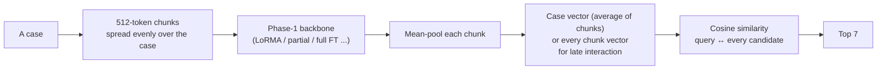

# Phase 7 · `batch1-every-backbone`

**Question.** How does a bi-encoder on each backbone compare with TF-IDF, and which design choices (pooling, objective, negatives, chunk choice) matter? **Finding.** Every dense model stayed below TF-IDF and the adaptation techniques tied. The two ablation notebooks gave the leads: chunks spread evenly over the case, ListNet, no projection and late interaction. In-batch negatives were essential. The GDN encoder never formed a similarity space (0.0248).

## Architecture

The pipeline all notebooks in this phase build on:

## Setup shared by these notebooks

- **Model (bi-encoder):** a case is cut into 512-token chunks; the Phase-1 backbone encodes each chunk (token mean-pooling); the chunk vectors are averaged into one case vector (or kept for late interaction). Relevance is cosine similarity; the 7 best candidates of the split's pool are returned, with the query itself removed from its own ranking.
- **Training:** in-batch negatives (8 queries per step) with InfoNCE (temperature 0.05) or ListNet. Batch 1 uses 4 training chunks (first 2 + last 2) and 8 chunks when indexing, projecting to 256 dimensions; later batches use chunks spread evenly over the case and often no projection.
- **Learning rates (batch 1):** LoRMA 3e-4, IA³ 3e-3, full fine-tuning 2e-5, partial 5e-5, prompt/prefix 3e-3, projection 1e-3. The epoch is chosen on dev micro-F1@7, evaluated after every epoch.
- **Every setup writes two zips:** `_dense` (our model alone) and `_hybrid` (dense + λ × TF-IDF, λ chosen on dev from {0.25, 0.5, 1, 2, 4}). Hyperparameters are our placeholders and were not tuned.

## Notebooks in this folder

| Notebook | What it does |
|---|---|
| `p7-ablate-a.ipynb` | GQA ablations: prefix / prompt tuning; objectives (InfoNCE, ListNet, pairwise, margin); negatives (hard, random, mixed, in-batch only); random-init control |
| `p7-ablate-b.ipynb` | GQA ablations: token pooling; chunk pooling (mean, max, attention, late interaction); dot vs cosine; no projection; chunk selection (uniform / first / head + tail); window size; header stripped |
| `p7-gdn.ipynb` | GDN encoder: LoRMA, partial top-4. Its encoder never formed a similarity space. |
| `p7-gqa.ipynb` | GQA: LoRMA, full fine-tuning, partial top-4, IA³, QLoRA |
| `p7-lstm.ipynb` | LSTM: full fine-tuning, partial (top layer) |
| `p7-moe.ipynb` | MoE: LoRMA, partial top-2, LoRMA on header-stripped text. Saves the **KD teacher** vectors. |

Each notebook was run on Kaggle with "Run All" and is saved **with its outputs**, so the printed tables, curves and scores are the record of that run.

## Submissions produced

24 files in [`../../submissions/batch1-every-backbone/`](../../submissions/batch1-every-backbone/). See that folder's README for every file; the scores that the phase README lists are:

| File | What it is | Score |
|---|---|---|
| `p7_gdn_gdn_lorma_dense.zip` | GDN (no similarity space) | 0.0248 |
| `p7_moe_moe_lorma_dense.zip` | batch-1 MoE LoRMA | 0.3012 |
