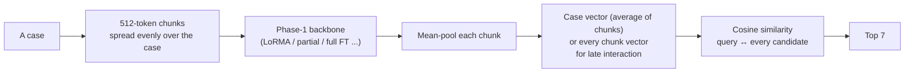
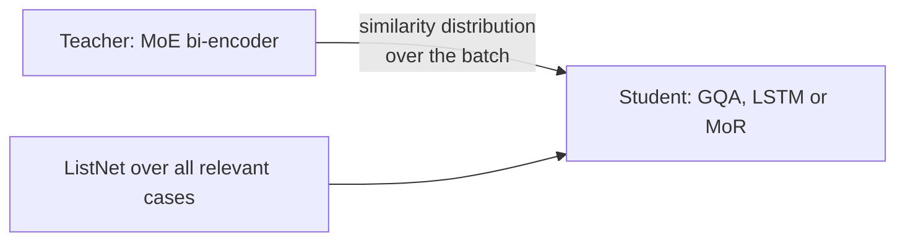

# Phase 7 · `batch2-recipe-and-kd`

**Question.** Do the winning choices combine, and does KD from the batch-1 MoE help? **Finding.** The combined recipe was the largest gain of the phase (MoE 0.301 → 0.328 on test). KD looked like noise on dev but helped every student on test (+0.008 to +0.018).

## Architecture

The pipeline all notebooks in this phase build on:

What batch 2 adds: knowledge distillation of the similarity scores.

## Setup shared by these notebooks

- **Model (bi-encoder):** a case is cut into 512-token chunks; the Phase-1 backbone encodes each chunk (token mean-pooling); the chunk vectors are averaged into one case vector (or kept for late interaction). Relevance is cosine similarity; the 7 best candidates of the split's pool are returned, with the query itself removed from its own ranking.
- **Training:** in-batch negatives (8 queries per step) with InfoNCE (temperature 0.05) or ListNet. Batch 1 uses 4 training chunks (first 2 + last 2) and 8 chunks when indexing, projecting to 256 dimensions; later batches use chunks spread evenly over the case and often no projection.
- **Learning rates (batch 1):** LoRMA 3e-4, IA³ 3e-3, full fine-tuning 2e-5, partial 5e-5, prompt/prefix 3e-3, projection 1e-3. The epoch is chosen on dev micro-F1@7, evaluated after every epoch.
- **Every setup writes two zips:** `_dense` (our model alone) and `_hybrid` (dense + λ × TF-IDF, λ chosen on dev from {0.25, 0.5, 1, 2, 4}). Hyperparameters are our placeholders and were not tuned.

## Notebooks in this folder

| Notebook | What it does |
|---|---|
| `p7-gqa2.ipynb` | GQA: the same recipe; without projection; with 8 training chunks |
| `p7-kd-gqa.ipynb` | **KD** MoE → GQA: the teacher's similarity distribution, its case vectors, or both |
| `p7-kd-lstm.ipynb` | KD MoE → LSTM |
| `p7-moe2.ipynb` | MoE: uniform chunks + ListNet; without projection; with late interaction |
| `p7-mor.ipynb` | LegalMoR: LoRMA, full fine-tuning, and full fine-tuning + KD |

Each notebook was run on Kaggle with "Run All" and is saved **with its outputs**, so the printed tables, curves and scores are the record of that run.

## Submissions produced

26 files in [`../../submissions/batch2-recipe-and-kd/`](../../submissions/batch2-recipe-and-kd/). See that folder's README for every file; the scores that the phase README lists are:

