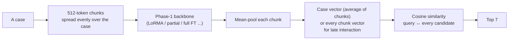
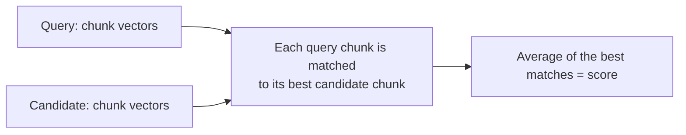

# Phase 7 · `batch3-stronger-teacher`

**Question.** Does a stronger, recipe-matched teacher and reading 16 chunks help? **Finding.** The distilled 111M GQA matched its 219M teacher on dev. The MoE with late interaction and 16 chunks was the best single dense model (0.3314 test). Dense models still trailed TF-IDF.

## Architecture

The pipeline all notebooks in this phase build on:

Late interaction (max-sim), used by the best dense model: every chunk vector is kept.

## Setup shared by these notebooks

- **Model (bi-encoder):** a case is cut into 512-token chunks; the Phase-1 backbone encodes each chunk (token mean-pooling); the chunk vectors are averaged into one case vector (or kept for late interaction). Relevance is cosine similarity; the 7 best candidates of the split's pool are returned, with the query itself removed from its own ranking.
- **Training:** in-batch negatives (8 queries per step) with InfoNCE (temperature 0.05) or ListNet. Batch 1 uses 4 training chunks (first 2 + last 2) and 8 chunks when indexing, projecting to 256 dimensions; later batches use chunks spread evenly over the case and often no projection.
- **Learning rates (batch 1):** LoRMA 3e-4, IA³ 3e-3, full fine-tuning 2e-5, partial 5e-5, prompt/prefix 3e-3, projection 1e-3. The epoch is chosen on dev micro-F1@7, evaluated after every epoch.
- **Every setup writes two zips:** `_dense` (our model alone) and `_hybrid` (dense + λ × TF-IDF, λ chosen on dev from {0.25, 0.5, 1, 2, 4}). Hyperparameters are our placeholders and were not tuned.

## Notebooks in this folder

| Notebook | What it does |
|---|---|
| `p7-gqa3.ipynb` | GQA with the recipe, with and without KD from the new teacher |
| `p7-lstm3.ipynb` | LSTM with the recipe, with and without KD |
| `p7-moe3.ipynb` | The best MoE recipe re-trained as the **new teacher** (late interaction); + ListNet; + **16 chunks** at indexing (best single dense model) |
| `p7-mor3.ipynb` | MoR with the recipe (LoRMA, full fine-tuning), with and without KD |

Each notebook was run on Kaggle with "Run All" and is saved **with its outputs**, so the printed tables, curves and scores are the record of that run.

## Submissions produced

22 files in [`../../submissions/batch3-stronger-teacher/`](../../submissions/batch3-stronger-teacher/). See that folder's README for every file; the scores that the phase README lists are:

| File | What it is | Score |
|---|---|---|
| `p7_gqa3_kd3_gqa_uni_list_proj0_dense.zip` | GQA LoRMA + KD (no KD: 0.3001) | 0.3136 |
| `p7_gqa3_kd3_gqa_uni_maxsim_hybrid.zip` | best single hybrid (GQA KD student + TF-IDF) | 0.4152 |
| `p7_lstm3_kd3_lstm_uni_list_proj0_dense.zip` | best LSTM (full fine-tuning + KD) | 0.2115 |
| `p7_moe3_moe_uni_maxsim_16_dense.zip` | best single dense model (MoE, late interaction, 16 chunks) | 0.3314 |
| `p7_mor3_mor_uni_list_proj0_dense.zip` | best MoR (LoRMA) | 0.2144 |
