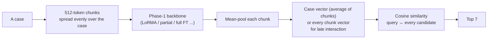
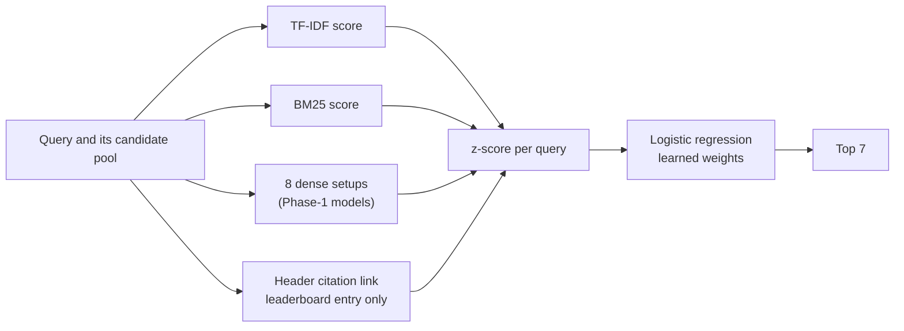

# Phase 7 · `batch4-fusion-and-final`

**Question.** Can fusing TF-IDF, BM25 and all dense setups beat any single system? **Finding.** Learned logistic weights beat every fixed-weight hybrid; rank fusion and boosted trees did worse. A 5×2-fold cross-validation over dev queries matched test within 0.002. The leaderboard entry `p7_learned` (0.4448) also uses the Supreme Court header citation link; **without** that feature the result is 0.4294 (`p7_learned_noheader`).

## Architecture

The pipeline all notebooks in this phase build on:

No training here: every score is a feature, and logistic weights are learned.

## Setup shared by these notebooks

- **Model (bi-encoder):** a case is cut into 512-token chunks; the Phase-1 backbone encodes each chunk (token mean-pooling); the chunk vectors are averaged into one case vector (or kept for late interaction). Relevance is cosine similarity; the 7 best candidates of the split's pool are returned, with the query itself removed from its own ranking.
- **Training:** in-batch negatives (8 queries per step) with InfoNCE (temperature 0.05) or ListNet. Batch 1 uses 4 training chunks (first 2 + last 2) and 8 chunks when indexing, projecting to 256 dimensions; later batches use chunks spread evenly over the case and often no projection.
- **Learning rates (batch 1):** LoRMA 3e-4, IA³ 3e-3, full fine-tuning 2e-5, partial 5e-5, prompt/prefix 3e-3, projection 1e-3. The epoch is chosen on dev micro-F1@7, evaluated after every epoch.
- **Every setup writes two zips:** `_dense` (our model alone) and `_hybrid` (dense + λ × TF-IDF, λ chosen on dev from {0.25, 0.5, 1, 2, 4}). Hyperparameters are our placeholders and were not tuned.

## Notebooks in this folder

| Notebook | What it does |
|---|---|
| `p7-fusion-final-log.txt` | The full printed log of the final fusion run |
| `p7-fusion-final.ipynb` | **Final fusion** over all 63 trained setups: A. TF-IDF and BM25 B. each setup + λ·TF-IDF C. reciprocal-rank fusion D. dense-only ensembles E. ensembles + TF-IDF F. paired bootstrap tests G. **learned combination weights**, scored by cross-validation, with and without the header feature |
| `p7-fusion-run1.ipynb` | First fusion run (batch-1 setups only) |

Each notebook was run on Kaggle with "Run All" and is saved **with its outputs**, so the printed tables, curves and scores are the record of that run.

## Submissions produced

11 files in [`../../submissions/batch4-fusion-and-final/`](../../submissions/batch4-fusion-and-final/). See that folder's README for every file; the scores that the phase README lists are:

| File | What it is | Score |
|---|---|---|
| `p7_dense_ensemble.zip` | **best Phase-1-only system**: MoE + KD-GQA + MoE | 0.3479 |
| `p7_learned.zip` | **leaderboard entry**: learned combination incl. header-citation link | 0.4448 |
| `p7_learned_noheader.zip` | the same **without** the header feature (leak-free) | 0.4294 |
